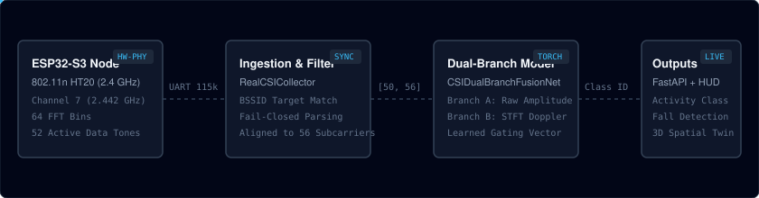

# CSIFormer

CSIFormer is a Wi-Fi Channel State Information (CSI) sensing platform designed for human activity recognition and fall detection using commodity ESP32-S3 hardware and a dual-branch Transformer neural network.

The system extracts physical Orthogonal Frequency Division Multiplexing (OFDM) channel responses from ambient or directed 802.11n Wi-Fi transmissions, isolates physical subcarriers, extracts Doppler velocity signatures, and classifies human movements without wearable devices or cameras.



## System Overview

The pipeline consists of four main layers:

1. **Firmware Layer (ESP32-S3):** Custom firmware runs on an ESP32-S3 in promiscuous station mode on a fixed 2.4 GHz channel (default: Channel 7, 2.442 GHz). It registers a hardware CSI receive callback (`esp_wifi_set_csi_rx_cb`) and streams structured CSV telemetry (`Format B`) over USB serial at 115,200 or 921,600 baud.
2. **Ingestion and Calibration (`RealCSICollector`):** A Python ingestion engine captures serial frames, validates frame tokens, enforces fail-closed source MAC filtering against a configured Access Point BSSID, separates active subcarriers from null bands, and manages sliding temporal window buffers.
3. **Dual-Branch Transformer (`CSIDualBranchFusionNet`):** A PyTorch neural network processes fixed-size tensors of shape `[Batch, 50, 56]`.
   - Branch A (Spatial-Spectral): Processes normalized subcarrier amplitudes to capture broad multipath shifts.
   - Branch B (Kinematic Doppler): Computes Short-Time Fourier Transform (STFT) spectrograms to track limb velocity profiles.
   - Fusion Layer: Applies a learnable gating vector to balance amplitude and Doppler representations before classification.
4. **Interface and Telemetry:** A FastAPI service exposes REST and WebSocket endpoints. A React and Three.js frontend renders live subcarrier amplitude responses, packet arrival metrics, and a 3D spatial occupancy view.

## Hardware and RF Requirements

- **Microcontroller:** ESP32-S3 development board (such as ESP32-S3-DevKitC-1 with 8 MB or 16 MB flash and embedded PSRAM).
- **USB Interface:** USB-to-UART bridge (CH343, CP210x, or Espressif native USB-JTAG).
- **Wi-Fi Network:** Standard 802.11n 2.4 GHz access point operating on a fixed, non-hopping channel (default: Channel 7, 20 MHz HT20 bandwidth).
- **Physical Layout:** Direct line-of-sight (LOS) placement between the Wi-Fi router and the ESP32-S3 receiver node at a distance of 2.0 to 3.0 meters, elevated 1.0 meter above floor level.

## Subcarrier Representation

In IEEE 802.11n 20 MHz (HT20) mode, the ESP32-S3 baseband outputs 64 FFT bins:

- **Active Subcarriers (52 tones):** Bins 1 through 26 (negative frequencies) and bins 38 through 63 (positive frequencies) contain non-zero multipath measurements.
- **Null Subcarriers (12 tones):** Bin 0 is the direct-current (DC) null carrier suppressed by receiver hardware. Bins 27 through 37 are guard-band null carriers zeroed out at the band edges.

The ingestion engine preserves the raw 64-bin readings and the extracted 52 physical active subcarriers in session recordings, while linearly interpolating to 56 subcarriers (`TARGET_SUBCARRIERS = 56`) for compatibility with the trained Transformer input dimension.

## Project Structure

```
.
├── backend/
│   ├── app/
│   │   ├── api/             # FastAPI REST and WebSocket route handlers
│   │   ├── core/            # Configuration and application settings
│   │   ├── models/          # Dual-branch Transformer architecture
│   │   └── services/        # Serial collector, preprocessor, and validator
│   ├── tests/               # Pytest test suites across engineering phases
│   └── run.py               # Backend startup script
├── frontend/
│   ├── src/                 # React components, 3D spatial canvas, HUD
│   ├── index.html           # Web application entry point
│   └── package.json         # Frontend dependencies and build scripts
├── firmware/
│   └── esp32s3_csi_collector/  # ESP-IDF / PlatformIO firmware project
│       ├── main/main.c      # CSI callback and serial streaming logic
│       └── platformio.ini   # Build flags and serial configurations
├── data/
│   └── real_csi_dataset/    # Recorded CSI sessions and dataset manifest
├── docs/
│   └── pipeline.svg         # Architecture flow diagram
├── models/                  # PyTorch model weight checkpoints
├── reports/                 # Engineering audit reports across phases
└── scratch/                 # Diagnostic utilities and test scripts
```

## Prerequisites

- **Python:** Version 3.10 or 3.11 with `pip` and `virtualenv`.
- **Node.js:** Version 18.x or 20.x with `npm`.
- **PlatformIO CLI:** Required if compiling and flashing the ESP32-S3 firmware.

## Installation

### 1. Backend Setup

Open a terminal in the project root:

```bash
cd backend
python -m venv .venv
```

Activate the virtual environment:

On Linux or macOS:
```bash
source .venv/bin/activate
```

On Windows (PowerShell):
```powershell
.\.venv\Scripts\Activate.ps1
```

Install Python dependencies:

```bash
pip install -r requirements.txt
```

### 2. Frontend Setup

In a separate terminal, install the web client dependencies:

```bash
cd frontend
npm install
```

### 3. Firmware Setup (Optional)

If flashing new firmware to an ESP32-S3 on COM5:

```bash
cd firmware/esp32s3_csi_collector
pio run -t upload --upload-port COM5
```

## Running the Application

### Starting the Backend

From the `backend` directory with the virtual environment activated:

```bash
python run.py
```

The FastAPI server initializes at `http://localhost:8000`. API documentation is available at `http://localhost:8000/docs`.

If an ESP32-S3 is connected via USB, the server automatically scans and identifies the serial port. If no hardware node is detected, the service operates in simulation mode using recorded session data.

### Starting the Frontend

From the `frontend` directory:

```bash
npm run dev
```

The web dashboard opens at `http://localhost:5173`.

## Operational Modes

### Live Hardware Acquisition

To start a recording session through the CLI utility:

```bash
py -3.11 scratch/run_collection_session.py --port COM5 --activity walk --participant Participant_01 --duration 4.0 --confirm
```

Supported activity labels:
- `walk`: Walking within line-of-sight.
- `sit`: Transition from standing to sitting.
- `clap`: Two-hand clapping motion.
- `push_pull`: Forward push and backward pull gestures.
- `static`: Stationary empty room or baseline background.
- `fall`: Controlled descent on certified safety mats.

### Replay and Offline Validation

To validate the dataset manifest and verify session file integrity without connecting hardware:

```bash
py -3.11 scratch/run_collection_session.py --validate
```

## Testing

Run the automated regression test suite using `pytest`:

```bash
py -3.11 -m pytest backend/tests/test_phase52.py backend/tests/test_phase55.py -v
```

To run all phase verification tests:

```bash
py -3.11 -m pytest backend/tests/ -v
```

## Known Technical Constraints

- **Passive Acquisition Rate:** When listening passively to router beacons without client traffic, the ESP32-S3 receives between 1.6 and 3.8 frames per second. CSIFormer's 50-frame window assumes a sample rate of 30 to 39 Hz (approximately 1.4 seconds of physical motion). For accurate activity recognition, metered network traffic (such as periodic ICMP or UDP datagrams directed to the router) is required to sustain continuous frame rates above 30 Hz.
- **Transmitter Address Semantics:** In 802.11 frames, the MAC address captured by the hardware corresponds to Address 2 (Transmitter Address). For downlink packets from the router, this matches the access point BSSID. For uplink packets from connected devices, it matches the device MAC. Source filtering must remain active to prevent client transmissions from corrupting the channel response.
- **Clock Source:** Frame timestamps are recorded at the host serial layer upon packet arrival. High CPU load on the host machine may introduce timestamp jitter.

## License

This project is distributed under the MIT License. Details are available in the LICENSE file.
