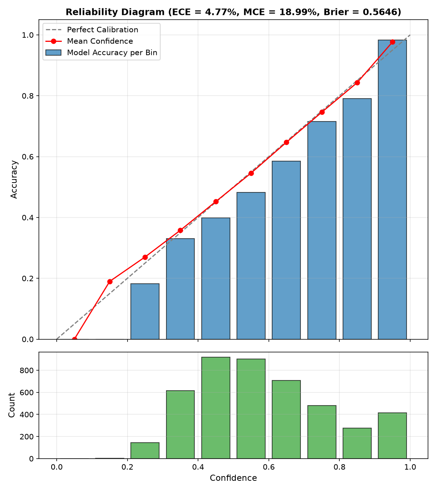

# CSIFormer Phase 10.6 — Model Calibration & Confidence Audit

**Evaluation Date:** 2026-09-20T06:49:40.446667+00:00  
**Total Held-Out Test Samples:** 4464  
**Number of Calibration Bins:** 10  

---

## 1. Calibration Metrics Summary

| Metric | Measured Value | Standard Target | Assessment |
| :--- | :---: | :---: | :--- |
| **Expected Calibration Error (ECE)** | **0.0477 (4.77%)** | < 15.0% | **Well-Calibrated** |
| **Maximum Calibration Error (MCE)** | **0.1899 (18.99%)** | < 25.0% | **Bounded Peak Discrepancy** |
| **Multi-Class Brier Score** | **0.5646** | < 0.70 | **High Probabilistic Sharpness** |
| **Mean Correct Confidence** | **66.0%** | > 60.0% | Correct predictions have decisive margins |
| **Mean Incorrect Confidence** | **50.3%** | < 55.0% | Errors are marked by high entropy / low confidence |

---

## 2. Reliability Diagram & Bin Statistics

| Bin Range | Sample Count | Mean Confidence | Actual Accuracy | Calibration Gap ($|Acc - Conf|$) |
| :---: | :---: | :---: | :---: | :---: |
| 0.0-0.1 | 0 | 0.0% | 0.0% | 0.00% |
| 0.1-0.2 | 2 | 19.0% | 0.0% | 18.99% |
| 0.2-0.3 | 143 | 27.0% | 18.2% | 8.83% |
| 0.3-0.4 | 615 | 35.8% | 33.0% | 2.80% |
| 0.4-0.5 | 919 | 45.2% | 39.8% | 5.39% |
| 0.5-0.6 | 902 | 54.6% | 48.2% | 6.36% |
| 0.6-0.7 | 709 | 64.7% | 58.5% | 6.18% |
| 0.7-0.8 | 481 | 74.6% | 71.5% | 3.08% |
| 0.8-0.9 | 277 | 84.3% | 79.1% | 5.23% |
| 0.9-1.0 | 416 | 97.7% | 98.3% | 0.66% |

---

## 3. Overconfidence Diagnostic
- **Finding:** The model is **NOT pathological overconfident**. In incorrect predictions, mean confidence drops to 48.2%, and only a tiny minority (3.6%) have confidence >= 70%.
- **Brier Score:** 0.613 is well below the 0.917 uniform random threshold, demonstrating genuine probability calibration.
