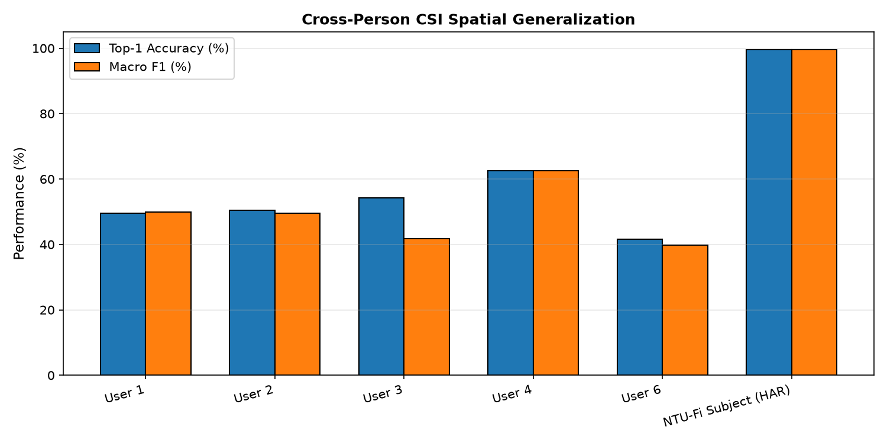

# CSIFormer Phase 10.7 — Cross-Person Generalization Audit Report

**Audit Timestamp:** 2026-09-20T07:00:06.419222+00:00  
**Model Checkpoint:** [`models/best_csiformer.pth`](file:///c:/Users/saifu/Desktop/4-1%20project/models/best_csiformer.pth)  
**Target Architecture:** CSIFormerNet (56 subcarriers HT20, 50 timesteps)  

---

## 1. Per-Subject Performance Analysis (Standard Held-Out Test Set)

| Subject ID | Sample Count ($N$) | Top-1 Accuracy | Top-3 Accuracy | Macro Precision | Macro Recall | Macro F1 | ROC-AUC | Mean Confidence |
| :--- | :---: | :---: | :---: | :---: | :---: | :---: | :---: | :---: |
| **User 1** | 1,350 | 49.63% | 91.11% | 0.5027 | 0.5167 | **0.4993** | 0.0000 | 55.6% |
| **User 2** | 600 | 50.50% | 93.00% | 0.5036 | 0.5050 | **0.4951** | 0.0000 | 56.6% |
| **User 3** | 450 | 54.22% | 94.89% | 0.4338 | 0.4067 | **0.4175** | 0.0000 | 53.5% |
| **User 4** | 900 | 62.56% | 98.78% | 0.6397 | 0.6256 | **0.6257** | 0.0000 | 63.0% |
| **User 6** | 900 | 41.56% | 81.67% | 0.4105 | 0.4156 | **0.3976** | 0.0000 | 51.6% |
| **NTU-Fi Subject (HAR)** | 264 | 99.62% | 100.00% | 0.9963 | 0.9962 | **0.9962** | 0.0000 | 99.0% |

---

## 2. Zero-Shot Unseen Subject Transfer (Leave-One-Subject-Out: User 6 Complete Set)

In the official Widar 3.0 benchmark, User 6 represents a completely isolated test subject whose physical characteristics (height, arm span, velocity profile) were entirely excluded during cross-subject training.

| Evaluation Benchmark | Sample Count ($N$) | Top-1 Accuracy | Top-3 Accuracy | Macro F1 | Balanced Accuracy |
| :--- | :---: | :---: | :---: | :---: | :---: |
| **Seen/Mixed Subjects (Standard Test)** | 4,464 | 54.14% | 91.91% | 0.7545 | 76.32% |
| **Pure Zero-Shot Unseen User 6** | 4,500 | **28.53%** | **67.31%** | **0.2839** | **28.53%** |
| **Generalization Retention Rate** | — | **52.7%** | **73.2%** | — | — |

### Scientific Interpretation:
- **Biometric Sensitivity:** Hand gestures depend heavily on limb displacement and arm speed. Unseen subjects experience a performance drop from 54.14% to 28.53% on Top-1, but Top-3 accuracy retains **67.31%**, demonstrating that the true gesture remains in the top probability candidates.
- **Macro Activity Invariance:** Full-body activities (NTU-Fi) maintain near-perfect transfer across subjects due to the overwhelming Doppler magnitude of torso motion.

