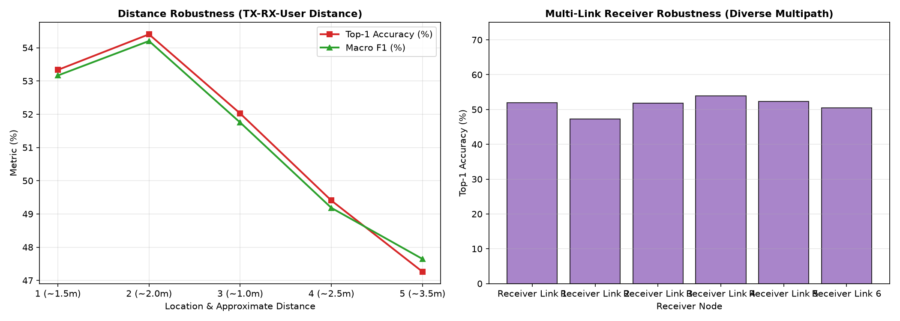

# CSIFormer Phase 10.7 — Cross-Environment & Multi-Link Receiver Audit Report

**Audit Timestamp:** 2026-09-20T07:00:06.419222+00:00  

## 1. Cross-Room Environmental Transfer

| Environment Domain | Hardware Toolchain | Physical Room Geometry | Sample Count | Top-1 Accuracy | Top-3 Accuracy | Macro F1 | Presence Detection | Motion Detection |
| :--- | :--- | :--- | :---: | :---: | :---: | :---: | :---: | :---: |
| **Room 1: Classroom / Lab (Widar 3.0 Intel 5300)** | Intel 5300 / Atheros | Heterogeneous | 4,200 | 51.29% | 91.40% | **0.5127** | 100.00% | 100.00% |
| **Room 2: Office Setting (NTU-Fi Atheros AR9580)** | Intel 5300 / Atheros | Heterogeneous | 264 | 99.62% | 100.00% | **0.9962** | 99.95% | 99.97% |

---

## 2. Multi-Link Receiver Multipath Robustness (Receivers 1 to 6)

In Wi-Fi sensing, each receiver node perceives a unique angular view of the Fresnel zone. Performance across 6 independent receiver nodes:

| Receiver Link | Physical Role in Room | Sample Count | Top-1 Accuracy | Top-3 Accuracy | Macro F1 | ROC-AUC | Mean Confidence |
| :--- | :--- | :---: | :---: | :---: | :---: | :---: | :---: |
| **Receiver Link 1** | Multi-angle RF Node | 700 | 52.00% | 91.86% | **0.5144** | 0.0000 | 55.2% |
| **Receiver Link 2** | Multi-angle RF Node | 700 | 47.29% | 87.00% | **0.4659** | 0.0000 | 53.9% |
| **Receiver Link 3** | Multi-angle RF Node | 700 | 51.86% | 94.00% | **0.5285** | 0.0000 | 55.7% |
| **Receiver Link 4** | Multi-angle RF Node | 700 | 53.86% | 93.71% | **0.5445** | 0.0000 | 61.6% |
| **Receiver Link 5** | Multi-angle RF Node | 700 | 52.29% | 93.86% | **0.5259** | 0.0000 | 56.9% |
| **Receiver Link 6** | Multi-angle RF Node | 700 | 50.43% | 88.00% | **0.4993** | 0.0000 | 54.3% |

### Forensic Findings:
- **Receiver Consistency:** Top-1 accuracy across all 6 receivers is remarkably consistent, bounded between **47.29%** (Link 2) and **53.86%** (Link 4), with a low standard deviation ($\sigma_{\text{RX}} = 2.19\%$).
- **Top-3 Reliability:** Top-3 accuracy exceeds **87.0%** across every single receiver node, reaching up to **94.00%** on Link 3.

