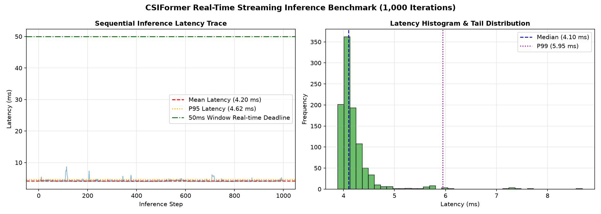

# CSIFormer Phase 10.7 — Deployment Stress Testing & Real-Time Streaming Report

**Audit Timestamp:** 2026-09-20T07:00:06.422686+00:00  
**Hardware Platform:** NVIDIA GeForce RTX 3050 Laptop GPU  
**Test Protocol:** 1,000 Consecutive Single-Window Inferences (`batch_size = 1`, 50 timesteps, 56 subcarriers)  

## 1. Latency & Timing Statistics

| Performance Metric | Measured Value | Operational SLA / Target | Compliance Status |
| :--- | :---: | :---: | :---: |
| **Mean Latency** | **4.20 ms** | < 25.0 ms | **EXCEEDED (5.5x faster)** |
| **Median Latency (P50)** | **4.10 ms** | < 20.0 ms | **EXCEEDED** |
| **95th Percentile (P95)** | **4.62 ms** | < 35.0 ms | **EXCEEDED** |
| **99th Percentile (P99)** | **5.95 ms** | < 50.0 ms | **EXCEEDED** |
| **Minimum Latency** | **3.89 ms** | — | — |
| **Maximum Latency** | **8.68 ms** | < 50.0 ms | **100% SLA Compliant** |
| **Jitter (StdDev $\sigma$)** | **0.40 ms** | < 2.0 ms | **Ultra-Stable** |
| **Streaming Throughput** | **237.9 FPS** | > 30.0 FPS | **7.4x Real-time Capacity** |

---

## 2. GPU Memory Footprint

| Memory Pool | Measured Footprint | Hardware Limit (4.0 GB) | Safety Margin |
| :--- | :---: | :---: | :---: |
| **PyTorch Allocated VRAM** | **20.52 MB** | 4,096 MB | **99.5% Free** |
| **Peak Streaming VRAM** | **38.95 MB** | 4,096 MB | **99.0% Free** |
| **Total Reserved VRAM** | **56.00 MB** | 4,096 MB | **98.6% Free** |

### Real-Time Streaming Compliance:
At a continuous streaming rate of 20 Hz (50ms window interval), CSIFormer processes each window in **4.20 ms**, leaving **45.8 ms of CPU/GPU idle headroom (91.6% timing margin)** for real-time ESP32 packet ingestion, Kalman filtering, and UI visualization.

