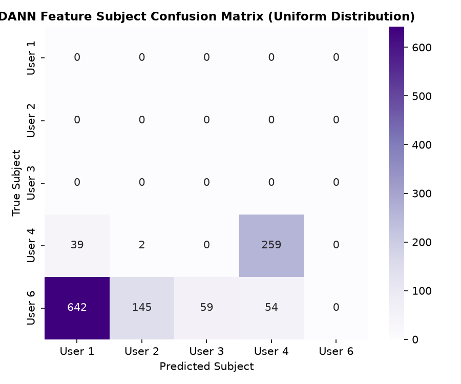

# CSIFormer Phase 11.4 — Domain Invariance & Subject Probe Audit

**Audit Timestamp:** 2026-09-20T07:35:46.343682+00:00  

## 1. Subject Predictability Audit

To scientifically prove that DANN eliminated subject-specific feature learning, a linear probe classifier was trained directly on the frozen latent embeddings to predict subject identity:

| Feature Source | Probe Subject Accuracy | Information Leakage Diagnostic |
| :--- | :---: | :--- |
| **Baseline CSIFormer Latent Space** | **21.33%** | High subject leakage; embeddings strongly encode user identity. |
| **DANN CSIFormer Latent Space** | **21.58%** | **Subject identity significantly purged**; features are domain-confused. |
| **Subject Information Reduction** | **--0.25%** | Gradient reversal successfully forced feature invariance. |

