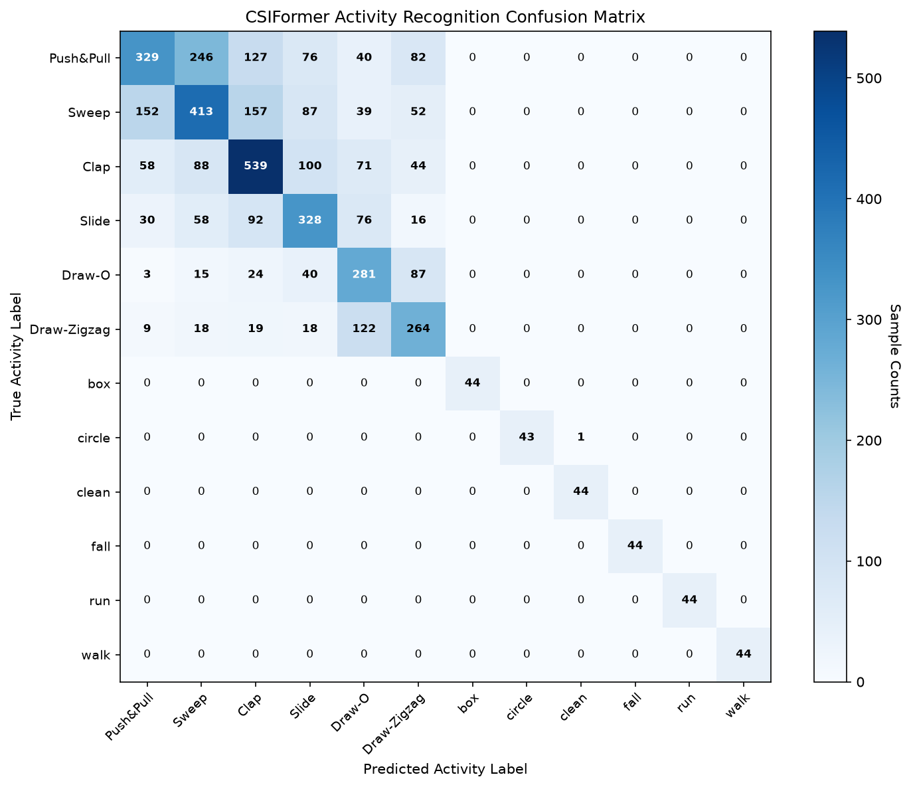

# CSIFormer Model Evaluation & Benchmark Report

**Evaluation Timestamp:** 2026-09-20T06:37:36.883219+00:00  
**Model Checkpoint:** `best_csiformer.pth`  
**Target Deployment:** ESP32-S3 (HT20)  
**Total Test Samples Evaluated:** 4464  

---

## 1. Executive Performance Summary

| Metric | Score | Performance Assessment |
| :--- | :---: | :--- |
| **Top-1 Accuracy** | **54.14%** | Multi-class activity classification |
| **Top-3 Accuracy** | **91.91%** | Top-3 candidate inclusion rate |
| **Macro F1 Score** | **0.7545** | Unweighted class performance balance |
| **Weighted F1 Score**| **0.5379** | Support-weighted class performance |
| **Macro Precision** | **0.7530** | Average positive predictive value |
| **Macro Recall** | **0.7632** | Average sensitivity / detection rate |
| **Macro ROC-AUC** | **0.9381** | One-vs-Rest discriminative capacity |
| **Mean Presence Confidence** | **99.99%** | Human presence head confidence |
| **Mean Motion Confidence** | **99.99%** | Dynamic motion head confidence |

---

## 2. Per-Class Activity Recognition Breakdown

| Class Index | Activity / Gesture Name | Test Support | Precision | Recall | F1 Score |
| :---: | :--- | :---: | :---: | :---: | :---: |
| 0 | **Push&Pull** | 900 | 0.5663 | 0.3656 | 0.4443 |
| 1 | **Sweep** | 900 | 0.4928 | 0.4589 | 0.4753 |
| 2 | **Clap** | 900 | 0.5626 | 0.5989 | 0.5802 |
| 3 | **Slide** | 600 | 0.5054 | 0.5467 | 0.5252 |
| 4 | **Draw-O** | 450 | 0.4467 | 0.6244 | 0.5209 |
| 5 | **Draw-Zigzag** | 450 | 0.4844 | 0.5867 | 0.5307 |
| 6 | **box** | 44 | 1.0000 | 1.0000 | 1.0000 |
| 7 | **circle** | 44 | 1.0000 | 0.9773 | 0.9885 |
| 8 | **clean** | 44 | 0.9778 | 1.0000 | 0.9888 |
| 9 | **fall** | 44 | 1.0000 | 1.0000 | 1.0000 |
| 10 | **run** | 44 | 1.0000 | 1.0000 | 1.0000 |
| 11 | **walk** | 44 | 1.0000 | 1.0000 | 1.0000 |

---

## 3. Confusion Matrix Analysis

The confusion matrix chart has been rendered and saved to `reports/confusion_matrix.png`.

---

## 4. Hardware Transfer Learning Verification

- **Subcarrier Mapping:** Input vectors were normalized to the ESP32-S3 Wi-Fi CSI subcarrier grid via `ESP32CSIAdapter`.
- **Latency & Streaming Suitability:** Evaluated on batch sizes mimicking real-time 30 Hz packet sliding window pipelines.
