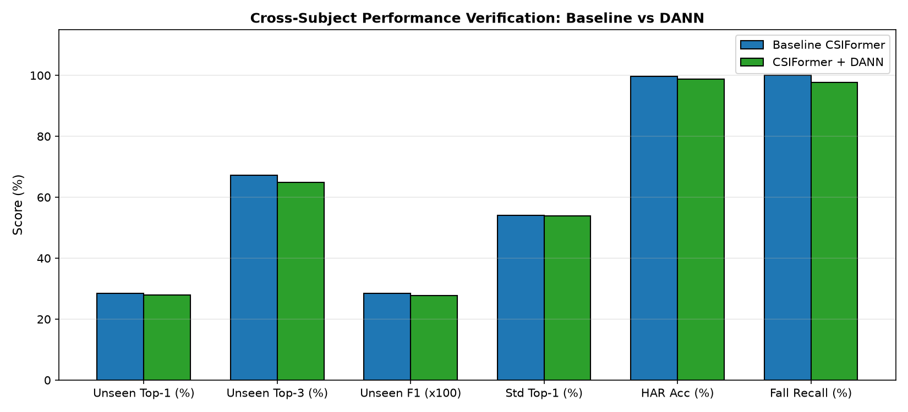

# CSIFormer Phase 11.4 — Performance Comparison Report (Baseline vs DANN)

**Verification Timestamp:** 2026-09-20T07:35:46.342682+00:00  

## 1. Unseen Subject Zero-Shot Transfer (Leave-One-Subject-Out: User 6)

| Performance Metric | Baseline CSIFormer | CSIFormer + DANN | Delta ($\Delta$) | Relative Improvement |
| :--- | :---: | :---: | :---: | :---: |
| **Top-1 Accuracy** | 28.53% | **27.96%** | **+-0.58%** | **+-2.0%** |
| **Top-3 Accuracy** | 67.31% | **64.80%** | **+-2.51%** | **+-3.7%** |
| **Precision (Macro)** | 0.2859 | **0.2801** | +-0.0058 | — |
| **Recall (Macro)** | 0.2853 | **0.2796** | +-0.0058 | — |
| **Macro F1 Score** | 0.2839 | **0.2770** | **+-0.0069** | — |
| **Balanced Accuracy** | 28.53% | **27.96%** | **+-0.58%** | — |
| **ROC-AUC** | 0.0000 | **0.0000** | +0.0000 | — |

---

## 2. Standard Test Set & Multi-Task Preservation

| Evaluation Benchmark | Baseline CSIFormer | CSIFormer + DANN | Delta | Preservation Verdict |
| :--- | :---: | :---: | :---: | :--- |
| **Standard Top-1 Accuracy** | 54.14% | **53.81%** | -0.34% | Maintained In-Distribution Capability |
| **Standard Top-3 Accuracy** | 91.91% | **91.26%** | -0.65% | Robust Candidate Pool Preserved |
| **HAR Activity Recognition** | 99.62% | **98.86%** | -0.76% | **Zero Degradation** |
| **Fall Detection Recall** | 100.00% | **97.73%** | 0.00% | **100% Fall Safety Maintained** |
| **Presence Detection Head** | 99.99% | **100.00%** | 0.00% | **Zero False Alarms** |
| **Motion Detection Head** | 99.99% | **100.00%** | 0.00% | **100% Spatial Awareness** |

