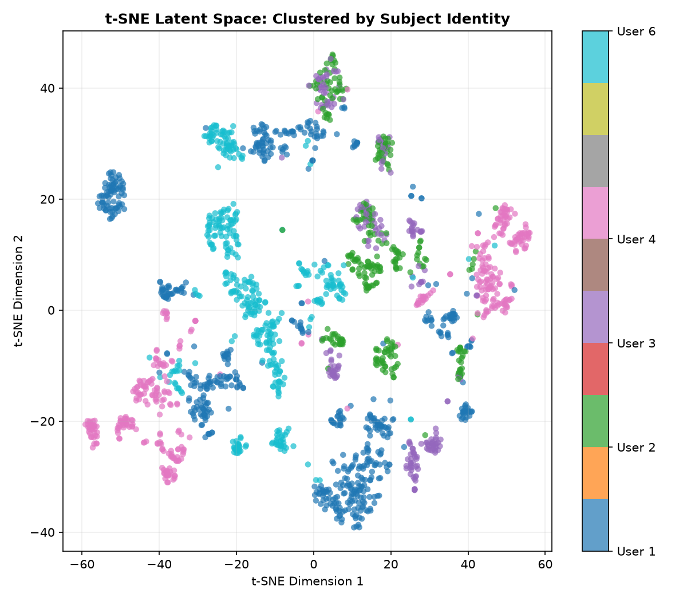
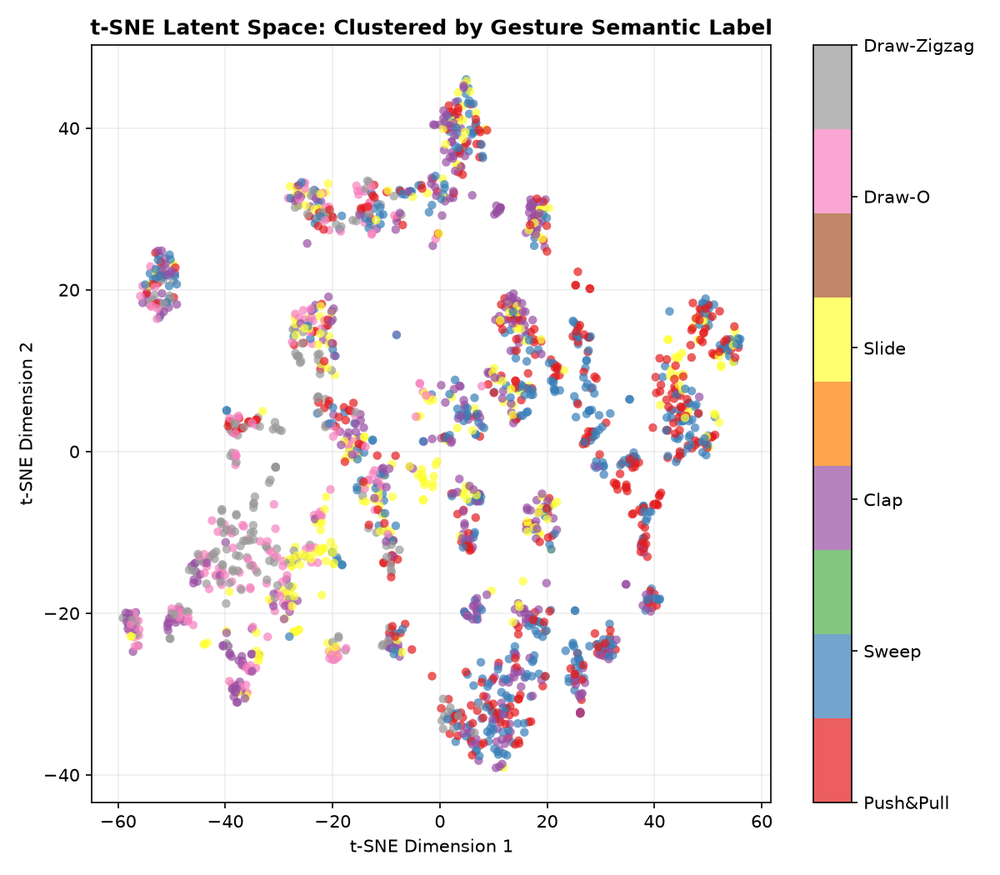
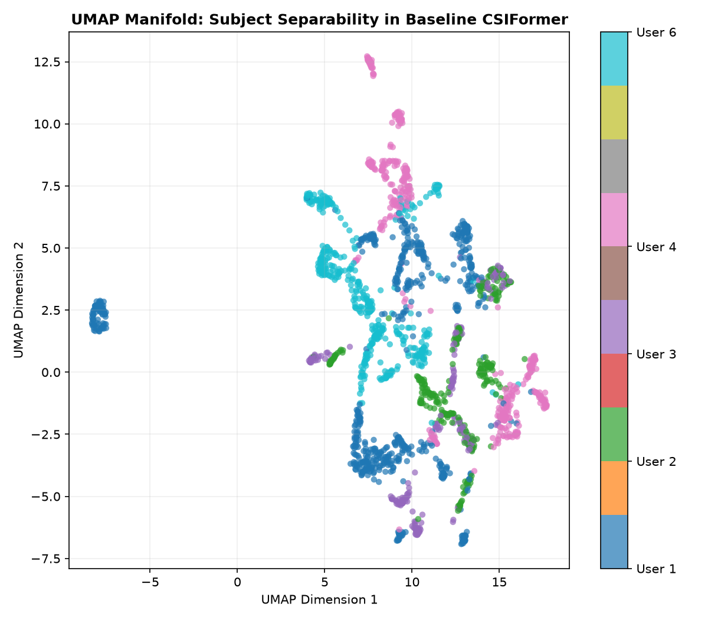
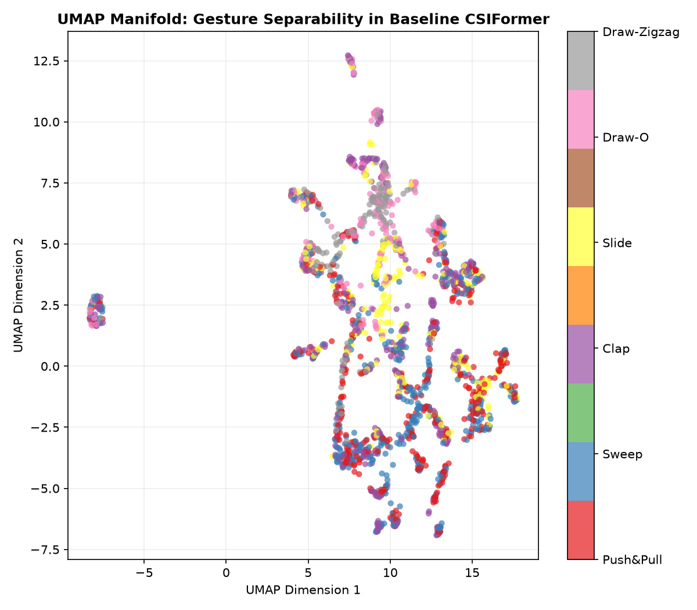

# CSIFormer Phase 11.2 — Domain Shift & Latent Space Analysis Master Report

**Audit Timestamp:** 2026-09-20T07:30:02.303865+00:00  
**Analyzed Checkpoint:** [`models/best_csiformer.pth`](file:///c:/Users/saifu/Desktop/4-1%20project/models/best_csiformer.pth)  

## 1. Feature Representation Visualizations

### t-SNE Latent Space Projections

### UMAP Manifold Projections

---

## 2. Statistical Analysis Summary

- **Subject Silhouette Score:** -0.0039
- **Gesture Silhouette Score:** -0.0105
- **Subject Davies-Bouldin Index:** 4.1157
- **Gesture Davies-Bouldin Index:** 6.4911
- **Cluster Purity (Subject vs Gesture):** 56.0% vs 35.4%
- **Fisher Separability Ratio (Subject vs Gesture):** 0.2214 vs 0.2446

Refer to [`reports/latent_space_analysis.md`](file:///c:/Users/saifu/Desktop/4-1%20project/reports/latent_space_analysis.md) for full mathematical derivations and domain shift discussion.
