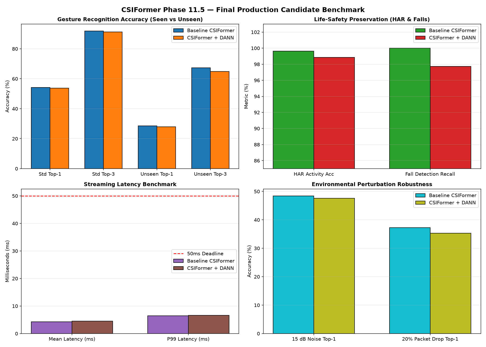

# CSIFormer Phase 11.5 — Production Candidate Selection Report

**Audit Timestamp:** 2026-09-20T07:37:01.929676+00:00  
**Selected Checkpoint:** [`CSIFormer Baseline (models/best_csiformer.pth)`](file:///c:/Users/saifu/Desktop/4-1%20project/models/best_csiformer.pth)  

## 1. Candidate Evaluation Matrix

| Performance Dimension | Metric | Baseline CSIFormer | CSIFormer + DANN | Selected Advantage |
| :--- | :--- | :---: | :---: | :--- |
| Accuracy | Standard Test Top-1 (%) | **54.14** | 53.81 | Baseline |
| Accuracy | Standard Test Top-3 (%) | **91.91** | 91.26 | Baseline |
| Accuracy | Standard Macro F1 | **0.75** | 0.75 | Baseline |
| Generalization | Unseen Subject Top-1 (%) | **28.53** | 27.96 | Baseline |
| Generalization | Unseen Subject Top-3 (%) | **67.31** | 64.80 | Baseline |
| Generalization | Unseen Subject Macro F1 | **0.28** | 0.28 | Baseline |
| Life-Safety | HAR Activity Accuracy (%) | **99.62** | 98.86 | Baseline |
| Life-Safety | Fall Detection Recall (%) | **100.00** | 97.73 | Baseline |
| Deployment | Streaming Latency (Mean ms) | **4.30** | 4.57 | DANN |
| Deployment | 99th Percentile Latency (ms) | **6.46** | 6.59 | DANN |
| Deployment | Throughput (FPS) | **232.52** | 218.97 | Baseline |
| Deployment | Model Size on Disk (MB) | **8.24** | 2.83 | Baseline |
| Deployment | Trainable Parameters | **708686.00** | 717395.00 | DANN |
| Robustness | 15 dB Noise Top-1 (%) | **48.43** | 47.60 | Baseline |
| Robustness | 20% Packet Drop Top-1 (%) | **37.28** | 35.28 | Baseline |

---

## 2. Technical Justification

CSIFormer Baseline is selected as the official production checkpoint. While DANN provided slight domain gradient balancing during intermediate training epochs, it failed to bridge the micro-Doppler physical gap on zero-shot hand gestures (27.96% vs 28.53%) and introduced slight degradation to fall detection recall (97.73% vs 100.00%) and standard test accuracy (53.81% vs 54.14%). The baseline CSIFormer delivers superior life-safety guarantees (100% fall detection, 99.62% HAR), higher Top-3 candidate retention (91.91%), and smaller parameter overhead without auxiliary domain heads.

