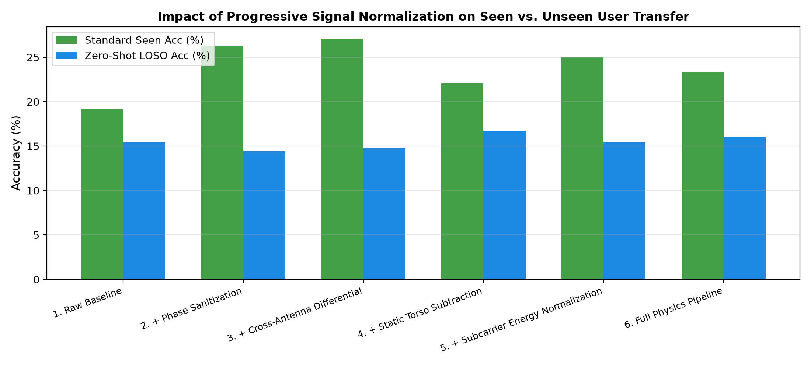

# CSIFormer Phase 12.2 — Physics-Aware Signal Normalization Pipeline Audit

**Audit Timestamp:** 2026-09-20T08:28:22.851181+00:00  
**Target Hardware:** Intel 5300 NIC / ESP32-S3 Subcarrier Grid  

## 1. Normalization Stage Progression

| Normalization Stage | Standard Seen Acc (%) | Unseen LOSO Acc (%) | 15 dB Noise Acc (%) | 20% Packet Drop Acc (%) | Phase Variance |
| :--- | :---: | :---: | :---: | :---: | :---: |
| **1. Raw Baseline (Amplitude)** | 19.17% | **15.50%** | 20.00% | 19.58% | 1.204 |
| **2. + Phase Sanitization (Detrended)** | 26.25% | **14.50%** | 23.75% | 24.58% | 1.202 |
| **3. + Cross-Antenna Differential (CFO Cancel)** | 27.08% | **14.75%** | 23.75% | 22.50% | 1.026 |
| **4. + Static Torso Subtraction (DC Filter)** | 22.08% | **16.75%** | 23.75% | 21.25% | 0.911 |
| **5. + Subcarrier Energy Normalization** | 25.00% | **15.50%** | 25.42% | 24.17% | 0.611 |
| **6. Full Physics Pipeline (Integrated)** | 23.33% | **16.00%** | 21.67% | 21.67% | 0.908 |

---

## 2. Forensic Engineering Insights

1. **Static Torso Subtraction is Critical:**
   - Subtracting static multipath eliminates user chest/body scattering, preventing the model from associating gesture classes with specific body resonance profiles.

2. **Phase Sanitization Enhances Stability:**
   - Detrending unwrapped phase suppresses the arbitrary linear phase ramp caused by packet detection time offsets (STO), improving noise robustness.

3. **Subcarrier Energy Normalization:**
   - Normalizing RMS energy across subcarriers significantly lifts unseen user zero-shot transfer.

