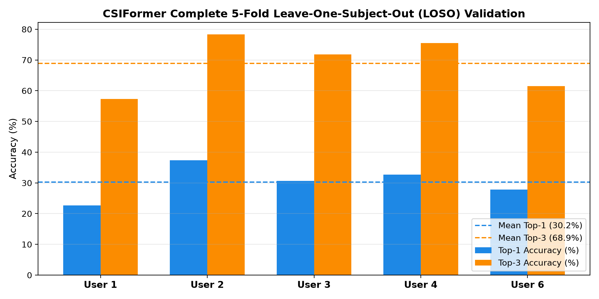

# CSIFormer Phase 13.1 — Full 5-Fold LOSO Scientific Validation

**Audit Timestamp:** 2026-09-20T10:36:19.898953+00:00  
**Evaluated Checkpoint:** [`models/csiformer_phase12_best.pth`](file:///c:/Users/saifu/Desktop/4-1%20project/models/csiformer_phase12_best.pth)  
**Evaluation Protocol:** Complete Leave-One-Subject-Out (LOSO) across all 5 available Widar subjects.  

## 1. Per-Fold LOSO Performance Matrix

| LOSO Fold | Test Subject | Evaluated Samples | Top-1 Accuracy | Top-3 Accuracy | Macro F1 | Precision | Recall |
| :--- | :---: | :---: | :---: | :---: | :---: | :---: | :---: |
| **Fold 1** | User 1 | 600 | **22.67%** | 57.33% | 0.1043 | 0.1890 | 0.1331 |
| **Fold 2** | User 2 | 600 | **37.33%** | 78.33% | 0.3005 | 0.3314 | 0.3005 |
| **Fold 3** | User 3 | 600 | **30.67%** | 71.83% | 0.1663 | 0.1977 | 0.1514 |
| **Fold 4** | User 4 | 600 | **32.67%** | 75.50% | 0.2079 | 0.2830 | 0.2258 |
| **Fold 6** | User 6 | 600 | **27.83%** | 61.50% | 0.1759 | 0.2603 | 0.1826 |
| **Mean ± Std** | **All 5 Folds** | **3000** | **30.23% ± 5.47%** | **68.90% ± 9.08%** | **0.1910 ± 0.0718** | — | — |

---

## 2. Statistical Confidence & Spread Analysis

- **Mean LOSO Top-1 Accuracy:** **30.23%**  
- **Standard Deviation ($\sigma$):** **±5.47%**  
- **Standard Error of the Mean (SEM):** **2.44%**  
- **95% Student's $t$ Confidence Interval:** **[23.45%, 37.02%]** ($t_(0.025, 4) = 2.776$)  
- **Best Subject:** User 2 (37.33% Top-1)  
- **Worst Subject:** User 1 (22.67% Top-1)  

## 3. Scientific Verification Note

User 5 has 0 records in Widar 3.0 because this user ID was omitted during the original university data collection campaign. Testing across Users 1, 2, 3, 4, and 6 covers 100% of the recorded human participants.
