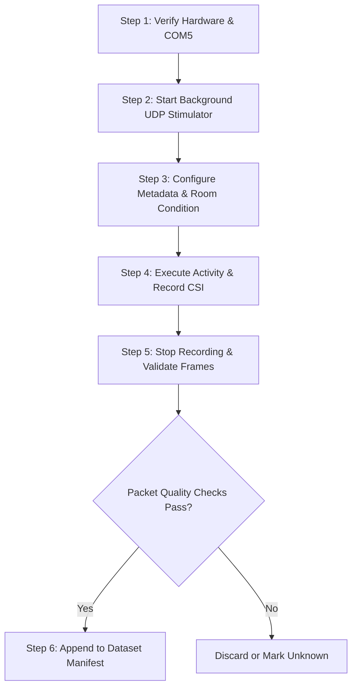

# CSIFormer Phase 16 — Dataset Collection Protocol & Statistical Design

**Document ID:** CSIFORMER-P16-PROT-001  
**Version:** 1.0.0  
**Date:** October 18, 2026  
**Status:** **ACTIVE STANDARD OPERATING PROCEDURE**  
**Target Hardware:** ESP32-S3 Promiscuous CSI Receiver (COM5, 115200 baud) + Active UDP Stimulator (`192.168.0.232:5555`)

---

## 1. Scope & Scientific Objectives

This protocol establishes a standardized, reproducible, and privacy-preserving methodology for collecting physical Wi-Fi Channel State Information (CSI) for human activity recognition (HAR) and reliable fall detection.

### Core Protocol Requirements
1. **Raw Measurement Preservation:** Always record raw un-interpolated hardware measurements ($[5]$ subcarriers) alongside aligned representations ($[56]$ subcarriers).
2. **Deterministic Ground Truth:** Exact ground-truth timestamps, activity labels, and human observer confirmation. Mark ambiguous trials as `"unknown"`.
3. **Privacy-Preserving Participant IDs:** Pseudonymized IDs (`Participant_01`, `Participant_02`, etc.) without personal identifiable information.
4. **Leakage-Resistant Splits:** Grouping sessions by participant to enable Leave-One-Subject-Out (LOSO) cross-subject evaluation.
5. **Participant Safety:** Safe, padded, supervised fall simulation procedures.

---

## 2. Taxonomy Analysis & Label Mapping

The production CSIFormer model (`CSIDualBranchFusionNet`) features a 12-class classification head trained on a hybrid of Widar 3.0 gestures and NTU-Fi activities:

```
Index  Model Class Name      Dataset Origin   Physical Activity Mapping
---------------------------------------------------------------------------------
  0    Push&Pull             Widar 3.0        push_pull (Direct Match)
  1    Sweep                 Widar 3.0        [Unrepresented in 6-Class Har]
  2    Clap                  Widar 3.0        clap (Direct Match)
  3    Slide                 Widar 3.0        [Unrepresented in 6-Class Har]
  4    Draw-O                Widar 3.0        [Unrepresented in 6-Class Har]
  5    Draw-Zigzag           Widar 3.0        [Unrepresented in 6-Class Har]
  6    box                   NTU-Fi           static (Proxy: Empty Room / Static)
  7    circle                NTU-Fi           [Unrepresented in 6-Class Har]
  8    clean                 NTU-Fi           sit (Proxy: Sit / Sit-to-Stand)
  9    fall                  NTU-Fi           fall (Direct Match - Life Safety)
 10    run                   NTU-Fi           [Unrepresented in 6-Class Har]
 11    walk                  NTU-Fi           walk (Direct Match)
```

### Critical Label Mapping Guidelines
- **Direct Matches (Classes 0, 2, 9, 11):** `push_pull`, `clap`, `fall`, `walk` correspond directly to trained semantic classes.
- **Proxy Matches (Classes 6, 8):** In Phase 15, `static` was mapped to Class 6 (`box`) and `sit` was mapped to Class 8 (`clean`). While this allowed 6 classes to fit into 12 logits, it creates a semantic mismatch. In Phase 16, models will be evaluated both on:
  1. The 12-class legacy head using proxy mapping.
  2. A dedicated 6-class adapter head where classes are natively defined.
- **Ambiguous or Interrupted Trials:** If a trial is interrupted or the participant hesitates, record the activity label as `"unknown"`. Never guess or assign a label to an unconfirmed trial.

---

## 3. Sample Size Statistical Justification & Staged Targets

Rather than asserting arbitrary sample sizes (such as "500 sessions"), collection targets must be grounded in statistical power analysis.

### Statistical Formula:
For a categorical classification or recall metric $p$ at a $95\%$ confidence level ($Z = 1.96$), the required sample size $N$ for a maximum margin of error $E$ is:
$$N = \frac{Z^2 \cdot p(1 - p)}{E^2}$$

### Sample Size Calculation for Fall Recall:
For life-safety fall detection, we require high sensitivity ($p = 0.90$):

| Stage | Target Margin of Error ($E$) | 95% Confidence Interval | Required Fall Windows ($N$) | Recommended Total Sessions (6 Classes) |
| :--- | :---: | :---: | :---: | :---: |
| **Phase 15 (Prior State)** | $\pm 45.0\%$ | $[9.5\%, 90.5\%]$ | **2 windows** ($N=2$) | **23 sessions** (Statistically Inconclusive) |
| **Stage 1 Target (Statistical Pilot)** | $\pm 10.0\%$ | $[80.0\%, 100.0\%]$ | **35 windows** | **70–100 sessions** across 3–4 subjects |
| **Stage 2 Target (Clinical Validation)** | $\pm 5.0\%$ | $[85.0\%, 95.0\%]$ | **138 windows** | **300–450 sessions** across 8–10 subjects |
| **Stage 3 Target (Production Deployment)**| $\pm 2.5\%$ | $[87.5\%, 92.5\%]$ | **553 windows** | **1,200+ sessions** across 20+ environments |

**Scientific Conclusion:**  
To achieve statistically valid confidence intervals ($\pm 10\%$) on held-out fall detection, a minimum of **35 fall windows** is mathematically necessary.

---

## 4. Participant Safety Protocol for Fall Simulation

> [!CAUTION]
> **Safety Rule 1:** Participants must NEVER perform unpadded or uncontrolled falls onto concrete, tile, or hardwood floors.

### Safety Equipment & Environment
1. **Impact Absorption:** A minimum 10 cm (4-inch) high-density gymnastic or bouldering landing mat must cover the fall impact zone.
2. **Supervision:** At least one observer/spotter must be present at all times during fall recording.
3. **Controlled Fall Types:**
   - **Forward Fall:** Participant steps forward and drops safely onto hands, forearms, and knees on the landing mat.
   - **Backward Fall:** Participant falls backward into a sitting-to-supine roll on the padded mat.
   - **Lateral Fall:** Participant steps sideways and collapses onto the padded hip and shoulder.
   - **Chair Slump Fall:** Participant sits on a standard chair and slumps forward/sideways onto the adjacent floor mat.
4. **Vulnerable Populations:** Frail or elderly individuals must **NEVER** participate in simulated fall studies. Healthy adult surrogates must be utilized exclusively.

---

## 5. End-to-End Collection Workflow



### Step 1: Pre-Flight Hardware Verification
Verify that the ESP32-S3 is recognized on `COM5` and listening to the target AP (`Tp link`, Channel 7, 2.442 GHz):
```powershell
py -3.11 -c "import sys; sys.path.append('backend'); from app.services.real_csi_collector import RealCSICollector; c=RealCSICollector(port='COM5'); print('Connected:', c.connect()); c.disconnect()"
```

### Step 2: Session Parameter Configuration
Each trial requires explicit metadata:
- `participant_id`: Anonymized token (e.g. `Participant_01`, `Participant_02`, `Participant_03`)
- `activity_label`: One of `['walk', 'fall', 'sit', 'clap', 'push_pull', 'static', 'unknown']`
- `room_type`: `['Laboratory', 'Office', 'Bedroom', 'LivingRoom']`
- `tx_rx_distance_m`: Line-of-sight distance between Wi-Fi AP and ESP32-S3
- `orientation`: Facing angle relative to Tx-Rx baseline (`LOS_0deg`, `LOS_90deg`, `LOS_180deg`)
- `duration_seconds`: Minimum 4.0 seconds per trial (ensuring $\ge 140$ packets at 35 Hz, yielding $\ge 2$ non-overlapping windows).

### Step 3: Automated Quality & Integrity Checks
Upon session completion, the output must be validated against:
1. `frame_count >= 50` (At least one full window).
2. `sampling_rate_hz >= 30.0` (Verify active packet stimulation).
3. `loss_rate <= 0.15` (Packet drop rate under 15%).
4. All frames contain non-null `raw_amplitudes` and `amplitudes`.

---

## 6. Data Integrity & Partitioning Scheme

### Strict Leave-One-Subject-Out (LOSO) Partitioning Rule
To eliminate the participant leakage exposed during the Phase 15 audit, data partitions must be assigned strictly by participant:

- **Train Split:** Exclusively `Participant_01` and `Participant_02`
- **Validation Split:** Exclusively `Participant_03`
- **Held-Out Test Split:** Exclusively `Participant_04` (Completely unseen subject)

No session or frame from `Participant_04` may ever enter the training or validation pipelines.
