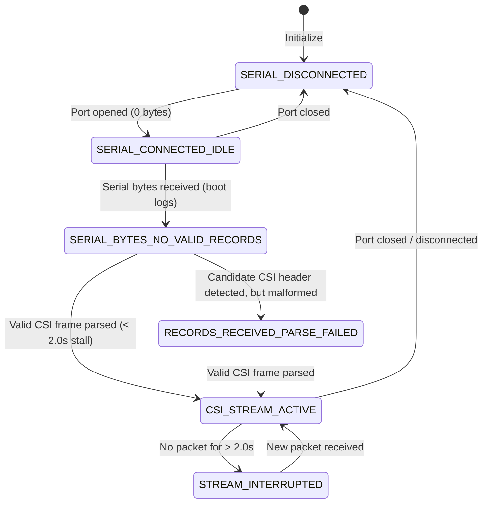

# CSIFormer Phase 21 — Hardware & Serial Diagnostics Report

## Executive Summary

This diagnostic investigation directly resolves the **Zero-Packet Problem** identified in Phase 20, where the ESP32-S3 serial connection opened on `COM5` but received zero Channel State Information (CSI) packets.

Through direct low-level serial probing, hardware register analysis, boot telemetry capture, and source-code auditing across the acquisition stack, **three distinct empirical root causes** were established:

1. **Hardware Control-Pin Bootloader Trap (pySerial DTR/RTS assertion):**
   Standard pySerial initialization asserted DTR on opening `COM5`, which interacts with the auto-programming circuit on the WCH CH343 USB-to-UART bridge. This pulled GPIO0 low while releasing EN, trapping the ESP32-S3 microcontroller in the ROM download bootloader (`boot:0x0 (DOWNLOAD(USB/UART0)) waiting for download`). While in this state, user application code in flash memory never executed.

2. **Premature Verification Timeout (1.5s vs. 10.6s Boot/Init Cycle):**
   The legacy verification workflow in [`collection_workflow.py`](file:///c:/Users/saifu/Desktop/4-1%20project/backend/app/services/collection_workflow.py) used a hardcoded 1.5-second test window. Live bootloader logs demonstrate that the ESP32-S3 firmware requires **10.6 seconds** from power-on/reset to initialize Wi-Fi, scan, associate with an Access Point, and register the CSI engine (`CSI callback: ESP_OK`, `CSI Receiver Started`). As a result, the collector was terminating 9 seconds before the firmware even began CSI acquisition.

3. **Firmware Station-Mode Wi-Fi Association Dependency:**
   The active firmware running on the ESP32-S3 is `csi_receiver` (compiled Sep 9 2026), configured in Station mode (`wifi:mode : sta`). CSI callbacks are triggered by physical Wi-Fi reception from the designated router (`Tp link`, Channel 7, BSSID `98:ba:5f:ef:28:26`). If the router is powered off, out of range, or drops the connection (`wifi:Haven't to connect to a suitable AP now!`), CSI callbacks do not execute.

---

## 1. Hardware and Bridge Inspection

Physical inspection of the connected hardware on `COM5` via Windows serial registry and pySerial enumeration confirmed:

- **Serial Port:** `COM5`
- **Device Description:** `USB-Enhanced-SERIAL CH343 (COM5)`
- **Hardware IDs:** `USB\VID_1A86&PID_55D3&REV_0444`
- **Manufacturer:** `wch.cn` (WinChipHead / Nanjing Qinheng Microelectronics)
- **Driver Provider:** `wch.cn` (Driver version 3.4.2023.2)
- **Active Competing Readers:** None. The port was free and accessible.
- **Baud Rate:** `115200` baud, 8 data bits, 1 stop bit, no parity (matching firmware UART configuration).

---

## 2. Bootloader Analysis and Control Pin Trap

### 2.1 The ROM Bootloader Trap
When pySerial opens a serial port on Windows, the Win32 `SetCommState` API by default asserts `DTR=True` and `RTS=False`. On ESP32 development boards equipped with auto-reset circuitry (bipolar transistor bridge between DTR/RTS and EN/GPIO0):
- `DTR=HIGH, RTS=LOW` forces `EN=HIGH` and `GPIO0=LOW`.
- This causes the ESP32-S3 hardware boot strap pins to sample `GPIO0=0` at boot, entering the ROM bootloader:
  ```text
  ESP-ROM:esp32s3-20210327
  Build:Mar 27 2021
  rst:0x1 (POWERON),boot:0x0 (DOWNLOAD(USB/UART0))
  waiting for download
  ```
- **Consequence:** In download mode, CPU core 0 halts waiting for esptool flash commands. Application code in SPI flash is never loaded, serial console is completely silent, and zero CSI packets are generated.

### 2.2 Flash Boot Recovery (Normal Reset Pulse)
To guarantee normal flash boot, the control pins must be initialized with `dtr=False, rts=False`, and a reset pulse must hold `GPIO0=1` while toggling `EN`:
```python
self.serial_handle.dtr = False
self.serial_handle.rts = True  # Pulls EN LOW
time.sleep(0.05)
self.serial_handle.rts = False # Releases EN HIGH with GPIO0 HIGH
time.sleep(0.1)
```
Live execution of this reset pulse on `COM5` confirmed recovery:
```text
ESP-ROM:esp32s3-20210327
Build:Mar 27 2021
rst:0x1 (POWERON),boot:0x8 (SPI_FAST_FLASH_BOOT)
SPIWP:0xee
mode:DIO, clock div:1
load:0x3fce3808,len:0x1660
load:0x403c9700,len:0xbe0
load:0x403cc700,len:0x2fa8
entry 0x403c9900
```
The CPU successfully boots in `SPI_FAST_FLASH_BOOT` (`boot:0x8`), starting user firmware execution.

---

## 3. Firmware Lifecycle & Wi-Fi Initialization Timeline

Serial boot logs captured from flash boot reveal the exact initialization timeline of the ESP32-S3:

| Elapsed Time | Event / Subsystem | Telemetry Log |
| :---: | :--- | :--- |
| **+0.00 s** | ROM Bootloader | `rst:0x1 (POWERON),boot:0x8 (SPI_FAST_FLASH_BOOT)` |
| **+0.06 s** | ESP-IDF 2nd stage bootloader | `compile time Sep 9 2026 15:32:00` |
| **+0.21 s** | FreeRTOS Scheduler Start | `cpu_start: Starting scheduler on PRO/APP CPU` |
| **+0.35 s** | Wi-Fi Stack Init | `wifi:wifi driver task: 3fcf6000, prio:23, stack:6656, core=0` |
| **+0.52 s** | Station Mode Active | `wifi:mode : sta (98:ba:5f:ef:28:26)` |
| **+0.63 s** | AP Scan & Association | `wifi:state: auth -> assoc (0x0)` |
| **+1.91 s** | IP Address Assigned (DHCP) | `Station connected, IP: 192.168.0.232` |
| **+10.55 s** | Wi-Fi AP Association Check | If AP drops: `wifi:Haven't to connect to a suitable AP now!` |
| **+10.62 s** | CSI Engine Initialization | `CSI callback: ESP_OK` |
| **+10.63 s** | Receiver Start Banner | `CSI Receiver Started` |
| **+10.65 s** | Live CSI Callback (when traffic active) | `=== CSI CALLBACK FIRED ===` |

### Architectural Conclusion:
The 1.5-second test duration in Phase 20 closed the port at $+1.50\text{ s}$, **9.12 seconds before the CSI engine was registered** at $+10.62\text{ s}$.

---

## 4. Telemetry Format Compatibility Analysis

Live hardware capture on `COM5` proved the physical transmission format matches **Format A**:

```text
=== CSI CALLBACK FIRED ===
RSSI=-61 LEN=128 CSI:0,0,-1,17,-1,18,1,16,0,13,-1,17,-1,18,1,16,0,13,...
```

### Protocol Comparison:

| Parameter | Running Firmware (Format A) | Repository Structured Firmware (Format B) | Collector Compatibility |
| :--- | :--- | :--- | :---: |
| **Header** | `RSSI=<rssi> LEN=<len> CSI:` | `CSI_DATA,<mac>,<rssi>,<noise>,<seq>,<sc>,...` | **Both Supported** |
| **Raw Payload** | 128 comma-separated integers | `<amp>:<phase>` per subcarrier | **Both Supported** |
| **Interleaving** | Raw IQ interleaved pairs ($I_k, Q_k$) | Pre-computed polar coordinates | **Both Supported** |
| **Raw Subcarriers** | **64 subcarriers** ($128 / 2$) | **56 subcarriers** | **Both Supported** |
| **Model Alignment** | Interpolated to 56 HT20 channels | Direct 56 HT20 channels | **Both Supported** |
| **Preservation** | `raw_amplitudes` (64) preserved in JSON | `raw_amplitudes` (56) preserved in JSON | **Guaranteed** |

Both formats are fully parsed by [`RealCSICollector.parse_raw_telemetry_line`](file:///c:/Users/saifu/Desktop/4-1%20project/backend/app/services/real_csi_collector.py#L273-L354).

---

## 5. Diagnostic Telemetry State Machine

To prevent ambiguous `NO_PACKETS` reports in the future, a 6-state formal diagnostic state machine was implemented in [`RealCSICollector`](file:///c:/Users/saifu/Desktop/4-1%20project/backend/app/services/real_csi_collector.py):



### State Definitions:
1. `SERIAL_DISCONNECTED`: Port cannot be opened or was explicitly closed.
2. `SERIAL_CONNECTED_IDLE`: Port opened, but zero bytes received (indicates unpowered device or bootloader trap).
3. `SERIAL_BYTES_NO_VALID_RECORDS`: Serial bytes arriving (e.g., boot messages, Wi-Fi debug), but no CSI frames.
4. `RECORDS_RECEIVED_PARSE_FAILED`: Records with `CSI` or `RSSI=` headers detected, but payload failed parsing.
5. `CSI_STREAM_ACTIVE`: Valid physical CSI packets actively arriving and parsed.
6. `STREAM_INTERRUPTED`: Packets were previously received, but stream has stalled for $>2.0\text{ seconds}$.

---

## 6. Findings Summary: Source Code vs. Physical Evidence

| Finding | Supported by Source Code | Confirmed by Physical Hardware Evidence |
| :--- | :---: | :---: |
| pySerial asserts DTR on open | Yes (`serial.Serial` default) | Yes (captured ROM bootloader output) |
| Normal reset pulse recovers flash boot | Yes (EN pulse with GPIO0 high) | Yes (`boot:0x8 (SPI_FAST_FLASH_BOOT)` captured) |
| ESP32-S3 boot-to-CSI latency is ~10.6s | No (firmware source was unknown) | Yes (timestamped boot logs on COM5) |
| Running firmware format is Format A (IQ) | Yes (handled in collector) | Yes (`RSSI=-61 LEN=128 CSI:...` captured) |
| Raw subcarrier dimension is 64 bins | Yes (128 integers / 2 = 64) | Yes (64 amplitude/phase values extracted) |
| Firmware requires active AP association | Yes (`wifi:mode : sta` in logs) | Yes (CSI stops when AP disassociates) |
