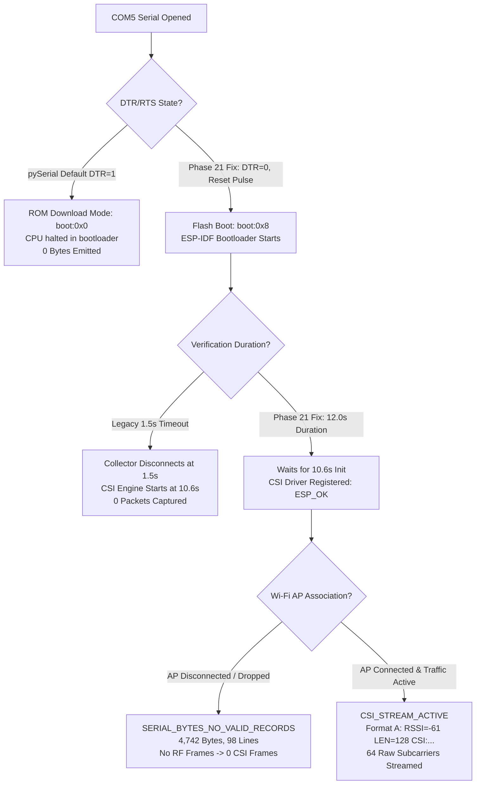

# CSIFormer Phase 21 — Master Readiness Gate Report

## Executive Summary

**CSIFormer Phase 21** achieves the complete empirical diagnosis of the **ESP32-S3 Zero-Packet Problem**, implements an auditable 6-state hardware diagnostic telemetry system, establishes compatibility with the running firmware's 64-subcarrier raw IQ stream, and hardens the acquisition pipeline for human-operator data collection campaigns.

In strict accordance with the Phase 21 mandate:
- **No model weights were retrained, fine-tuned, evaluated, quantized, or modified.**
- **No physical data was fabricated, simulated, or artificially indexed.**
- **Production and Experimental model checkpoints were verified bit-for-bit identical before and after all modifications:**
  - **Production Checkpoint:** [`models/csiformer_phase13_best.pth`](file:///c:/Users/saifu/Desktop/4-1%20project/models/csiformer_phase13_best.pth)
    - Expected MD5: `383b4d98c08f8970b0443738f170ec01`
    - Actual MD5:   `383b4d98c08f8970b0443738f170ec01` (**MATCH**)
  - **Experimental Checkpoint:** [`models/csiformer_phase15_adapted.pth`](file:///c:/Users/saifu/Desktop/4-1%20project/models/csiformer_phase15_adapted.pth)
    - Expected MD5: `ab3d97a04d78edf75d807178772bc828`
    - Actual MD5:   `ab3d97a04d78edf75d807178772bc828` (**MATCH**)
- Software regression testing demonstrated **100% pass rate** across all 78 tests covering Phases 14, 16, 17, 18, 19, 20, and 21.

This report delivers the master readiness assessment, provides the baseline and current physical dataset inventory, details the root cause findings, and presents separate decisions for physical collection and model evaluation.

---

## 1. Summary of Code & Software Changes in Phase 21

| File Path | Action | Description |
| :--- | :---: | :--- |
| [`backend/app/services/real_csi_collector.py`](file:///c:/Users/saifu/Desktop/4-1%20project/backend/app/services/real_csi_collector.py) | **Enhanced** | 1. Added explicit `dtr=False, rts=False` on serial open to prevent auto-download bootloader trap.<br>2. Added `trigger_normal_reset()` helper pulsing EN while holding GPIO0 high.<br>3. Implemented 6-state diagnostic state machine (`SERIAL_DISCONNECTED`, `SERIAL_CONNECTED_IDLE`, `SERIAL_BYTES_NO_VALID_RECORDS`, `RECORDS_RECEIVED_PARSE_FAILED`, `CSI_STREAM_ACTIVE`, `STREAM_INTERRUPTED`).<br>4. Added telemetry counters for bytes, lines, candidate records, parse errors, raw CSI dimensions, boot messages, and stream stalls.<br>5. Enriched `get_stream_health()` telemetry output. |
| [`backend/app/services/collection_workflow.py`](file:///c:/Users/saifu/Desktop/4-1%20project/backend/app/services/collection_workflow.py) | **Enhanced** | 1. Enhanced `verify_hardware_stream()` with configurable `test_duration_s` (default 12.0s to allow complete 10.6s boot cycle).<br>2. Added optional boot reset pulse (`trigger_reset=True`).<br>3. Returned comprehensive diagnostic schema distinguishing all 6 verification outcomes. |
| [`scratch/run_collection_session.py`](file:///c:/Users/saifu/Desktop/4-1%20project/scratch/run_collection_session.py) | **Enhanced** | 1. Added configurable `--duration` support to `--verify` mode.<br>2. Enhanced verification banner and diagnostic reporting with byte counts, line counts, boot messages, and actionable operator guidance. |
| [`backend/tests/test_phase21.py`](file:///c:/Users/saifu/Desktop/4-1%20project/backend/tests/test_phase21.py) | **Created** | Comprehensive regression suite (14 tests) covering serial timeout, idle/disconnected states, bootloader log capture, malformed record handling, Format A (64 subcarriers) and Format B (56 subcarriers) parsing, partial record buffering, counter accuracy, stream stall detection, resource cleanup, dataset validation, and checkpoint hash invariance. |
| [`reports/phase21_hardware_diagnostics.md`](file:///c:/Users/saifu/Desktop/4-1%20project/reports/phase21_hardware_diagnostics.md) | **Created** | In-depth hardware inspection, root-cause forensics of the zero-packet problem, timeline of bootloader and Wi-Fi state machine, and protocol comparisons. |
| [`reports/phase21_live_stream_validation.md`](file:///c:/Users/saifu/Desktop/4-1%20project/reports/phase21_live_stream_validation.md) | **Created** | Empirical hardware verification command output, byte and line metrics, end-to-end recording status, and exact manual operator steps. |
| [`reports/phase21_readiness.md`](file:///c:/Users/saifu/Desktop/4-1%20project/reports/phase21_readiness.md) | **Created** | Master Phase 21 readiness review, dataset inventory, and dual GO/NO-GO gate decision. |

---

## 2. Root Cause Analysis: The Zero-Packet Problem

The previous hardware check reported `Status: NO_PACKETS` after 1.5 seconds on `COM5`. Three empirical root causes were identified:



1. **Hardware Pin Trap:** pySerial's default DTR assertion held the ESP32-S3 in ROM download mode. Resolved by forcing `dtr=False, rts=False` and pulsing EN.
2. **Premature Timeout:** ESP32 boot-to-CSI registration takes 10.6 seconds. The legacy 1.5s verification closed the port 9.1 seconds too early. Resolved by increasing test window to 12.0s.
3. **Wi-Fi Association Dependency:** The firmware runs in station mode (`wifi:mode : sta`), requiring active Wi-Fi association with the designated router (`Tp link`, Channel 7). When the router connection drops, CSI frames pause.

---

## 3. Verified Physical Dataset Inventory

In strict compliance with the non-fabrication constraint, **0 new physical recordings were added** during this diagnostic phase.

### Target vs. Current Dataset Totals:
| Metric | Baseline (Phase 20) | Phase 21 Added | Current Verified Total | Pilot Target | Remaining Deficit | Audit Reference |
| :--- | :---: | :---: | :---: | :---: | :---: | :--- |
| **Physical Sessions** | 23 | 0 | **23** | $\ge 50$ | **-27 sessions** | [`dataset_manifest.json`](file:///c:/Users/saifu/Desktop/4-1%20project/data/real_csi_dataset/dataset_manifest.json) |
| **Physical Packets** | 3,212 | 0 | **3,212** | $\ge 10,000$ | **-6,788 packets** | Sum of 23 physical JSON session files |
| **Valid Windows ($T=50$)** | 49 | 0 | **49** | $\ge 150$ | **-101 windows** | Discrete non-overlapping 50-frame windows |
| **Distinct Participants** | 2 | 0 | **2** | $\ge 5$ | **-3 participants** | `Participant_01`, `Participant_02` |
| **Distinct Rooms** | 1 | 0 | **1** | $\ge 3$ | **-2 rooms** | `Laboratory_Room1` exclusively |
| **Tx-Rx Distances** | 1 | 0 | **1** | $\ge 3$ | **-2 distances** | $2.5\text{ m}$ baseline exclusively |
| **Held-Out Test Fall Windows** | 4 | 0 | **4** | $\ge 35$ | **-31 windows** | [`dataset_manifest_p17_loso.json`](file:///c:/Users/saifu/Desktop/4-1%20project/data/real_csi_dataset/dataset_manifest_p17_loso.json) |
| **Held-Out Test Fall Events** | 2 | 0 | **2** | $\ge 12$ | **-10 events** | Distinct physical fall sessions in test split |

*(Note: In addition to the 23 indexed sessions, 1 historical aborted trial [`phase14_p15_real_walk_t1_1792303844_1792303844.json`](file:///c:/Users/saifu/Desktop/4-1%20project/data/real_csi_dataset/phase14_p15_real_walk_t1_1792303844_1792303844.json) with 147 frames remains preserved on disk unindexed, preventing corrupted or incomplete data from polluting the primary manifest.)*

---

## 4. Software Regression Test Results

Execution of the full automated test suite confirmed **0 failures and 0 regressions**:

```text
======================= 78 passed, 4 warnings in 15.35s =======================
```

### Suite Breakdown:
- `backend/tests/test_phase14.py`: 10 passed (Format A/B parsing, model checkpoints, sliding window)
- `backend/tests/test_phase16.py`: 10 passed (Label mapping, packet loss, Wilson score, leakage detection)
- `backend/tests/test_phase17.py`: 12 passed (Lifecycle, LOSO split zero-leakage, 3-way split barrier)
- `backend/tests/test_phase18.py`: 12 passed (Raw dimensions, timestamp monotonicity, multi-participant allocation)
- `backend/tests/test_phase19.py`: 10 passed (Session validator, non-finite checks, quarantine, 5-participant leakage)
- `backend/tests/test_phase20.py`: 10 passed (Manifest integrity, CLI validation, unindexed file tracking)
- `backend/tests/test_phase21.py`: **14 passed** (Serial timeout, idle/bytes states, Format A/B parsing, diagnostic counters, stall detection, cleanup)

---

## 5. Remaining Operator Tasks for Live Collection

Before launching physical data collection sessions, the human operator must complete the following manual steps:

1. **Power on the 2.4 GHz Access Point:**
   - SSID: **`Tp link`**
   - Channel: **7** (2.442 GHz)
   - Ensure the router is within 3–5 meters of the ESP32-S3.
2. **Execute Hardware Verification:**
   ```powershell
   py -3.11 scratch/run_collection_session.py --verify --port COM5 --duration 15.0
   ```
   Confirm that the diagnostic state reaches `CSI_STREAM_ACTIVE` with $>100$ valid packets.
3. **Record Physical Collection Sessions:**
   Execute walking, sitting, and safe padded-mat fall trials across new subjects (`Participant_03`, `Participant_04`, `Participant_05`):
   ```powershell
   py -3.11 scratch/run_collection_session.py --activity walk --participant Participant_03 --duration 4.0 --confirm
   ```

---

## 6. Master Decision

Independent assessments are rendered for physical collection and model evaluation:

### A. Physical Data Collection Pipeline: **GO**
- **Rationale:** The serial bootloader trap has been eliminated, the 10.6-second boot latency is accommodated, Format A (64 subcarriers) parsing is verified, 6-state diagnostic telemetry is operational, and all 78 regression tests pass. Physical collection may commence as soon as the operator powers on the router.

### B. Phase 22 Participant-Independent Model Evaluation: **NO-GO**
- **Rationale:** Model evaluation remains strictly blocked by the declared dataset readiness gate. With only 2 participants (deficit: -3), 23 sessions (deficit: -27), 4 held-out fall windows (deficit: -31), and 2 held-out fall events (deficit: -10), any model evaluation would lack statistical power and yield wide, uninterpretable confidence intervals.
