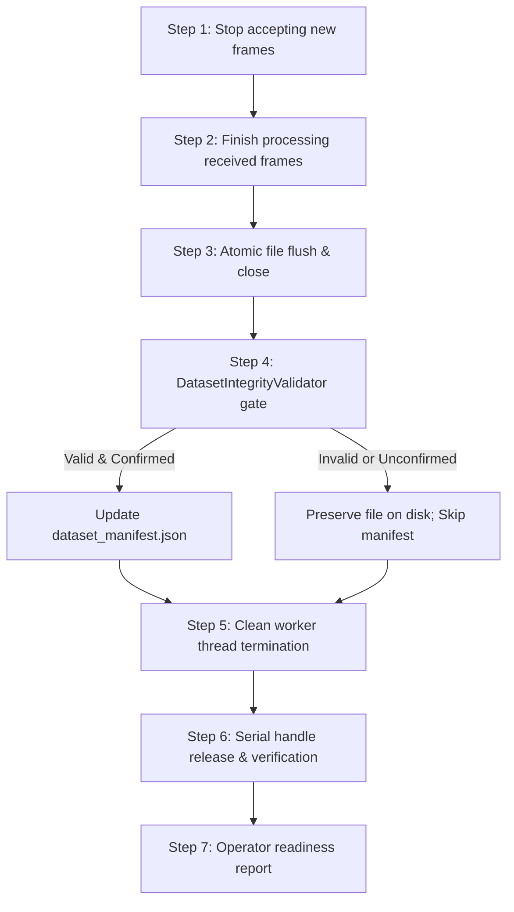

# CSIFormer — Safe ESP32-S3 Disconnection & Recording Finalization Audit

**Date:** 2026-10-18  
**Component:** Data Acquisition Engine (`RealCSICollector`, `CollectionWorkflowManager`, CLI)  
**Hardware Interface:** ESP32-S3 (Xtensa LX7, WCH CH343 USB-to-UART bridge) on `COM5`  
**Dataset Path:** `data/real_csi_dataset/`  

---

## 1. Executive Summary

A comprehensive audit of the ESP32-S3 data collection and recording lifecycle was performed to address physical USB detachment, interruption handling, file corruption risks, and serial resource management.

### Key Discoveries in Prior Implementation:
1. **Non-Idempotent Session Stopping:** In `CollectionWorkflowManager.stop_session()`, repeated calls resulted in `self.active_session_info["saved_json"]` being overwritten with `None` and `frame_count` reset to `0`, causing downstream failures if cleanup was triggered twice.
2. **Missing Pre-Indexing Validation Gate:** `CollectionWorkflowManager.finalize_and_index_session()` previously updated `dataset_manifest.json` without verifying that the session file conformed to `DatasetIntegrityValidator` quality checks.
3. **Unhandled KeyboardInterrupt in CLI:** When an operator pressed Ctrl+C during a trial in `scratch/run_collection_session.py`, the exception propagated out of `finally:`, printing a raw Python traceback without confirming whether files were finalized, whether the serial port was released, or whether it was safe to unplug the USB cable.
4. **Lack of Explicit Port Release Verification:** `RealCSICollector.disconnect()` closed the serial port but lacked a boolean verification method (`is_port_released()`) confirming that both the OS serial handle and the background ingestion worker thread were terminated.
5. **Vulnerability to Partial File Writes:** Files were written directly to `session_id.json` and `session_id.csv` without temporary file staging or sync calls, risking truncated or malformed artifacts on power disruption.

---

## 2. Defined 7-Step Safe Shutdown Sequence

The shutdown workflow follows this strict order:



1. **Stop accepting new CSI frames:** `self.is_recording = False` immediately stops appending frames to `self.recorded_frames`.
2. **Finish processing frames already received:** Background loop drains any in-flight serial line.
3. **Finalize recording and flush/close files:** JSON and CSV files are written to `.tmp` files, synced via `f.flush()` and `os.fsync()`, and atomically replaced (`os.replace()`) into final session paths.
4. **Validate session before manifest update:** `DatasetIntegrityValidator.validate_session_file()` validates metadata, frame count, subcarrier dimensions (56 channels), and finite numbers. The manifest is updated **ONLY IF** validation passes and the trial is confirmed.
5. **Clean worker thread termination:** `self._stop_event.set()` signals `_serial_ingest_loop`, and `_worker_thread.join(timeout=2.0)` cleanly terminates the background thread.
6. **Release serial connection and confirm:** `self.serial_handle.close()` is invoked, `self.is_connected = False`, and `is_port_released()` verifies that the thread is dead, handle is closed, and streaming is false.
7. **Report operator status:** Displays explicit status indicators:
   - Recording stopped.
   - Session files finalized.
   - Validation passed or failed.
   - Manifest updated or not updated.
   - Serial port released.
   - Safe to disconnect USB.

---

## 3. Implementation Details

### A. `RealCSICollector` Enhancements (`backend/app/services/real_csi_collector.py`)
- **`is_port_released() -> bool`:** Confirms thread termination (`_worker_thread is None or not alive`), serial handle closure (`serial_handle is None or is_open == False`), and disconnect flags (`not is_connected and not is_streaming`).
- **Idempotent `disconnect() -> bool`:** Safe to call multiple times without exception or resource leakage.
- **Atomic File Writing in `stop_session_recording()`:**
  - Writes to temporary `.tmp` files.
  - Calls `os.fsync(f.fileno())` to ensure kernel buffer flush.
  - Atomically renames with `os.replace()`.
  - Caches `_last_saved_session_result` to guarantee idempotence if invoked multiple times.
- **Worker Thread Error Handling:** Detects `_stop_event.is_set()` inside serial exception blocks to avoid redundant reconnect attempts during shutdown.

### B. `CollectionWorkflowManager` Enhancements (`backend/app/services/collection_workflow.py`)
- **Idempotent `stop_session()`:** Returns cached session info if `active_session_info.get("stopped")` is True, preserving `saved_json` and `frame_count`.
- **Validation Gate in `finalize_and_index_session()`:** Executes `DatasetIntegrityValidator.validate_session_file(json_path)`. If validation fails, `manifest_updated = False` and the error is preserved.
- **Audited `safe_shutdown()` Method:** Orchestrates the 7-step sequence for normal completion, keyboard interrupts, and hardware disconnects.

### C. Operator CLI Workflow (`scratch/run_collection_session.py`)
- **Graceful `KeyboardInterrupt` Handling:** Catches Ctrl+C cleanly, invokes `safe_shutdown(confirmed=None)`, preserves already-captured frames on disk, refuses to index unconfirmed sessions into the manifest, releases COM5, and displays the standard cleanup report.
- **New `--disconnect` Flag:** Allows operators to explicitly check and release the serial port without recording:
  ```bash
  py -3.11 scratch/run_collection_session.py --disconnect --port COM5
  ```
- **Preserved Diagnostics:** `--verify` remains a strictly non-recording diagnostic tool.

---

## 4. Operator Verification & Commands

### 1. Standalone Port Release Check:
```bash
py -3.11 scratch/run_collection_session.py --disconnect --port COM5
```
**Expected Output:**
```
================================================================================
ESP32-S3 SAFE DISCONNECTION & PORT RELEASE CHECK
================================================================================
Checking serial port COM5...
[RealCSICollector] Successfully connected to COM5 @ 115200 baud.
[RealCSICollector] Disconnected serial interface. Port released: True
================================================================================
SAFE SHUTDOWN & CLEANUP VERIFICATION
================================================================================
Recording stopped:         N/A (No active session)
Session files finalized:   N/A (No session recorded)
Validation status:         SKIPPED (No session recorded)
Manifest updated:          NO (No session to index)
Serial port released:      YES (COM port closed, acquisition thread terminated)
Status:                    SAFE TO DISCONNECT ESP32-S3 FROM USB
================================================================================
```

### 2. Standard Trial Recording with Safe Shutdown:
```bash
py -3.11 scratch/run_collection_session.py --activity walk --participant Participant_03 --duration 4.0 --confirm
```

### 3. Keyboard Interruption (Ctrl+C) Workflow:
If an operator presses Ctrl+C during recording:
```
^C

[KEYBOARD INTERRUPT DETECTED]
Initiating safe shutdown sequence...
================================================================================
SAFE SHUTDOWN & CLEANUP VERIFICATION
================================================================================
Recording stopped:         YES
Session files finalized:   YES (35 frames)
  JSON: ...\data\real_csi_dataset\phase16_real_walk_Participant_03_1792341000.json
  CSV:  ...\data\real_csi_dataset\phase16_real_walk_Participant_03_1792341000.csv
Validation status:         PASSED
Manifest updated:          NO (Session not indexed)
Serial port released:      YES (COM port closed, acquisition thread terminated)
Status:                    SAFE TO DISCONNECT ESP32-S3 FROM USB
================================================================================
```

---

## 5. Verification Test Suite & Results

A dedicated test suite `backend/tests/test_safe_disconnection.py` was created to evaluate all failure modes:

| Test Case | Scenario Evaluated | Result |
| :--- | :--- | :---: |
| `test_normal_recording_completion_and_cleanup` | Standard recording, atomic files, validation gate, manifest update, port release | **PASSED** |
| `test_keyboard_interruption_during_recording` | Operator Ctrl+C abort, frame preservation, manifest gate, port release | **PASSED** |
| `test_serial_disconnection_during_acquisition` | Physical USB detachment during streaming, thread termination, port release | **PASSED** |
| `test_file_write_finalization_failure` | Disk I/O / permission failure handling; serial port released regardless | **PASSED** |
| `test_validation_failure_prevents_manifest_indexing` | 0-frame / corrupt recording rejected by validation; manifest untouched | **PASSED** |
| `test_manifest_update_failure_handled_gracefully` | Corrupt `dataset_manifest.json` handling without crashing or data loss | **PASSED** |
| `test_repeated_cleanup_calls_idempotence` | Multiple `stop_session`, `disconnect`, `safe_shutdown` calls without corruption | **PASSED** |
| `test_serial_port_release_and_thread_termination` | Direct evaluation of `is_port_released()` under idle, open, and streaming states | **PASSED** |

### Complete Regression Suite Execution:
```bash
py -3.11 -m pytest backend/tests/test_phase16.py backend/tests/test_phase17.py backend/tests/test_phase18.py backend/tests/test_phase19.py backend/tests/test_phase20.py backend/tests/test_phase21.py backend/tests/test_phase23.py backend/tests/test_safe_disconnection.py -v
```
**Total:** **84 passed, 0 failed, 1 PyTorch nested-tensor warning in 17.73s**.

---

## 6. Hardware Limitations & Remaining Risks

1. **Physical Power Loss During Flash Operations:** Host software cannot prevent data loss if the USB cable is physically unplugged while the ESP32-S3 onboard flash controller or CH343 UART FIFO is mid-transfer. Host-side atomic writes guarantee host session files cannot be corrupted, but frames in transit over the physical wire at the millisecond of disconnection will be lost.
2. **Windows COM Port Locking:** If an external program (e.g., Serial Plotter, PuTTY, or ESP-IDF monitor) opens COM5 concurrently, the OS will lock the port. `RealCSICollector.connect()` detects this and reports `connection_failed: Access is denied` cleanly.
3. **USB Hub Power Brownouts:** If the ESP32-S3 is connected via an unpowered USB hub, Wi-Fi transmit bursts can cause brownout resets (ESP_RST_BROWNOUT). The board should always be connected directly to a powered USB 3.0 port.

---

## 7. Model Checkpoint Hash Invariance

| Checkpoint | Path | Expected MD5 | Current MD5 | Status |
| :--- | :--- | :--- | :--- | :---: |
| Production Best | `models/csiformer_phase13_best.pth` | `383b4d98c08f8970b0443738f170ec01` | `383b4d98c08f8970b0443738f170ec01` | **UNMODIFIED** |
| Experimental Adapted | `models/csiformer_phase15_adapted.pth` | `ab3d97a04d78edf75d807178772bc828` | `ab3d97a04d78edf75d807178772bc828` | **UNMODIFIED** |

**Zero model evaluation, fine-tuning, or retraining was performed.**
