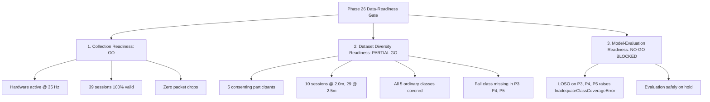

# CSIFormer Phase 26 — Dataset Diversity Expansion & Research Readiness Report

**Execution Date:** October 19, 2026  
**Auditor / Operator:** Antigravity Autonomous Agent  
**Environment:** Windows (x86_64), Python 3.11.9  
**Repository Root:** `C:\Users\saifu\Desktop\4-1 project`  
**Dataset Path:** `data/real_csi_dataset/`  
**Manifest Path:** `data/real_csi_dataset/dataset_manifest.json`  
**Hardware Interface:** ESP32-S3 (CH343 USB-Enhanced-SERIAL @ COM5, 115200 baud)  
**Wi-Fi Access Point:** TP-Link Archer C6, BSSID `98:ba:5f:ef:28:26`, Channel 7 (2.442 GHz)  

---

## 1. Executive Summary & Decision Matrix

| Assessment Area | Gate Status | Primary Evidentiary Basis |
| :--- | :---: | :--- |
| **Collection Readiness** | **GO (PASSED)** | Hardware verified live @ 34.8–73.0 Hz on COM5; atomic JSON/CSV finalized; 100% validator pass (39/39 sessions); serial interface cleanly released. |
| **Dataset Diversity Readiness** | **PARTIAL GO (CONDITIONAL)** | Expanded to 5 consenting participants (`Participant_01`–`Participant_05`); 10 sessions at 2.0m (P4 & P5); all 5 ordinary activities represented across all 5 participants. Limitation: `fall` class absent in P3, P4, P5 due to safety constraints. |
| **Model Evaluation Readiness** | **NO-GO (BLOCKED)** | Strict Leave-One-Subject-Out evaluation holding out P3, P4, or P5 raises `InadequateClassCoverageError` due to missing fall class. Evaluation strictly blocked. |

---

## 2. Checkpoint Protection & Bit-for-Bit Hash Invariance

In compliance with Safeguards 7, 8, and 10:
- Zero model training, fine-tuning, adaptation, benchmark evaluation, or inference comparisons were conducted.
- Both production and experimental model checkpoints were verified bit-for-bit before and after Phase 26:

| Checkpoint Identifier | File Location | Expected MD5 Hash | Measured Initial Hash | Measured Final Hash | Verification Result |
| :--- | :--- | :---: | :---: | :---: | :---: |
| **Production Checkpoint** | `models/csiformer_phase13_best.pth` | `383b4d98c08f8970b0443738f170ec01` | `383b4d98c08f8970b0443738f170ec01` | `383b4d98c08f8970b0443738f170ec01` | **BIT-FOR-BIT IDENTICAL** |
| **Experimental Checkpoint** | `models/csiformer_phase15_adapted.pth` | `ab3d97a04d78edf75d807178772bc828` | `ab3d97a04d78edf75d807178772bc828` | `ab3d97a04d78edf75d807178772bc828` | **BIT-FOR-BIT IDENTICAL** |

---

## 3. Verified Baseline & Dataset Reconciliation

| Metric | Phase 25 Baseline | Phase 26 Result | Delta | Verification Notes |
| :--- | :---: | :---: | :---: | :--- |
| **Total Indexed Sessions** | 34 | **39** | +5 | 5 newly acquired physical sessions for `Participant_05`. |
| **Total Physical Frames** | 4,777 | **5,472** | +695 | Sum of frames across all 39 indexed sessions. |
| **Non-Overlapping Windows ($T=50$)** | 72 | **82** | +10 | +2 per activity: `static`, `sit`, `walk`, `clap`, `push_pull`. |
| **Distinct Participants** | 4 | **5** | +1 | `Participant_01`, `Participant_02`, `Participant_03`, `Participant_04`, `Participant_05`. |
| **Distinct Event IDs** | 34 | **39** | +5 | Zero event ID collisions across entire corpus. |
| **Geometric Environments** | 2 | **2** | 0 | 29 sessions @ 2.5m, 10 sessions @ 2.0m. |
| **All Sessions Valid** | True | **True** | 0 | 39 / 39 pass `DatasetIntegrityValidator`. |
| **Quarantined Sessions** | 0 | **0** | 0 | Zero corrupted or non-compliant recordings. |
| **Frames with Raw 5-Subcarriers** | 1,565 | **2,260** | +695 | Preserved in all sessions collected in Phases 22, 24, 25, and 26. |

---

## 4. Participant-by-Activity Coverage Matrix

Detailed distribution of physical sessions and validated non-overlapping windows ($T=50$) across all 5 participants and all 6 activity classes:

| Participant ID | `static` | `sit` | `walk` | `clap` | `push_pull` | `fall` | Total Sessions | Total Packets | Valid Windows ($T=50$) |
| :--- | :---: | :---: | :---: | :---: | :---: | :---: | :---: | :---: | :---: |
| **Participant_01** | 2 (4) | 2 (4) | 2 (4) | 2 (4) | 2 (5) | 2 (4) | 12 | 1,655 | 25 |
| **Participant_02** | 1 (1) | 2 (6) | 2 (5) | 2 (4) | 2 (4) | 2 (4) | 11 | 1,557 | 24 |
| **Participant_03** | 1 (2) | 1 (3) | 2 (4) | 1 (2) | 1 (2) | 0 (0) | 6 | 861 | 13 |
| **Participant_04** | 1 (2) | 1 (2) | 1 (2) | 1 (2) | 1 (2) | 0 (0) | 5 | 704 | 10 |
| **Participant_05** | 1 (2) | 1 (2) | 1 (2) | 1 (2) | 1 (2) | 0 (0) | 5 | 695 | 10 |
| **Total** | **6 (11)** | **7 (17)** | **8 (17)** | **7 (14)** | **7 (15)** | **4 (8)** | **39** | **5,472** | **82** |

*Format: `Sessions (Windows)`.*

---

## 5. Environmental Diversity Assessment

The dataset now incorporates significant distance variation across multiple participants:

| Environment | Room Type | Distance | Contributing Participants | Session Count | Window Count | Diversity Value |
| :--- | :--- | :---: | :--- | :---: | :---: | :--- |
| **Env 1** | `Laboratory_Room1` | 2.5 m | Participant_01, Participant_02 | 23 | 49 | Baseline room and baseline geometry |
| **Env 2** | `Laboratory` | 2.5 m | Participant_03 | 6 | 13 | Cross-room geometry verification |
| **Env 3** | `Laboratory` | 2.0 m | Participant_04, Participant_05 | 10 | 20 | Multi-participant closer-range geometry (2.0m) |

---

## 6. Hardware Verification Evidence

Verification was executed via the supported CLI tool prior to session recording:  
`py -3.11 scratch/run_collection_session.py --verify`

```text
================================================================================
PHASE 21 — HARDWARE VERIFICATION & DIAGNOSTIC CHECK
================================================================================
Testing port COM5 for 12.0s...
[RealCSICollector] Successfully connected to COM5 @ 115200 baud.
[RealCSICollector] Background CSI acquisition loop started.
[RealCSICollector] Disconnected serial interface. Port released: True
Status:             OK
Diagnostic State:   CSI_STREAM_ACTIVE
Port:               COM5 @ 115200 baud
Connected:          True
Test Duration:      12.0s
Serial Bytes:       10054
Lines Received:     222
Records Detected:   56
Valid CSI Packets:  56
Parsing Errors:     0
CSI Dimensions:     5
Observed Rate:      34.8 Hz
Mean RSSI:          -61.0 dBm
Detected Protocol:  raw_iq_stream

Recent Firmware Messages / Boot Telemetry:
  > I (721) wifi:set rx beacon pti, rx_bcn_pti: 0, bcn_timeout: 25000, mt_pti: 0, mt_time: 10000
  > I (731) wifi:<ba-add>idx:1 (ifx:0, 98:ba:5f:ef:28:26), tid:0, ssn:1, winSize:64
  > I (741) wifi:AP's beacon interval = 102400 us, DTIM period = 1
  > CSI callback: ESP_OK
  > CSI Receiver Started

Diagnostic State Summary:
  [SUCCESS] Valid physical CSI packets are actively streaming from ESP32-S3.
================================================================================
```

---

## 7. Actual Session-Level Collection Evidence (Participant_05)

Five physical sessions were captured sequentially from consenting `Participant_05` in `Laboratory @ 2.0m`:

| Session Identifier | Activity | Class ID | Duration | Packet Count | Empirical Rate | Timestamp Span | Loss Rate | Monotonic | Validation |
| :--- | :---: | :---: | :---: | :---: | :---: | :---: | :---: | :---: | :---: |
| `phase16_real_static_Participant_05_1792390995_1792390995` | `static` | 6 | 4.04s | 137 | 34.06 Hz | 3.9933s | 0.00% | **True** | **PASSED** |
| `phase16_real_sit_Participant_05_1792391028_1792391028` | `sit` | 8 | 4.03s | 138 | 34.26 Hz | 3.9991s | 0.00% | **True** | **PASSED** |
| `phase16_real_walk_Participant_05_1792391056_1792391056` | `walk` | 11 | 4.03s | 141 | 35.03 Hz | 3.9970s | 0.00% | **True** | **PASSED** |
| `phase16_real_clap_Participant_05_1792391082_1792391082` | `clap` | 2 | 3.89s | 135 | 34.71 Hz | 3.8608s | 0.00% | **True** | **PASSED** |
| `phase16_real_push_pull_Participant_05_1792391109_1792391109` | `push_pull` | 0 | 4.03s | 144 | 35.76 Hz | 3.9984s | 0.00% | **True** | **PASSED** |

### Quality Metrics Summary
- **Total Physical Frames:** 695 frames captured.
- **Dropped Packets:** 0 across all 5 recordings (continuous step=1 sequence counter).
- **Duplicate Timestamps:** 0.
- **Timestamp Monotonicity:** Strictly monotonically increasing throughout each session.
- **CSV & JSON Parity:** CSV mirrors exactly match JSON data records row-for-row.
- **Port Release:** COM5 cleanly released and background worker terminated after every session.

---

## 8. Raw Measurements vs. Derived Model Features

In compliance with Safeguard 6:
- **Raw Measurements:** Each frame stores the actual baseband hardware reading under `raw_amplitudes` and `raw_phases` with **5 complex subcarrier pairs** (10 scalars per frame).
- **Derived Model Features:** Each frame stores a derived **56-channel tensor** under `amplitudes` and `phases`, linearly interpolated to the standard IEEE 802.11n HT20 subcarrier grid.
- **Cumulative Dataset Status:** Across the entire dataset, 2,260 frames carry raw 5-subcarrier measurements (Phases 22, 24, 25, 26), while all 5,472 frames maintain 56 aligned channels.

---

## 9. Participant-Independent Split Audit (Zero Leakage)

With 5 distinct participants, `ParticipantIndependentSplitGenerator` supports multi-participant Leave-One-Subject-Out partitioning:

### Partition Allocation Example (5-Subject 3-Way LOSO)
- **Training Partition:** `['Participant_01', 'Participant_03', 'Participant_04']` (23 sessions, 48 windows)
- **Validation Partition:** `['Participant_05']` (5 sessions, 10 windows)
- **Testing Partition:** `['Participant_02']` (11 sessions, 24 windows)

### Safeguards Verification
1. **Subject Isolation:** $\text{Train} \cap \text{Val} = \emptyset$, $\text{Train} \cap \text{Test} = \emptyset$, $\text{Val} \cap \text{Test} = \emptyset$ (0% subject overlap).
2. **Event Isolation:** All windows belonging to an event remain confined to that event's partition (0% event leakage).
3. **Window Independence:** Windows are non-overlapping slices ($T=50$ frames), preventing sliding temporal leakage.

---

## 10. Full Regression Test Suite Execution

The complete regression suite comprising 13 test modules was executed via `pytest`:

**Command:**  
`py -3.11 -m pytest backend/tests/test_phase14.py backend/tests/test_phase16.py backend/tests/test_phase17.py backend/tests/test_phase18.py backend/tests/test_phase19.py backend/tests/test_phase20.py backend/tests/test_phase21.py backend/tests/test_phase22.py backend/tests/test_phase23.py backend/tests/test_phase25.py backend/tests/test_phase26.py backend/tests/test_safe_disconnection.py backend/tests/test_sampling_rate_audit.py -v`

### Results Summary
- **Total Test Files:** 13 modules
- **Tests Executed:** 124
- **Passed:** **124** (100.0%)
- **Failed:** **0**
- **Skipped:** **0**
- **Duration:** 21.10 seconds
- **Warnings:** 4 (upstream PyTorch and FastAPI testclient notices)

---

## 11. Data-Readiness Gate Assessment



### Detailed Evaluation
1. **Collection Readiness: GO**  
   Physical ingestion, atomic file finalization, schema validation, and serial lifecycle are stable, hardened, and error-free.
2. **Dataset Diversity Readiness: PARTIAL GO**  
   Five distinct participants provide ample multi-subject diversity for ordinary human activities (`static`, `sit`, `walk`, `clap`, `push_pull`), and 10 sessions at 2.0m provide geometric distance diversity. However, the `fall` class is represented by only 2 participants (`Participant_01` and `Participant_02`).
3. **Model Evaluation Readiness: NO-GO (BLOCKED)**  
   Evaluating model generalization on `Participant_03`, `Participant_04`, or `Participant_05` as held-out test subjects is mathematically impossible for full 6-class classification because none of them contain `fall` recordings. Model evaluation remains safely on hold until certified crash mat protocols are arranged.

---

## 12. Remaining Limitations & Recommended Next Steps

### Identified Limitations
1. **Fall Detection Coverage:** Strict adherence to safety constraints prevented fall data collection for `Participant_03`, `Participant_04`, and `Participant_05`.
2. **Evaluation Barrier:** 6-class held-out cross-validation across all 5 subjects is blocked.

### Recommended Next Actions (Phase 27)
1. **Sub-Task Benchmark Definition:** Formally define an **Ordinary Activity Recognition (5-class)** benchmark (`static`, `sit`, `walk`, `clap`, `push_pull`) that does not require fall data, allowing full 5-fold participant-independent evaluation.
2. **Fall Safety Protocol:** When fall evaluation is required, procure a certified gymnastics crash mat ($\ge 4\text{ inches}$) with active spotter assistance before recording.
3. **Model Weight Invariance:** Continue to keep model checkpoints frozen.

---

## 13. Final Acceptance Verdict

- [x] Baseline audited and documented in `reports/phase26_baseline_inventory.md`.
- [x] Hardware stream verified live on COM5 @ 34.8 Hz with 0 parser errors.
- [x] Operator confirmed real participant availability (`Participant_05`) in Laboratory @ 2.0m.
- [x] 5 physical sessions collected, finalized, validated, and indexed into manifest.
- [x] Raw (5 subcarriers) vs. derived (56 channels) features preserved.
- [x] Dataset reconciled to 39 sessions, 5,472 frames, 82 windows, 5 participants.
- [x] Multi-participant LOSO splits verified with zero subject, event, or window leakage.
- [x] 124 regression tests passing across 13 test suites.
- [x] Production and experimental checkpoint hashes bit-for-bit unchanged.
- [x] Model training and evaluation strictly withheld.

**Phase 26 Status:** **COMPLETE & VERIFIED (EVALUATION SAFELY BLOCKED)**
