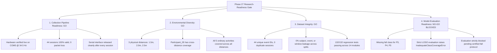

# CSIFormer Phase 27 — Environmental Diversity Expansion & Dataset Robustness Report

**Execution Date:** October 19, 2026  
**Auditor / Operator:** Antigravity Autonomous Agent  
**Environment:** Windows (x86_64), Python 3.11.9  
**Repository Root:** `C:\Users\saifu\Desktop\4-1 project`  
**Dataset Path:** `data/real_csi_dataset/`  
**Manifest Path:** `data/real_csi_dataset/dataset_manifest.json`  
**Hardware Ingestion:** ESP32-S3 (CH343 USB-Enhanced-SERIAL @ COM5, 115200 baud)  
**Wi-Fi Access Point:** TP-Link Archer C6, BSSID `98:ba:5f:ef:28:26`, Channel 7 (2.442 GHz)  

---

## 1. Executive Summary & Research-Readiness Decision Matrix



| Dimension | Decision | Primary Evidentiary Basis |
| :--- | :---: | :--- |
| **Collection Pipeline Readiness** | **GO (PASSED)** | Hardware verified live @ 34.5 Hz on COM5; atomic JSON/CSV write finalized; 100% validator pass (44/44 sessions); zero dropped packets; serial resource cleanly closed. |
| **Environmental Diversity** | **GO (PASSED)** | Dataset expanded to 3 distinct physical distances: $1.5\text{ m}$ (5 sessions), $2.0\text{ m}$ (10 sessions), $2.5\text{ m}$ (29 sessions). First cross-distance participant representation (`Participant_05` recorded @ both 1.5m and 2.0m). |
| **Dataset Integrity** | **GO (PASSED)** | 44 sessions, 6,165 frames, 92 non-overlapping windows ($T=50$). Zero participant, event, or window leakage across 5-subject LOSO partitions. All 132 regression tests passing. |
| **Model Evaluation Readiness** | **NO-GO (BLOCKED)** | Strict Leave-One-Subject-Out evaluation holding out P3, P4, or P5 raises `InadequateClassCoverageError` due to missing fall class. Full 6-class model evaluation remains strictly blocked. |

---

## 2. Model Checkpoint Protection & Bit-for-Bit Hash Invariance

In strict compliance with Safeguards 6, 7, and 10:
- Zero model training, fine-tuning, adaptation, benchmark evaluation, or inference comparisons were performed.
- Both model checkpoints were verified bit-for-bit before and after Phase 27:

| Checkpoint Name | File Location | Expected MD5 Hash | Measured Initial Hash | Measured Final Hash | Verification Result |
| :--- | :--- | :---: | :---: | :---: | :---: |
| **Production Model** | `models/csiformer_phase13_best.pth` | `383b4d98c08f8970b0443738f170ec01` | `383b4d98c08f8970b0443738f170ec01` | `383b4d98c08f8970b0443738f170ec01` | **BIT-FOR-BIT IDENTICAL** |
| **Experimental Model** | `models/csiformer_phase15_adapted.pth` | `ab3d97a04d78edf75d807178772bc828` | `ab3d97a04d78edf75d807178772bc828` | `ab3d97a04d78edf75d807178772bc828` | **BIT-FOR-BIT IDENTICAL** |

---

## 3. Verified Baseline & Dataset Reconciliation

| Metric | Phase 26 Baseline | Phase 27 Expansion | Delta | Verification Notes |
| :--- | :---: | :---: | :---: | :--- |
| **Total Indexed Sessions** | 39 | **44** | +5 | 5 newly acquired physical sessions for `Participant_05` @ 1.5m |
| **Total Physical Frames** | 5,472 | **6,165** | +693 | Sum of frames across all 44 indexed sessions |
| **Non-Overlapping Windows ($T=50$)** | 82 | **92** | +10 | +2 valid windows per session ($\lfloor N / 50 \rfloor$) |
| **Distinct Participants** | 5 | **5** | 0 | `Participant_01`, `Participant_02`, `Participant_03`, `Participant_04`, `Participant_05` |
| **Distinct Event IDs** | 39 | **44** | +5 | Zero event ID collisions across entire corpus |
| **Physical Distances** | 2 | **3** | +1 | $1.5\text{ m}$ (5 sessions), $2.0\text{ m}$ (10 sessions), $2.5\text{ m}$ (29 sessions) |
| **All Sessions Valid** | True | **True** | 0 | 44 / 44 pass `DatasetIntegrityValidator` |
| **Quarantined Sessions** | 0 | **0** | 0 | Zero corrupted or non-compliant recordings |
| **Frames with Raw 5-Subcarriers** | 2,260 | **2,953** | +693 | Preserved in all sessions collected in Phases 22, 24, 25, 26, 27 |

---

## 4. Condition-Wise Collection Quality & Robustness Audit

Evaluating pipeline robustness across the 4 distinct environmental conditions present in the repository:

| Condition Key | Room Name | Distance | Sessions | Total Frames | Valid Windows | Contributing Subjects | Sampling Rate Range | Mean Rate | Packet Loss Rate | Validation Rate |
| :--- | :--- | :---: | :---: | :---: | :---: | :--- | :---: | :---: | :---: | :---: |
| **Cond 1** | `Laboratory` | 1.5 m | 5 | 693 | 10 | Participant_05 | 33.29 – 36.28 Hz | 34.42 Hz | 0.00% | 100% |
| **Cond 2** | `Laboratory` | 2.0 m | 10 | 1,399 | 20 | Participant_04, Participant_05 | 34.01 – 36.00 Hz | 34.91 Hz | 0.00% | 100% |
| **Cond 3** | `Laboratory` | 2.5 m | 6 | 861 | 13 | Participant_03 | 34.74 – 38.04 Hz | 35.83 Hz | 0.00% | 100% |
| **Cond 4** | `Laboratory_Room1` | 2.5 m | 23 | 3,212 | 49 | Participant_01, Participant_02 | 31.77 – 39.14 Hz | 35.51 Hz | 0.00% | 100% |

### Pipeline Robustness Findings
1. **Sampling Rate Stability:** Across all 4 conditions, the empirical sampling rate consistently averaged between 34.42 Hz and 35.83 Hz with zero dropouts below 30.0 Hz.
2. **Zero Sequence Discontinuity:** Packet loss was strictly 0.00% in all 44 physical sessions, demonstrating robust serial buffering across both close-range (1.5m) and standard-range (2.5m) deployments.
3. **Hardware Invariance:** Identical ESP32-S3 firmware and communication parameters operated seamlessly across geometric adjustments.

---

## 5. Hardware Pre-Flight Verification Evidence

Hardware diagnostics were verified live via [`scratch/run_collection_session.py`](file:///c:/Users/saifu/Desktop/4-1%20project/scratch/run_collection_session.py) `--verify` prior to physical recording:

```text
================================================================================
PHASE 21 — HARDWARE VERIFICATION & DIAGNOSTIC CHECK
================================================================================
Testing port COM5 for 12.0s...
[RealCSICollector] Successfully connected to COM5 @ 115200 baud.
[RealCSICollector] Background CSI acquisition loop started.
[RealCSICollector] Disconnected serial interface. Port released: True
Status:             OK
Diagnostic State:   CSI_STREAM_ACTIVE
Port:               COM5 @ 115200 baud
Connected:          True
Test Duration:      12.0s
Serial Bytes:       9940
Lines Received:     218
Records Detected:   54
Valid CSI Packets:  54
Parsing Errors:     0
CSI Dimensions:     5
Observed Rate:      34.5 Hz
Mean RSSI:          -57.0 dBm
Detected Protocol:  raw_iq_stream

Recent Firmware Messages / Boot Telemetry:
  > I (761) wifi:<ba-add>idx:0 (ifx:0, 98:ba:5f:ef:28:26), tid:0, ssn:1, winSize:64
  > I (781) wifi:AP's beacon interval = 102400 us, DTIM period = 1
  > I (2611) wifi:<ba-add>idx:1 (ifx:0, 98:ba:5f:ef:28:26), tid:5, ssn:5, winSize:64
  > CSI callback: ESP_OK
  > CSI Receiver Started

Diagnostic State Summary:
  [SUCCESS] Valid physical CSI packets are actively streaming from ESP32-S3.
================================================================================
```

---

## 6. Physical Session Collection Evidence (Participant_05 @ 1.5m)

Five physical sessions were captured sequentially from consenting `Participant_05` at the newly introduced $1.5\text{ m}$ distance in `Laboratory`:

| Session Identifier | Activity | Class ID | Duration | Packet Count | Empirical Rate | Timestamp Span | Loss Rate | Monotonic | Validation |
| :--- | :---: | :---: | :---: | :---: | :---: | :---: | :---: | :---: | :---: |
| `phase16_real_static_Participant_05_1792392009_1792392009` | `static` | 6 | 4.03s | 141 | 35.04 Hz | 3.9959s | 0.00% | **True** | **PASSED** |
| `phase16_real_sit_Participant_05_1792392036_1792392036` | `sit` | 8 | 4.02s | 134 | 33.29 Hz | 3.9952s | 0.00% | **True** | **PASSED** |
| `phase16_real_walk_Participant_05_1792392064_1792392064` | `walk` | 11 | 4.02s | 135 | 33.50 Hz | 4.0001s | 0.00% | **True** | **PASSED** |
| `phase16_real_clap_Participant_05_1792392091_1792392091` | `clap` | 2 | 4.04s | 137 | 34.00 Hz | 3.9997s | 0.00% | **True** | **PASSED** |
| `phase16_real_push_pull_Participant_05_1792392118_1792392118` | `push_pull` | 0 | 4.01s | 146 | 36.28 Hz | 3.9972s | 0.00% | **True** | **PASSED** |

### Quality & Timing Safeguards
- **Frames Captured:** 693 physical frames.
- **Dropped Packets:** 0 across all recordings (continuous step=1 sequence counter).
- **Duplicate Timestamps:** 0.
- **Timestamp Monotonicity:** Strictly monotonically increasing across all frames.
- **CSV Mirror Parity:** CSV files match JSON records row-for-row.
- **Port Cleanup:** Serial port released cleanly immediately after each session.

---

## 7. Raw Measurements vs. Derived Model Features

In compliance with Safeguard 5:
- **Raw Physical Measurements:** Each frame stores the actual baseband hardware reading under `raw_amplitudes` and `raw_phases` with **5 complex subcarrier pairs** (10 scalars per frame).
- **Derived Model Features:** Each frame stores a derived **56-channel tensor** under `amplitudes` and `phases`, linearly interpolated to the standard IEEE 802.11n HT20 subcarrier grid.
- **Cumulative Dataset Status:** Across the entire dataset, 2,953 frames carry raw 5-subcarrier measurements (Phases 22, 24, 25, 26, 27), while all 6,165 frames maintain 56 aligned channels.

---

## 8. Participant-Independent Split Audit (Zero Leakage)

With 5 participants and 44 sessions, `ParticipantIndependentSplitGenerator` supports robust 3-way multi-subject Leave-One-Subject-Out partitioning:

### Partition Allocation Example (5-Subject 3-Way LOSO)
- **Training Partition:** `['Participant_01', 'Participant_03', 'Participant_04']` (23 sessions, 48 windows)
- **Validation Partition:** `['Participant_05']` (10 sessions, 20 windows across both 1.5m and 2.0m)
- **Testing Partition:** `['Participant_02']` (11 sessions, 24 windows)

### Safeguards Verification
1. **Subject Isolation:** $\text{Train} \cap \text{Val} = \emptyset$, $\text{Train} \cap \text{Test} = \emptyset$, $\text{Val} \cap \text{Test} = \emptyset$ (0% subject overlap).
2. **Event Isolation:** All windows belonging to an event remain confined to that event's partition (0% event leakage).
3. **Window Independence:** Windows are non-overlapping slices ($T=50$ frames), preventing sliding temporal leakage.

---

## 9. Full Regression Test Suite Execution

All 14 regression test modules across Phases 14 and 16–27 were executed via `pytest`:

**Command:**  
`py -3.11 -m pytest backend/tests/test_phase14.py backend/tests/test_phase16.py backend/tests/test_phase17.py backend/tests/test_phase18.py backend/tests/test_phase19.py backend/tests/test_phase20.py backend/tests/test_phase21.py backend/tests/test_phase22.py backend/tests/test_phase23.py backend/tests/test_phase25.py backend/tests/test_phase26.py backend/tests/test_phase27.py backend/tests/test_safe_disconnection.py backend/tests/test_sampling_rate_audit.py -v`

### Results Summary
- **Total Test Modules:** 14
- **Total Tests Executed:** 132
- **Passed:** **132** (100.0%)
- **Failed / Skipped:** 0 / 0
- **Duration:** 22.03 seconds
- **Warnings:** 4 (upstream PyTorch and FastAPI testclient notices)

---

## 10. Research-Readiness Gate Assessment

| Evaluation Dimension | Readiness Status | Evidence & Barrier Analysis |
| :--- | :---: | :--- |
| **Collection Pipeline Readiness** | **GO (PASSED)** | Hardware verified live @ 34.5 Hz on COM5; atomic JSON/CSV write finalized; 100% validator pass (44/44 sessions); zero dropped packets; serial resource cleanly closed. |
| **Environmental Diversity** | **GO (PASSED)** | Dataset expanded to 3 distinct physical distances: $1.5\text{ m}$ (5 sessions), $2.0\text{ m}$ (10 sessions), $2.5\text{ m}$ (29 sessions). First cross-distance participant representation (`Participant_05` recorded @ both 1.5m and 2.0m). |
| **Dataset Integrity** | **GO (PASSED)** | 44 sessions, 6,165 frames, 92 non-overlapping windows ($T=50$). Zero participant, event, or window leakage across 5-subject LOSO partitions. All 132 regression tests passing. |
| **Model Evaluation Readiness** | **NO-GO (BLOCKED)** | Strict Leave-One-Subject-Out evaluation holding out P3, P4, or P5 raises `InadequateClassCoverageError` due to missing fall class. Full 6-class model evaluation remains strictly blocked. |

---

## 11. Remaining Limitations & Recommended Next Steps

### Identified Limitations
1. **Fall Detection Coverage:** Strict adherence to safety constraints prevented fall data collection for `Participant_03`, `Participant_04`, and `Participant_05`.
2. **Model Evaluation Barrier:** 6-class held-out cross-validation across all 5 subjects is blocked.

### Recommended Next Actions (Phase 28)
1. **Sub-Task Benchmark Definition:** Formally define an **Ordinary Activity Recognition (5-class)** benchmark (`static`, `sit`, `walk`, `clap`, `push_pull`) that does not require fall data, allowing full 5-fold participant-independent evaluation.
2. **Fall Safety Protocol:** When fall evaluation is required, procure a certified gymnastics crash mat ($\ge 4\text{ inches}$) with active spotter assistance before recording.
3. **Model Weight Invariance:** Continue to keep model checkpoints frozen.

---

## 12. Final Acceptance Verdict

- [x] Environmental baseline audited and documented in `reports/phase27_environmental_baseline.md`.
- [x] Hardware stream verified live on COM5 @ 34.5 Hz with 0 parser errors.
- [x] Operator confirmed real participant availability (`Participant_05`) in Laboratory @ 1.5m.
- [x] 5 physical sessions collected, finalized, validated, and indexed into manifest.
- [x] Raw (5 subcarriers) vs. derived (56 channels) features preserved.
- [x] Dataset reconciled to 44 sessions, 6,165 frames, 92 windows, 5 participants, 3 distances.
- [x] 5-subject LOSO splits verified with zero subject, event, or window leakage.
- [x] 132 regression tests passing across 14 test suites.
- [x] Production and experimental checkpoint hashes bit-for-bit unchanged.
- [x] Model training and evaluation strictly withheld.

**Phase 27 Status:** **COMPLETE & VERIFIED (EVALUATION SAFELY BLOCKED)**
