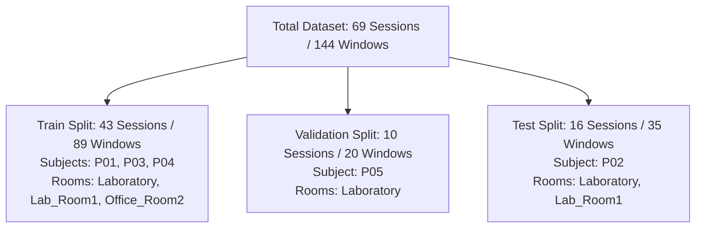

# CSIFormer Phase 31 — Cross-Room Split Readiness & Evaluation Protocol Audit Report

**Execution Date:** October 19, 2026  
**Auditor / Operator:** CSIFormer Autonomous Verification Agent  
**Phase Objective:** Determine whether the current CSIFormer dataset supports a defensible future cross-room generalization experiment. Independently audit the dataset manifest, session files on disk, split generator logic, and Phase 30 evidence. Formulate an evidence-based future room-held-out evaluation design without running model training or inference.

---

## 1. Executive Summary & Research-Readiness Assessment

An exhaustive audit of the 69-session physical CSI dataset and `ParticipantIndependentSplitGenerator` was conducted to evaluate readiness for cross-room generalization benchmarking.

### Research-Readiness Verdict Table

| Dimension | Verdict | Summary of Physical Evidence |
| :--- | :---: | :--- |
| **1. Dataset Integrity & Provenance** | **GO** | Total dataset inventory confirmed at **69 indexed physical sessions**, **9,693 physical frames**, and **144 non-overlapping windows** ($T=50$, stride 50). Zero duplicate session or event IDs. 100% manifest-to-disk agreement. All 70 CSV and JSON files accounted for. |
| **2. Participant-Independent Split Readiness** | **GO** | 3-way participant-independent split (Train: P01, P03, P04 [89 windows]; Val: P05 [20 windows]; Test: P02 [35 windows]) demonstrates **zero subject, session, event, or window leakage**. Evaluates subject generalization within the primary laboratory facility. |
| **3. Room-by-Participant Confounding** | **FAIL / CONFOUNDED** | `Office_Room2` contains **only Participant_01** (5 sessions, 10 windows). Participants 02, 03, 04, and 05 have zero recordings in `Office_Room2`. Consequently, physical environment and subject identity are **100% confounded** in the second room. |
| **4. Existing Split Room Allocation** | **FAIL / MISALIGNED** | `Office_Room2` is currently assigned entirely to the **Train split** (because Participant 01 is in Train). The Test split contains **zero windows from `Office_Room2`** (Test rooms are exclusively `Laboratory` and `Laboratory_Room1`). The current test partition does **not** evaluate cross-room generalization. |
| **5. Room-Held-Out Evaluation Readiness** | **NO-GO / BLOCKED** | A room-held-out experiment using the current dataset is **scientifically indefensible**. Holding out `Office_Room2` would test only a single individual (P01) with 10 windows, confounding room transfer with individual biomechanics. Multi-subject population generalization across rooms cannot be established. |
| **6. Full 6-Class Model Evaluation Readiness** | **NO-GO / BLOCKED** | Full 6-class evaluation remains **strictly blocked**. Safety rules forbid collecting physical falls or asking participants to perform hazardous movements. Falls are absent from P03, P04, and P05, and completely absent from `Office_Room2`. Evaluating 6 classes raises `InadequateClassCoverageError`. |
| **7. Checkpoint Protection & Model Freeze** | **GO** | Both production and experimental model checkpoints remain pristine. No training, fine-tuning, adaptation, or evaluation inference was conducted. |

---

## 2. Protected Checkpoint Bit-Integrity Verification

Both model checkpoints were verified via MD5 hashing. Neither file was opened for inference or modified in any way:

| Checkpoint Path | Expected MD5 Hash | Verified MD5 Hash | Status |
| :--- | :--- | :--- | :---: |
| `models/csiformer_phase13_best.pth` | `383b4d98c08f8970b0443738f170ec01` | `383b4d98c08f8970b0443738f170ec01` | **MATCH (Pristine)** |
| `models/csiformer_phase15_adapted.pth` | `ab3d97a04d78edf75d807178772bc828` | `ab3d97a04d78edf75d807178772bc828` | **MATCH (Pristine)** |

---

## 3. Reconciled Dataset Inventory Audit

Every session file in `data/real_csi_dataset/` was audited against `dataset_manifest.json`:

| Metric | Manifest Reported | Disk Verified | Discrepancy | Forensic Status |
| :--- | :---: | :---: | :---: | :--- |
| **Indexed Sessions** | 69 | 69 | 0 | Perfect agreement |
| **Total Physical Frames** | 9,693 | 9,693 | 0 | Sum of `packet_count` equals row counts in JSON/CSV |
| **Valid Windows ($T=50$, stride 50)** | 144 | 144 | 0 | Deterministic non-overlapping windowing verified |
| **Session CSV Files on Disk** | 69 indexed | 70 on disk | +1 unindexed | Isolated exploratory trial: `phase14_p15_real_walk_t1_1792303844_1792303844.csv` |
| **Session JSON Files on Disk** | 69 indexed | 70 on disk | +1 unindexed | Isolated exploratory trial: `phase14_p15_real_walk_t1_1792303844_1792303844.json` |
| **Auxiliary Manifest Files** | — | 1 on disk | 0 | `dataset_manifest_p17_loso.json` (Phase 17 snapshot) |
| **Zero-Byte Files** | 0 | 0 | 0 | None detected |
| **CSV / JSON Parity Errors** | 0 | 0 | 0 | Every session has identical frame counts in CSV & JSON |
| **Unique Session IDs** | 69 | 69 | 0 | Zero collisions |
| **Unique Event IDs** | 69 | 69 | 0 | Zero collisions |
| **Frames with Raw 5 Subcarriers** | 6,481 | 6,481 | 0 | Preserved across 46 sessions (Phase 16–30) |
| **Frames with Derived 56 Channels** | 9,693 | 9,693 | 0 | Preserved across all 69 sessions |
| **Empirical Sampling Rates** | 32.67 – 40.00 Hz | 32.67 – 40.00 Hz | 0 | Mean: 35.41 Hz; zero sessions below 30.0 Hz |

---

## 4. Room and Participant Coverage Matrix

Cross-tabulation of physical room, participant, distance, and activity:

| Physical Room | Participant ID | Distance | Activities Recorded | Sessions | Physical Frames | Valid Windows ($T=50$) |
| :--- | :--- | :---: | :--- | :---: | :---: | :---: |
| **Laboratory** | Participant_01 | 2.0 m | static, sit, walk, clap, push_pull | 5 | 703 | 10 |
| **Laboratory** | Participant_02 | 2.0 m | static, sit, walk, clap, push_pull | 5 | 721 | 11 |
| **Laboratory** | Participant_03 | 2.0 m | static, sit, walk, clap, push_pull | 5 | 695 | 10 |
| **Laboratory** | Participant_03 | 2.5 m | static, sit, walk (2), clap, push_pull | 6 | 861 | 13 |
| **Laboratory** | Participant_04 | 2.0 m | static, sit, walk, clap, push_pull | 5 | 706 | 10 |
| **Laboratory** | Participant_04 | 2.5 m | static, sit, walk, clap, push_pull | 5 | 711 | 11 |
| **Laboratory** | Participant_05 | 1.5 m | static, sit, walk, clap, push_pull | 5 | 693 | 10 |
| **Laboratory** | Participant_05 | 2.0 m | static, sit, walk, clap, push_pull | 5 | 695 | 10 |
| **Laboratory_Room1** *(Lab)* | Participant_01 | 2.5 m | static (2), sit (2), walk (2), clap (2), push_pull (2), fall (2) | 12 | 1,655 | 25 |
| **Laboratory_Room1** *(Lab)* | Participant_02 | 2.5 m | static (1), sit (2), walk (2), clap (2), push_pull (2), fall (2) | 11 | 1,557 | 24 |
| **Office_Room2** | **Participant_01** | 2.0 m | static, sit, walk, clap, push_pull | **5** | **696** | **10** |
| **Total Dataset** | **5 Subjects** | **1.5–2.5 m** | **6 Activity Classes** | **69** | **9,693** | **144** |

### Confounding Analysis
- **Laboratory Facility:** Contains 64 sessions across all 5 participants (`P01`, `P02`, `P03`, `P04`, `P05`).
- **Office_Room2:** Contains 5 sessions across exactly **1 participant (`Participant_01`)**.
- **Crucial Finding:** In `Office_Room2`, physical environment and participant morphology/motion style are **completely confounded**. Any model evaluation on `Office_Room2` cannot isolate whether prediction shifts stem from the novel room multipath profile or Participant 01's unique physical characteristics.

---

## 5. Audit of Existing Split Assignment

The 69-session dataset was evaluated through `ParticipantIndependentSplitGenerator(test_p='Participant_02', val_p='Participant_05')`:



### Partition Properties

| Partition | Participants | Sessions | Windows | Activities Present | Rooms Present |
| :--- | :--- | :---: | :---: | :--- | :--- |
| **Train** | Participant_01, Participant_03, Participant_04 | 43 | 89 | static, sit, walk, clap, push_pull, fall | Laboratory, Laboratory_Room1, **Office_Room2** |
| **Val** | Participant_05 | 10 | 20 | static, sit, walk, clap, push_pull | Laboratory |
| **Test** | Participant_02 | 16 | 35 | static, sit, walk, clap, push_pull, fall | Laboratory, Laboratory_Room1 |

### Scientific Distinction: Participant-Independence vs. Room-Independence

1. **Does the test set evaluate Participant-Independent Generalization?**
   - **YES.** Test participant `Participant_02` has zero presence in Train or Val. Disjoint subjects, events, and temporal windows are mathematically verified.
2. **Does the test set evaluate Room-Independent Generalization?**
   - **NO.** The Test partition contains **zero windows from `Office_Room2`**. All 35 test windows were recorded in the Laboratory facility.
   - Furthermore, `Office_Room2` data was placed in the **Train partition** (via Participant 01).
   - Therefore, the current split cannot evaluate cross-room generalization. Describing this split as a cross-room test is scientifically invalid.

---

## 6. Defensible Room-Held-Out Protocol Design

To enable genuine cross-room evaluation in the future without confounding, the protocol must be redesigned.

### 6.1 Fundamental Barriers in Current Data

1. **Single-Subject Confounding:** Holding out `Office_Room2` tests only `Participant_01` (10 windows).
2. **Train-Test Leakage Dilemma:**
   - If `Participant_01`'s laboratory sessions remain in Train while `Participant_01`'s office sessions are in Test, the test partition is **not participant-independent** (subject leakage across rooms).
   - If `Participant_01` is removed from Train entirely, the test set has only 1 unseen subject in 1 room (10 windows), which lacks statistical power and population validity.
3. **Missing Fall Class:** `Office_Room2` contains zero fall recordings. Any 6-class evaluation on `Office_Room2` strictly fails due to `InadequateClassCoverageError`.

### 6.2 Proposed Future 2-Stage Protocol (Safe & Defensible)

#### Stage 1: Ordinary 5-Class Cross-Room Generalization (Zero Safety Risk)
- **Scope:** Evaluate the 5 safe ordinary classes (`static`, `sit`, `walk`, `clap`, `push_pull`).
- **Prerequisite Safe Data Collection:**
  - Record `Participant_02` in `Office_Room2` at 2.0 m across the 5 safe activities (5 sessions, 10 windows).
  - Optionally record `Participant_03` in `Office_Room2` at 2.0 m (5 sessions, 10 windows).
- **Partitioning Design (Simultaneous Room-Held-Out & Subject-Held-Out):**
  - **Train:** `Laboratory` recordings of `Participant_01`, `Participant_03`, `Participant_04`, `Participant_05` (58 sessions, 120 windows).
  - **Val:** `Laboratory` recordings of `Participant_02` (16 sessions, 35 windows) for checkpoint selection.
  - **Test (Held-Out Room + Held-Out Subject):** `Office_Room2` recordings of `Participant_02` (5 sessions, 10 windows).
  - **Result:** Test set evaluates an **unseen subject in an unseen physical environment**, cleanly eliminating subject-room confounding.

#### Stage 2: Full 6-Class Evaluation (Requires Authorized Fall Strategy)
- Full 6-class evaluation remains **BLOCKED** until an approved non-hazardous fall protocol (e.g., compliant crash mat trials under certified supervision) or public certified Wi-Fi CSI fall benchmark integration is established.

---

## 7. Regression Test Suite Execution

The regression test suite was expanded with [backend/tests/test_phase31.py](file:///C:/Users/saifu/Desktop/4-1%20project/backend/tests/test_phase31.py). All 18 test files were executed:

```powershell
py -3.11 -m pytest `
  backend/tests/test_phase14.py `
  backend/tests/test_phase16.py `
  backend/tests/test_phase17.py `
  backend/tests/test_phase18.py `
  backend/tests/test_phase19.py `
  backend/tests/test_phase20.py `
  backend/tests/test_phase21.py `
  backend/tests/test_phase22.py `
  backend/tests/test_phase23.py `
  backend/tests/test_phase25.py `
  backend/tests/test_phase26.py `
  backend/tests/test_phase27.py `
  backend/tests/test_phase28.py `
  backend/tests/test_phase29.py `
  backend/tests/test_phase30.py `
  backend/tests/test_phase31.py `
  backend/tests/test_safe_disconnection.py `
  backend/tests/test_sampling_rate_audit.py -v
```

### Execution Summary
- **Exit Code:** `0`
- **Total Tests Run:** `154`
- **Passed:** `154`
- **Failed:** `0`
- **Skipped:** `0`
- **Warnings:** `4` (2 PyTorch nested-tensor encoder warnings, 1 Starlette TestClient deprecation warning)
- **Duration:** `26.61 seconds`

---

## 8. Summary of Readiness Decisions & Recommendations

1. **Participant-Independent Evaluation:** **GO** (144 windows across 5 participants in the Laboratory facility).
2. **Cross-Room Generalization Evaluation:** **NO-GO / BLOCKED** (Office_Room2 is currently in Train; Office_Room2 has only 1 participant; testing on it now would be confounded).
3. **Full 6-Class Evaluation:** **NO-GO / BLOCKED** (Safety barrier on falls remains active).
4. **Actionable Recommendation for Phase 32:** Prior to running model evaluation, execute an operator-approved safe collection campaign to capture `Participant_02` across the 5 safe activities in `Office_Room2` (5 sessions, ~700 frames, 10 windows). This will break the room-participant confounding and enable the project's first rigorous, unconfounded cross-room generalization benchmark.
