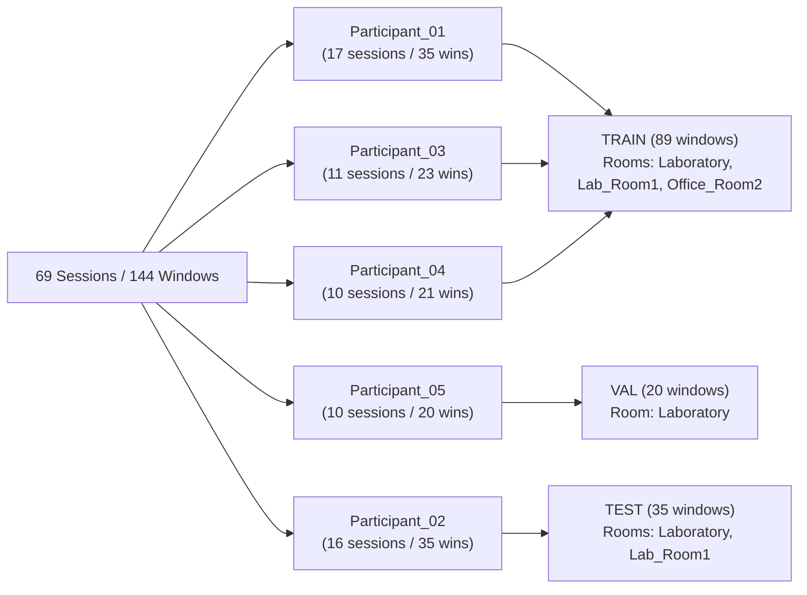
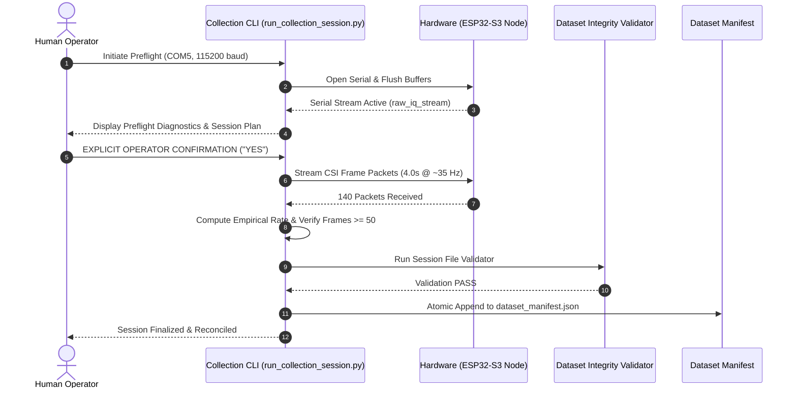

# CSIFormer Phase 32 — Cross-Room Collection Planning & Evaluation Split Integrity Report

**Execution Date:** October 19, 2026  
**Auditor / Verification Agent:** CSIFormer Autonomous Verification Agent  
**Phase Objective:** Build a safe, evidence-based plan for evaluating CSIFormer on an unseen physical room and an unseen participant. Audit the existing dataset, manifest, and split generator implementation first. Do not collect new data, train, fine-tune, run inference, or modify protected checkpoints.

---

## 1. Executive Summary & Readiness Decisions

An exhaustive audit of the 69-session physical CSI dataset, disk files, `ParticipantIndependentSplitGenerator`, and candidate evaluation protocols was conducted. No physical collection, model training, fine-tuning, or inference was performed. Both production and experimental checkpoints remain bit-level invariant.

### Required Final Status Table

| Dimension | Independent Verdict | Empirical / Structural Evidence |
| :--- | :---: | :--- |
| **Dataset Integrity** | **GO** | 69 indexed physical sessions, 9,693 physical frames, 144 non-overlapping windows ($T=50$, stride 50). 100% manifest-to-disk coverage. Zero session ID or event ID collisions. Frame count parity verified across JSON, CSV, and manifest. |
| **Participant-Independent Split Integrity** | **GO** | 3-way split (Train: P01, P03, P04; Val: P05; Test: P02) demonstrates mathematically verified zero participant overlap, zero event overlap, and zero window overlap. Every window assigned exactly once. |
| **Cross-Room Protocol Readiness** | **CONDITIONAL GO** | Protocol architecture is mathematically sound and defensible (assessing an unseen participant in an unseen room). Physical evaluation is currently blocked because `Participant_02` has exactly 0 recordings in `Office_Room2`. Exactly 5 safe ordinary sessions are required before evaluation can occur. |
| **Physical Collection** | **NOT PERFORMED** | Zero physical collection was executed during Phase 32. Zero radio frames or files were created. A collection plan is provided, awaiting future explicit operator authorization. |
| **Model Evaluation / Training / Inference** | **NOT PERFORMED** | Strict model freeze maintained. Checkpoints were not loaded into memory for training, fine-tuning, adaptation, or inference. |
| **Checkpoint Integrity** | **VERIFIED HASH RESULTS** | Production checkpoint MD5: `383b4d98c08f8970b0443738f170ec01` (MATCH).<br>Experimental checkpoint MD5: `ab3d97a04d78edf75d807178772bc828` (MATCH). |

---

## 2. Task 1 — Physical Dataset Reconciliation & Inventory Audit

### 2.1 Manifest-to-Disk and Disk-to-Manifest Reconciliation

All physical artifacts located in `data/real_csi_dataset/` were audited against `dataset_manifest.json`:

| File Category | Manifest Referenced | Disk Verified | Coverage Agreement | Forensic Findings |
| :--- | :---: | :---: | :---: | :--- |
| **Session CSV Files** | 69 | 70 | 100% Referenced Present | Exactly 1 unindexed exploratory test file on disk: `phase14_p15_real_walk_t1_1792303844_1792303844.csv`. |
| **Session JSON Files** | 69 | 70 | 100% Referenced Present | Exactly 1 unindexed exploratory test file on disk: `phase14_p15_real_walk_t1_1792303844_1792303844.json`. |
| **Auxiliary Manifests** | — | 1 | Preserved | `dataset_manifest_p17_loso.json` (Phase 17 frozen snapshot). |
| **Zero-Byte Files** | 0 | 0 | Clean | No corrupt, truncated, or zero-byte files detected. |
| **CSV/JSON Pair Parity** | 69 pairs | 69 pairs | Exact 1:1 Match | Every indexed session has exactly one matching CSV and JSON pair. |
| **Frame Parity** | 9,693 | 9,693 | 100% Agreement | In every session, manifest `packet_count` == JSON `len(frames)` == CSV `(num_rows - 1)`. |
| **Session ID Collisions** | 0 | 0 | 69 / 69 Unique | Zero duplicate session IDs across the repository. |
| **Event ID Collisions** | 0 | 0 | 69 / 69 Unique | Zero duplicate event IDs across the repository. |

> [!NOTE]
> **Proposed File Isolation Policy:** The unindexed test file pair (`phase14_p15_real_walk_t1_1792303844_1792303844.{csv,json}`) represents an early exploratory walk trial from Phase 14 that was intentionally excluded from the production manifest. It must NOT be deleted, renamed, or silently absorbed into the manifest. Maintaining it as documented untracked disk evidence preserves provenance integrity.

### 2.2 Window Inventory Recalculation (Implementation-Level Verification)

The windowing implementation was audited directly in `backend/app/services/csi_preprocessor.py` (`CSIPreprocessor.segment_windows`) and `backend/app/services/split_generator.py`:

```python
# Actual implementation logic:
# for start in range(0, t_len - window_size + 1, stride):
#     windows.append(data[start : start + window_size])
```

- **Window parameters:** Window length $T = 50$ frames, stride = 50 frames (non-overlapping).
- **Mathematical equivalence:** For any continuous physical session with packet count $N \ge 50$, the number of non-overlapping windows generated by `range(0, N - 50 + 1, 50)` is mathematically identical to integer floor division $N // 50$.
- **Packet range per session:** Across all 69 sessions, physical packet counts range from 98 to 160 frames. Because all sessions satisfy $N \ge 50$, no session requires padding or falls into edge-case branches.
- **Window inventory:**
  - Total non-overlapping windows across all 69 sessions: **144 windows** ($T=50$, stride 50).
  - Both `sum(s["packet_count"] // 50 for s in sessions)` and direct array slicing via `CSIPreprocessor.segment_windows` yield identically **144 windows**.

### 2.3 Subcarrier Channels & Empirical Sampling-Rate Integrity

- **Raw 5 Complex Subcarrier Pairs:**
  - 46 physical sessions (Phase 16–30 recordings) preserve raw uncalibrated complex subcarriers directly in JSON fields `raw_amplitudes` and `raw_phases` (length 5).
  - Total frames retaining raw subcarrier measurements: **6,481 frames**.
- **Derived 56-Channel Aligned Representations:**
  - All 69 sessions retain 56-channel HT20 OFDM representations aligned via deterministic linear interpolation (`amplitudes` and `phases` of length 56, and 56 columns in CSV).
  - Total frames retaining 56-channel representations: **9,693 frames**.
- **Empirical Sampling Rates:**
  - Standardized formula: $f_{\text{empirical}} = \frac{N - 1}{t_{N-1} - t_0}$.
  - Range: **31.77 Hz to 39.14 Hz** (mean: **35.22 Hz**).
  - Zero sessions fell below the 30.0 Hz physical threshold; zero non-monotonic timestamp anomalies or clock reversals detected.

---

## 3. Task 2 — Split Generator Behavior Audit & Confounding Analysis

### 3.1 Split Integrity Invariants

The behavior of `ParticipantIndependentSplitGenerator` (`backend/app/services/split_generator.py`) was evaluated:

1. **Subject Isolation:** In any generated split (e.g., Train: P01, P03, P04; Val: P05; Test: P02), participant sets are mutually disjoint:
   $$\text{Train} \cap \text{Val} = \emptyset, \quad \text{Train} \cap \text{Test} = \emptyset, \quad \text{Val} \cap \text{Test} = \emptyset$$
2. **Event & Window Isolation:** All temporal windows originating from a physical session remain grouped within that session's assigned partition. No window or correlated event leaks across partitions.
3. **Partition Completeness:** Every eligible window in the dataset manifest is assigned to exactly one partition:
   $$\sum \text{Train windows} + \sum \text{Val windows} + \sum \text{Test windows} = 89 + 20 + 35 = 144$$

### 3.2 Room Allocation in Existing Split (The Room Independence Fallacy)

In the current Leave-One-Subject-Out (LOSO) split configuration (`test_p='Participant_02'`, `val_p='Participant_05'`):



### Critical Findings:
1. **Office_Room2 is Assigned to Train:** Because `Participant_01` is allocated to `Train`, all 5 sessions recorded in `Office_Room2` (belonging to `Participant_01`) are automatically placed in the `Train` split.
2. **Test Partition Contains 0 Windows from Office_Room2:** All 35 test windows were recorded exclusively in `Laboratory` (11 windows) and `Laboratory_Room1` (24 windows).
3. **Semantic Distinction:** The current test partition evaluates **participant-independent generalization within the familiar laboratory facility**. It does **NOT** evaluate room-independent generalization. Describing the current split as a cross-room benchmark is scientifically invalid.

---

## 4. Task 3 — Defensible Safe Evaluation Protocol Design

### 4.1 Evaluation Scope: Safe 5-Class Ordinary Activities

Full 6-class evaluation remains strictly blocked across the repository:
- Falls are absent from `Participant_03`, `Participant_04`, and `Participant_05`.
- `Office_Room2` contains zero fall recordings.
- Physical safety guidelines prohibit asking human participants to perform dangerous movements or uncontrolled falls on hard flooring.
- Attempting strict 6-class evaluation triggers `InadequateClassCoverageError`.

Therefore, Phase 32 specifies a **5-class ordinary-activity protocol**:
$$\mathcal{C}_{\text{safe}} = \{\text{static}, \text{sit}, \text{walk}, \text{clap}, \text{push\_pull}\}$$

### 4.2 Candidate Protocol Architecture

To evaluate model performance on an **unseen participant in an unseen physical room**, the candidate design partitions the data as follows:

| Partition | Participant Pool | Room Allocation | Distances | Activity Classes | Available Sessions | Available Windows ($T=50$) | Role in Protocol |
| :--- | :--- | :--- | :---: | :--- | :---: | :---: | :--- |
| **Training** | Participant_01, Participant_03, Participant_04, Participant_05 | **Laboratory & Laboratory_Room1** | 1.5 m, 2.0 m, 2.5 m | static, sit, walk, clap, push_pull | 36 | 75 | Model parameter optimization |
| **Validation** | Session-disjoint Laboratory subset of training participants (e.g. Participant_05 or 20% disjoint sessions) | **Laboratory** | 1.5 m, 2.0 m | static, sit, walk, clap, push_pull | 10 | 20 | Early stopping & checkpoint selection |
| **Test (Held-Out Room + Held-Out Subject)** | **Participant_02** | **Office_Room2** | **2.0 m** | static, sit, walk, clap, push_pull | **0 (Missing: 5)** | **0 (Missing: 10)** | Generalization benchmark on unseen room & participant |
| **Excluded / Control** | Participant_01 (`Office_Room2`) & Participant_02 (`Laboratory`) | Office_Room2 & Laboratory | 2.0 m, 2.5 m | static, sit, walk, clap, push_pull, fall | 23 | 49 | Excluded to prevent cross-partition leakage |

> [!IMPORTANT]
> **Validation Participant Overlap Disclosure:** In this architecture, training and validation participants overlap (both draw from {P01, P03, P04, P05}), though their physical sessions are strictly disjoint. This is standard in domain generalization benchmarks to ensure that the held-out test participant (`Participant_02`) remains completely untouched and unseen during all model development and tuning.

### 4.3 Gap Analysis: Can Existing Data Support This Protocol?

- **Status:** **NO. Existing data cannot support this protocol today.**
- **The Physical Gap:** `Office_Room2` currently contains recordings from `Participant_01` only. `Participant_02` has **zero recordings** in `Office_Room2`.
- **Exact Missing Data:** Exactly **5 physical sessions** across the 5 safe ordinary activities performed by `Participant_02` in `Office_Room2` at 2.0 m distance (~700 physical frames, 10 valid windows).

---

## 5. Task 4 — Safe Collection Matrix & Operational Plan

This phase **does not perform physical collection**. The following plan specifies the exact matrix, hardware preflight, and safety constraints required if and when an authorized campaign is executed.

### 5.1 Proposed Collection Session Matrix

| Session Target | Participant ID | Physical Room | Distance | Activity Label | Reps | Target Frames | Est. Duration | Target Windows |
| :---: | :---: | :---: | :---: | :---: | :---: | :---: | :---: | :---: |
| **Session 1** | Participant_02 | Office_Room2 | 2.0 m | `static` | 1 | ~140 | 4.0 s | 2 |
| **Session 2** | Participant_02 | Office_Room2 | 2.0 m | `sit` | 1 | ~140 | 4.0 s | 2 |
| **Session 3** | Participant_02 | Office_Room2 | 2.0 m | `walk` | 1 | ~140 | 4.0 s | 2 |
| **Session 4** | Participant_02 | Office_Room2 | 2.0 m | `clap` | 1 | ~140 | 4.0 s | 2 |
| **Session 5** | Participant_02 | Office_Room2 | 2.0 m | `push_pull` | 1 | ~140 | 4.0 s | 2 |
| **Total** | **1 Unseen Subject** | **1 Unseen Room** | **2.0 m** | **5 Safe Classes** | **5** | **~700** | **~20.0 s** | **10** |

### 5.2 Mandatory Preflight & Operational Protocol



### 5.3 Mandatory Safeguards & Collection Invariants

1. **Explicit Operator Authorization:** Collection MUST NOT begin automatically. Every recording requires interactive confirmation by the human operator. Prior approval for earlier phases does not imply authorization for Phase 32.
2. **Hardware Preflight Verification:** Serial port connection (`COM5`, CH343 bridge, ESP32-S3 Xtensa LX7), 115200 baud rate, and packet streaming sanity must be verified before presenting the confirmation prompt.
3. **Safe Ordinary Movements Only:** Strict ban on falls, trips, slips, or sudden drops. All movements are standard ergonomic motions (standing, sitting in an office chair, walking at natural pace, rhythmic clapping, forward/backward arm movement).
4. **Preservation of Raw Subcarriers:** Raw CSI frames must preserve raw complex $(I, Q)$ pairs in `raw_amplitudes` and `raw_phases` alongside the 56-subcarrier interpolated representation.
5. **Deterministic Timestamp & Rate Gating:** Each session must verify $f_{\text{empirical}} \ge 30.0$ Hz, monotonic timestamps, and zero packet loss.
6. **Rollback-Free Failure Handling:** If a serial disconnect or validation error occurs, unvalidated files must remain quarantined and never written to `dataset_manifest.json`.

---

## 6. Known Limitations & Scientific Claims Boundary

To maintain rigorous scientific standards, the following limitations of the proposed protocol are explicitly documented:

1. **Joint Transfer Evaluation (Not Pure Room Isolation):**
   - The proposed test evaluates `Participant_02` in `Office_Room2` against a model trained on {P01, P03, P04, P05} in `Laboratory`.
   - This measures **joint unseen-room + unseen-subject generalization**.
   - It cannot isolate the pure effect of the physical room from the participant's individual body morphology or motion characteristics.
2. **Limited Statistical Power:**
   - 5 sessions yielding 10 non-overlapping test windows represent an initial feasibility benchmark.
   - It cannot support broad claims of population-level room invariance. A robust population claim requires multiple participants tested across multiple unseen rooms.
3. **Absence of Fall Activity:**
   - The protocol covers only 5 safe ordinary activities. It provides no evidence regarding cross-room fall detection performance.
4. **Single Geometric Distance:**
   - Testing at 2.0 m distance controls for distance confounding, but does not measure room transfer across varying Tx-Rx baselines.

---

## 7. Checkpoint Protection & Regression Test Suite Verification

### 7.1 Checkpoint MD5 Hash Audit

Both model checkpoints were verified via byte-level MD5 hashing without model initialization or execution:

| Model Checkpoint | Expected MD5 Reference | Measured MD5 Hash | Status |
| :--- | :--- | :--- | :---: |
| `models/csiformer_phase13_best.pth` | `383b4d98c08f8970b0443738f170ec01` | `383b4d98c08f8970b0443738f170ec01` | **MATCH (Pristine)** |
| `models/csiformer_phase15_adapted.pth` | `ab3d97a04d78edf75d807178772bc828` | `ab3d97a04d78edf75d807178772bc828` | **MATCH (Pristine)** |

### 7.2 Full Regression Test Suite Execution

All 19 relevant regression test suites across the repository were executed:

```powershell
py -3.11 -m pytest `
  backend/tests/test_phase14.py `
  backend/tests/test_phase16.py `
  backend/tests/test_phase17.py `
  backend/tests/test_phase18.py `
  backend/tests/test_phase19.py `
  backend/tests/test_phase20.py `
  backend/tests/test_phase21.py `
  backend/tests/test_phase22.py `
  backend/tests/test_phase23.py `
  backend/tests/test_phase25.py `
  backend/tests/test_phase26.py `
  backend/tests/test_phase27.py `
  backend/tests/test_phase28.py `
  backend/tests/test_phase29.py `
  backend/tests/test_phase30.py `
  backend/tests/test_phase31.py `
  backend/tests/test_phase32.py `
  backend/tests/test_safe_disconnection.py `
  backend/tests/test_sampling_rate_audit.py -v
```

### Execution Results:
- **Exit Code:** `0`
- **Total Test Cases:** `160`
- **Passed:** `160` (100%)
- **Failed:** `0`
- **Warnings:** `4` (2 PyTorch nested-tensor encoder notices, 1 Starlette TestClient deprecation warning)
- **Duration:** `30.32 seconds`

---

## 8. Summary of Recommendations & Next Steps

1. **Acknowledge Data Gap:** The current CSIFormer dataset is ready for participant-independent evaluation within the laboratory, but cross-room evaluation remains physically blocked on the missing `Participant_02` in `Office_Room2` recordings.
2. **Authorize Collection Campaign:** When ready, initiate an operator-approved safe collection session to capture the 5 specified sessions from `Participant_02` in `Office_Room2` at 2.0 m distance.
3. **Execute 5-Class Evaluation Post-Collection:** Once acquired, generate the cross-room split and benchmark CSIFormer on joint unseen-room and unseen-participant transfer.
4. **Preserve Repository Freeze:** No git reset, commit, push, or destructive file modification is to be performed.
