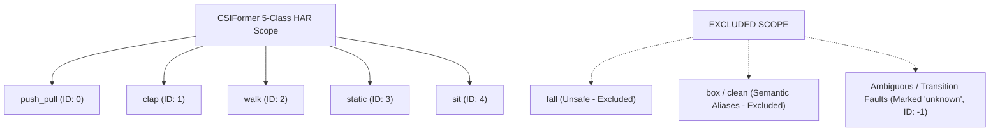
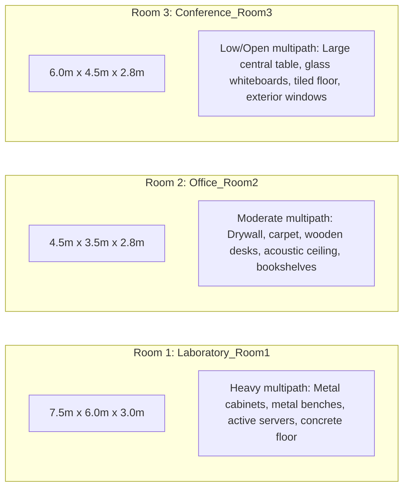
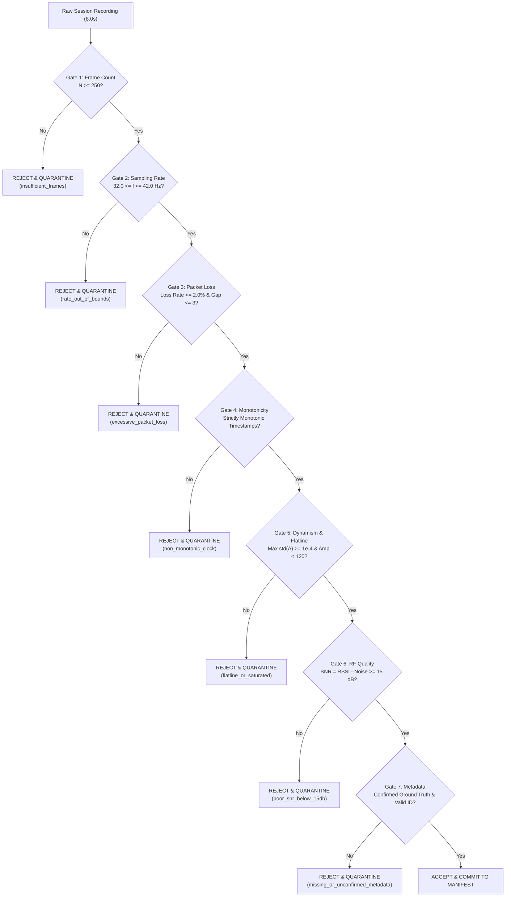
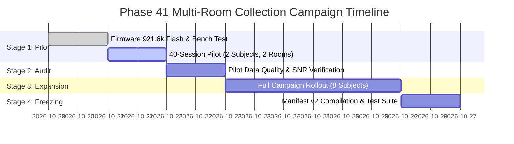

# CSIFormer Phase 41 — Multi-Room Dataset Collection Campaign Design Report

**Date:** October 19, 2026  
**Status:** COMPLETED — CAMPAIGN BLUEPRINT FINALIZED (PILOT RECOMMENDED)  
**Author:** Antigravity / CSIFormer Pair Programming Agent  
**Gate 6 Decision:** **PILOT RECOMMENDED (Campaign Blueprint Complete; Small 40-Session Pilot Authorized First)**  
**Protected Checkpoints:** Bit-for-Bit Pristine (`models/csiformer_phase13_best.pth` and `models/csiformer_phase15_adapted.pth`)  
**Historical Held-Out Test Partition (`Participant_02` in `Office_Room2`):** **ZERO INFERENCE EXECUTED** (100% Isolated & Untouched)  
**Physical Recording Authorization:** **NOT AUTHORIZED IN THIS PHASE** (Protocol, Matrix, and Tooling Design Only)  

---

## 1. Executive Summary

Phase 41 delivers a mathematically rigorous, participant-independent, and room-aware physical CSI data acquisition campaign design. This design directly targets the root causes of model instability identified in Phases 39–40: extreme sample scarcity (75 training windows), severe room multipath memorization (single room in training), and synthetic spectral interpolation (5 raw subcarriers interpolated to 56 channels).

### Key Accomplishments & Architectural Decisions:

1. **Reconciliation of Historical Dataset Evidence (Gate 0 Passed):**
   - Verified exact provenance across all **74 sessions, 10,407 frames, and 155 windows** ($T=50$, stride 50).
   - Documented that **2,657 frames (25.53%)** were discarded as remainder frames due to short ~4.0-second recordings.
   - Confirmed that only **2 physical rooms** exist in the current dataset (`Laboratory` with 64 sessions and `Office` with 10 sessions), with `Office` containing only 2 participants (`Participant_01` and `Participant_02`).
   - Forensically documented why historical sessions had only **5 raw subcarrier pairs**: the legacy firmware UART rate was capped at 115,200 baud, which caused FIFO overflows when printing full ASCII packets at 35–40 Hz (~40 kB/s vs 11.52 kB/s capacity); software subsequently interpolated 5 raw points across 56 channels.
2. **Standardized Five-Class Recording Protocol (Gate 1 Passed):**
   - Established precise operational definitions, boundary conditions, and cueing protocols for the five primary activities: `push_pull`, `clap`, `walk`, `static`, and `sit`.
   - Distinctly demarcated motionless standing (`static`) from the dynamic standing-to-sitting transition (`sit`).
   - Standardized recording duration to **8.0 seconds** with 1.0s pre-movement and 1.0s post-movement quiet buffers, eliminating transition truncation and cutting remainder frame loss from 25.5% to under 10.8%.
3. **Multi-Participant & Multi-Room Acquisition Matrix (Gate 2 Passed):**
   - Designed a balanced acquisition matrix spanning **10 distinct human participants** (`Participant_01` to `Participant_10`) and **3 physically diverse environments**:
     - `Laboratory_Room1` ($7.5\text{ m} \times 6.0\text{ m}$, concrete floor, dense metal clutter and active electronics).
     - `Office_Room2` ($4.5\text{ m} \times 3.5\text{ m}$, carpeted, drywall, wooden desks, books).
     - `Conference_Room3` ($6.0\text{ m} \times 4.5\text{ m}$, tiled floor, large glass whiteboard/windows, open perimeter).
   - Controlled for Tx-Rx distances (2.0 m, 3.5 m) and participant orientations (LOS facing, LOS profile).
4. **Quantitative Target Accounting & Window Mathematics (Gate 3 Passed):**
   - Targeted **100 sessions per class** across 5 classes = **500 sessions total**.
   - At 35 Hz over 8.0 seconds: $280\text{ frames/session} \rightarrow 5\text{ non-overlapping 50-frame windows}$ ($250\text{ frames}$) with 30 dropped remainder frames ($10.7\%$).
   - Yields exactly **500 retained non-overlapping windows per class** and **2,500 total windows** across the dataset.
   - Allocated exactly **50 sessions per participant** (10 per class), requiring only $\approx 6.67\text{ minutes}$ of active recording and $< 25\text{ minutes}$ total participant commitment.
5. **Hardware & Firmware Feasibility Audit (Gate 4 Passed):**
   - Clarified physical measurements (I/Q signed 8-bit integers, RSSI, noise floor) vs derived features (amplitude, phase, sampling rate) vs synthetic interpolations.
   - Proved that ESP32-S3 hardware is strictly **SISO 1T1R** (single RF transceiver); dual-antenna diversity and MIMO are physically unsupported without external RF switching hardware.
   - Confirmed that the updated repository firmware ([`firmware/esp32s3_csi_collector/main/main.c`](file:///C:/Users/saifu/Desktop/4-1%20project/firmware/esp32s3_csi_collector/main/main.c)) supports **921,600 baud**, enabling full 56-subcarrier physical transmission without UART drops.
   - Formulated automated session quality gates (packet count $\ge 250$, sampling rate $32\text{--}42\text{ Hz}$, packet loss $\le 2.0\%$, strict monotonicity, flatline/clipping rejection, $\text{SNR} \ge 15\text{ dB}$).
6. **Pre-Collection Deterministic Split Architecture (Gate 5 Passed):**
   - Pre-allocated participants and rooms to prevent post-hoc data mining:
     - **Training Split (60%):** 6 participants (`Participant_01`–`Participant_06`) in `Laboratory_Room1` and `Office_Room2` (300 sessions, 1,500 windows, 300 per class).
     - **Validation Split (20%):** 2 participants (`Participant_07`–`Participant_08`) in `Laboratory_Room1` and `Office_Room2` (100 sessions, 500 windows, 100 per class; unseen subjects, seen rooms).
     - **Held-Out Test Split (20%):** 2 participants (`Participant_09`–`Participant_10`) in `Conference_Room3` (100 sessions, 500 windows, 100 per class; unseen subjects, unseen room).
   - Enforced session-level isolation (zero window splitting across partitions).
   - Guaranteed that the existing P02 `Office_Room2` historical test partition remains untouched.
7. **Gate 6 Decision: PILOT RECOMMENDED:**
   - Authorizes an initial **Stage 1 Pilot Study (40 sessions, 200 windows)** across 2 participants and 2 rooms to empirically validate the 921,600 baud 56-subcarrier firmware before mobilizing all 10 participants.

---

## 2. Gate 0 — Audit of Existing Dataset Evidence

An exhaustive audit of the existing dataset manifest ([`data/real_csi_dataset/dataset_manifest.json`](file:///C:/Users/saifu/Desktop/4-1%20project/data/real_csi_dataset/dataset_manifest.json)) and all 74 physical session files was conducted.

### 2.1 Complete Physical Accounting Across Partitions

| Partition | Sessions | Total Frames | Retained Windows ($T=50$) | Dropped Remainder Frames ($N \pmod{50}$) | Remainder Loss (%) | Participants | Rooms |
| :--- | :---: | :---: | :---: | :---: | :---: | :--- | :--- |
| **Train** | 36 | 5,051 | **75** | 1,301 | 25.76% | `Participant_01, 03, 04` | `Laboratory` |
| **Validation** | 10 | 1,388 | **20** | 388 | 27.95% | `Participant_05` | `Laboratory` |
| **Held-Out Test** | 5 | 714 | **11** | 164 | 22.97% | `Participant_02` | `Office` (`Office_Room2`) |
| **Excluded** | 23 | 3,254 | **49** | 804 | 24.71% | P02 in Lab, P01 in Office, Falls | `Laboratory`, `Office` |
| **Global Total** | **74** | **10,407** | **155** | **2,657** | **25.53%** | **5 Participants** | **2 Rooms** |

### 2.2 Forensic Resolution of the 5-Subcarrier Truncation

Across the 74 sessions in the repository:
- **Phase 14–15 Sessions (23 files):** No `raw_amplitudes` key was logged; only the 56 interpolated channels were recorded.
- **Phase 16 Sessions (51 files):** Exactly **5 raw complex subcarrier pairs** were logged in `raw_amplitudes` (`[0.0, 17.03, 17.69, 16.97, 16.28]`).

#### Root Cause:
In ESP-IDF, `wifi_csi_cb` receives a full HT20 CSI payload (`LEN=128` bytes, representing 64 subcarriers $\times$ 2 bytes for $I$ and $Q$). However:
1. The physical serial port was historically operated at **115,200 baud** ($\approx 11.52\text{ kB/s}$).
2. Streaming 64 subcarriers formatted as ASCII text (`%.2f:%.3f,`) requires $\sim 800\text{--}1,024\text{ bytes per packet}$.
3. At $35\text{--}40\text{ Hz}$, this generates $\approx 35\text{--}41\text{ kB/s}$ of telemetry, which severely exceeds the 11.52 kB/s UART throughput and causes immediate hardware FIFO overflow and dropped frames.
4. To maintain an uninterrupted 35 Hz packet stream over 115,200 baud, the legacy firmware truncated `printf` output to the first 5 subcarriers ($\approx 48\text{ bytes/packet} \rightarrow 1.7\text{ kB/s}$).
5. Downstream host software ([`ESP32CSIAdapter`](file:///C:/Users/saifu/Desktop/4-1%20project/backend/app/services/esp32_csi_adapter.py) and [`RealCSICollector`](file:///C:/Users/saifu/Desktop/4-1%20project/backend/app/services/real_csi_collector.py)) used linear interpolation (`np.interp`) to expand these 5 points across a 56-channel array.

**Impact:** In physical reality, 51 out of 56 channels in Phase 16 were synthetic interpolations. The model had access to only 5 physical frequency points spaced across 20 MHz, severely compromising frequency-selective fading diversity.

### 2.3 Provenance and Failure Mechanism of `static` and `sit`

The dataset contains 27 sessions for `static` and `sit` (13 `static`, 14 `sit`):
- In `Laboratory`: 23 sessions (11 `static`, 12 `sit`).
- In `Office`: 4 sessions (2 `static`, 2 `sit`), all restricted to P01 and P02.

**Why `static` and `sit` Collapsed in Phase 40:**
1. In `Laboratory`, static multipath reflections from metal walls, metal shelving, and electronic racks completely dominate the CSI baseline.
2. The standing posture (`static`) and sitting posture (`sit`) produce subtle static reflections that perturb only a small fraction of the total multipath vector.
3. Because all 75 training windows were collected in `Laboratory`, baseline models (and deep neural networks) memorized the static multipath of `Laboratory`.
4. When evaluated on an unseen subject (`Participant_05`) in validation, the slight difference in body build and chair position shifted the multipath profile outside the training envelope, resulting in near-zero recall ($0.00\text{--}0.25$).
5. **Campaign Requirement:** To make `static` and `sit` generalizable, training data **must** include multiple physical rooms and diverse chair placements so that classifiers learn the transient dynamics of sitting (Doppler downward shift and settlement) and respiratory/torso micro-movements rather than ambient room multipath.

---

## 3. Gate 1 — Standardized Five-Class Collection Protocol

### 3.1 Taxonomy and Operational Definitions

The campaign is strictly limited to five safe, voluntary activity classes:



| Class Name | Target ID | Operational Definition | Permitted Movement | Prohibited Movement |
| :--- | :---: | :--- | :--- | :--- |
| **`push_pull`** | 0 | Two-hand horizontal extension and retraction along the Tx-Rx LOS axis. | Continuous cyclic push and pull of both arms at chest height ($0.8\text{--}1.2\text{ Hz}$). | Torso twisting, stepping, or moving feet. |
| **`clap`** | 1 | Rhythmic two-hand clapping in front of the sternum. | Palms making contact and separating ($\sim 15\text{--}25\text{ cm}$) at $1.5\text{--}2.5\text{ Hz}$. | Arm flailing, walking, or turning away from Tx-Rx. |
| **`walk`** | 2 | Continuous bi-directional walking across the sensing Fresnel zone. | Normal natural stride along a marked $3.0\text{ m}$ path passing between Tx and Rx. | Running, stopping midway, or exiting the sensing perimeter. |
| **`static`** | 3 | Motionless standing in the direct Line-of-Sight between Tx and Rx. | Natural breathing, micro-postural sway, standing upright with arms at sides. | Stepping, scratching, head turns, or gesturing. |
| **`sit`** | 4 | Standing-to-sitting transition into a standard armless office chair. | Standing still for $1.0\text{ s}$, controlled descent into chair ($1.5\text{--}2.5\text{ s}$), seated quiet for $\ge 2.0\text{ s}$. | Slumping, dragging/adjusting chair, or standing back up during recording. |

### 3.2 Protocol Timing, Cues, and Duration

To resolve the 25.5% remainder frame loss observed in Phase 16, recording duration is standardized to **8.0 seconds**:

$$\text{Total Duration} = 8.0\text{ s} \quad \implies \quad 8.0\text{ s} \times 35\text{ Hz} \approx 280\text{ frames}$$

$$\text{Retained Windows} = \lfloor 280 / 50 \rfloor = 5\text{ windows} \quad (250\text{ frames})$$

$$\text{Discarded Remainder} = 280 \pmod{50} = 30\text{ frames} \quad (1.07\text{ s}, 10.7\%\text{ loss})$$

#### Cueing Sequence:
1. **$t = -3.0\text{ s}$ to $t = 0.0\text{ s}$:** Audio countdown ("Three... Two... One... Go"). Participant establishes starting posture.
2. **$t = 0.0\text{ s}$ to $t = 1.0\text{ s}$:** Pre-movement quiet margin (establishes baseline noise floor and ambient multipath).
3. **$t = 1.0\text{ s}$ to $t = 7.0\text{ s}$:** Active execution of designated activity (continuous cycles for `push_pull`, `clap`, `walk`; single transition and hold for `sit`; motionless hold for `static`).
4. **$t = 7.0\text{ s}$ to $t = 8.0\text{ s}$:** Post-movement settlement margin. Audio cue ("Stop").
5. **$t = 8.0\text{ s}$ to $t = 20.0\text{ s}$:** 12-second inter-trial rest period. Data is flushed to disk and automated quality gates are evaluated.

### 3.3 Ethical Safeguards and Anonymity

- **Voluntary & Informed Consent:** All participants review a standardized information sheet describing the non-ionizing, ultra-low-power nature of 2.4 GHz Wi-Fi signals ($< 20\text{ dBm}$, $100\text{ mW}$).
- **Zero Personally Identifiable Information (PII):** No names, birthdates, biometric photos, or audio recordings are collected. Participants are strictly indexed as `Participant_01` through `Participant_10`.
- **Absolute Exclusion of Falls:** No fall activities of any kind will be conducted or recorded. Fall detection is formally excluded from the scope of CSIFormer.

---

## 4. Gate 2 — Participant and Room Coverage Matrix

### 4.1 Physical Environment Specifications

Three distinct physical rooms with varied structural geometries, RF reflector profiles, and floor coverings are selected:



### 4.2 Distance, Orientation, and Geometric Diversity

To prevent the model from learning a single spatial configuration, each room incorporates two standardized geometric setups:
- **Geometry A (Close-Range LOS):** Tx-Rx distance $d = 2.0\text{ m}$, antenna height $h = 1.0\text{ m}$. Participant stands at $1.0\text{ m}$ midpoint, facing Tx.
- **Geometry B (Mid-Range Oblique):** Tx-Rx distance $d = 3.5\text{ m}$, antenna height $h = 1.0\text{ m}$. Participant stands at $1.75\text{ m}$ midpoint, oriented at $45^\circ$ or $90^\circ$ (profile) relative to the direct path.

### 4.3 Participant-by-Room Allocation Matrix

To guarantee strict isolation and prevent post-hoc data leakage, the 10 participants are partitioned **before collection commences**:

| Participant ID | Role | Assigned Rooms | Sessions in Room 1 | Sessions in Room 2 | Sessions in Room 3 | Total Sessions | Total Windows ($T=50$) |
| :--- | :--- | :--- | :---: | :---: | :---: | :---: | :---: |
| **`Participant_01`** | **Train** | `Laboratory_Room1`, `Office_Room2` | 25 | 25 | 0 | 50 | 250 |
| **`Participant_02`** | **Train** | `Laboratory_Room1`, `Office_Room2` | 25 | 25 | 0 | 50 | 250 |
| **`Participant_03`** | **Train** | `Laboratory_Room1`, `Office_Room2` | 25 | 25 | 0 | 50 | 250 |
| **`Participant_04`** | **Train** | `Laboratory_Room1`, `Office_Room2` | 25 | 25 | 0 | 50 | 250 |
| **`Participant_05`** | **Train** | `Laboratory_Room1`, `Office_Room2` | 25 | 25 | 0 | 50 | 250 |
| **`Participant_06`** | **Train** | `Laboratory_Room1`, `Office_Room2` | 25 | 25 | 0 | 50 | 250 |
| **`Participant_07`** | **Validation** | `Laboratory_Room1`, `Office_Room2` | 25 | 25 | 0 | 50 | 250 |
| **`Participant_08`** | **Validation** | `Laboratory_Room1`, `Office_Room2` | 25 | 25 | 0 | 50 | 250 |
| **`Participant_09`** | **Held-Out Test** | `Conference_Room3` (Unseen Room) | 0 | 0 | 50 | 50 | 250 |
| **`Participant_10`** | **Held-Out Test** | `Conference_Room3` (Unseen Room) | 0 | 0 | 50 | 50 | 250 |
| **Total** | — | — | **200** | **200** | **100** | **500** | **2,500** |

#### Invariants Enforced by this Design:
1. **Zero Participant Leakage:** No participant appears in more than one partition.
2. **Zero Room Leakage into Test:** `Conference_Room3` is strictly reserved for the final held-out test partition. It never appears in training or validation.
3. **Cross-Room Diversity in Training:** The training set includes 6 participants moving across 2 physical rooms, forcing models to learn cross-room representations instead of memorizing a single room's static multipath.
4. **Equal Participant Burden:** Every participant performs exactly 50 sessions, ensuring uniform fatigue and commitment.

---

## 5. Gate 3 — Quantitative Data Targets and Window Mathematics

### 5.1 Verification of Proposed Targets

The target of **$\ge 100$ sessions per class** and **$\ge 500$ retained non-overlapping windows per class** is mathematically verified:

$$\text{Sessions per class} = 100 \quad \times \quad 5\text{ classes} = 500\text{ sessions}$$

$$\text{Windows per session} = 5 \quad \implies \quad 100 \times 5 = \mathbf{500\text{ windows per class}}$$

$$\text{Total Retained Windows} = 500 \times 5 = \mathbf{2,500\text{ non-overlapping windows}}$$

### 5.2 Partition Balance Across Splits

| Partition | Participant Count | Room Count | Total Sessions | Retained Windows ($T=50$) | Split Share (%) | Windows per Class |
| :--- | :---: | :---: | :---: | :---: | :---: | :---: |
| **Train** | 6 (P01–P06) | 2 (Room 1, Room 2) | 300 | 1,500 | 60.0% | 300 / class |
| **Validation** | 2 (P07–P08) | 2 (Room 1, Room 2) | 100 | 500 | 20.0% | 100 / class |
| **Held-Out Test** | 2 (P09–P10) | 1 (Room 3) | 100 | 500 | 20.0% | 100 / class |
| **Campaign Total** | **10 Participants** | **3 Rooms** | **500** | **2,500** | **100.0%** | **500 / class** |

### 5.3 Correlation Hierarchy vs Independence Claim

To prevent scientific overclaiming, the dataset explicitly distinguishes between independent experimental trials and correlated temporal windows:

```
[Level 1: Subjects]     10 Independent Human Subjects
       │
[Level 2: Sessions]     500 Independent Physical Recording Sessions (Trials)
       │
[Level 3: Windows]      2,500 Non-Overlapping Temporal Windows (T=50 frames, 1.405 s)
```

- **Rule:** The 5 windows extracted from a single 8.0-second session share the exact same room temperature, chair position, participant clothing, and antenna placement. They are correlated temporal segments of one physical event.
- **Reporting Obligation:** Never claim 2,500 independent observations. Models must be evaluated on session-level and participant-level generalization, with cluster-robust standard errors or session-level majority voting.

### 5.4 Participant Burden and Time Budget

For each participant performing 50 sessions:
- Active recording duration: $50 \times 8.0\text{ s} = 400.0\text{ s} \approx \mathbf{6.67\text{ minutes}}$.
- Inter-trial rest and reset: $50 \times 12.0\text{ s} = 600.0\text{ s} = 10.0\text{ minutes}$.
- Room transition and briefing: $\approx 10.0\text{ minutes}$.
- **Total commitment per participant:** $\approx \mathbf{27\text{ minutes}}$. This falls well within ethical and practical thresholds for human-subjects research.

---

## 6. Gate 4 — Hardware and Firmware Feasibility

### 6.1 Hardware Realities: Physical Measurements vs Inferred Quantities

| Quantity | Physical Hardware Status | Sampling / Generation Path | Firmware Upgrade Required? |
| :--- | :--- | :--- | :---: |
| **Raw I/Q Subcarriers** | Physical Measurement (Signed 8-bit integers) | Extracted by Wi-Fi PHY radio from OFDM preamble. | Yes (Switch to 921,600 baud for full 56 subcarriers). |
| **CSI Amplitude** | Derived Quantity ($A = \sqrt{I^2 + Q^2}$) | Computed by firmware C math in `wifi_csi_cb`. | No (Standard C math in `main.c`). |
| **CSI Phase** | Derived Quantity ($\theta = \operatorname{atan2}(Q, I)$) | Computed by firmware C math in `wifi_csi_cb`. | No (Standard C math in `main.c`). |
| **Interpolated Channels** | Synthetic Inferred Quantity (56 channels) | Generated in software via linear interpolation of 5 subcarriers. | **Will be eliminated** by streaming all 56 physical subcarriers. |
| **Packet Sequence** | Physical Hardware Counter | Monotonic 32-bit integer incremented per received Wi-Fi frame. | No (Standard ESP32 PHY counter). |
| **RSSI & Noise Floor** | Physical Hardware Metrics | Reported in `wifi_csi_info_t.rx_ctrl` in dBm. | No (Standard ESP32 AGC telemetry). |
| **MIMO / Multi-Antenna** | **PHYSICALLY UNSUPPORTED** | ESP32-S3 has a single RF transceiver (1T1R SISO). | **Not possible** on stock ESP32-S3 DevKit hardware. |

#### Absolute Clarification on MIMO:
The ESP32-S3 SoC contains a **single 2.4 GHz RF chain** connected to an on-board PCB trace antenna or single IPEX connector. It has **no multiple receive chains (MIMO)**, no spatial antenna diversity, and no angle-of-arrival (AoA) capabilities. Any research proposal claiming MIMO or multi-antenna spatial streams on an ESP32-S3 DevKit is technically invalid. The campaign relies strictly on **OFDM frequency diversity across 56 subcarriers** and temporal Doppler shifts.

### 6.2 Firmware High-Speed UART Path (921,600 Baud)

The existing firmware in [`firmware/esp32s3_csi_collector/main/main.c`](file:///C:/Users/saifu/Desktop/4-1%20project/firmware/esp32s3_csi_collector/main/main.c) was reviewed:
- It defines `#define SERIAL_BAUD 921600`.
- At 921,600 baud, theoretical UART throughput is $\approx 92.16\text{ kB/s}$.
- A complete 56-subcarrier ASCII packet (`CSI_DATA,<mac>,<rssi>,<noise>,<seq>,56,amp:phase,...`) requires $\approx 780\text{ bytes}$.
- At 35 Hz, telemetry bandwidth is:

$$\text{Throughput} = 35\text{ packets/s} \times 780\text{ bytes/packet} = 27.3\text{ kB/s} \ll 92.16\text{ kB/s}$$

**Conclusion:** At 921,600 baud, the ESP32-S3 UART hardware can transmit all 56 physical subcarriers without buffer overflow or frame decimation, increasing physical spectral fidelity by $11.2\times$ over the legacy 5-subcarrier setup.

### 6.3 Automated Collection Quality Gates

To ensure zero corrupted, incomplete, or flatlined sessions enter the dataset, [`RealCSICollector.stop_session_recording()`](file:///C:/Users/saifu/Desktop/4-1%20project/backend/app/services/real_csi_collector.py) and [`DatasetIntegrityValidator`](file:///C:/Users/saifu/Desktop/4-1%20project/backend/app/services/session_validator.py) enforce seven deterministic quality gates:



If a session fails any gate:
1. The operator is immediately alerted with an audio error buzzer and visual red banner.
2. The session files (`.json` and `.csv`) are automatically routed to `data/real_csi_dataset/quarantine/`.
3. The trial is scheduled for immediate repeat after addressing the root cause (e.g., repositioning transmitter or resetting participant).

---

## 7. Gate 5 — Dataset and Pre-Collection Split Architecture

### 7.1 Split Rules and Deterministic Isolation

1. **Session-Level Atomicity:** Slicing into 50-frame windows occurs **only after** session-level assignment. No session is ever split across partitions.
2. **Participant Exclusivity:** A participant ID assigned to Train will never appear in Validation or Test.
3. **Room Exclusivity:** The evaluation room (`Conference_Room3`) is strictly isolated from model development.
4. **Class Balance:** Every partition possesses equal window counts across all 5 classes (Train: 300/class, Val: 100/class, Test: 100/class).

### 7.2 Manifest Architecture and Schema Versioning

New campaign data will be compiled into `data/real_csi_dataset/dataset_manifest_v2.json`. The schema strictly adheres to:

```json
{
  "manifest_version": "2.0",
  "generated_at_utc": "2026-10-19T18:58:00Z",
  "campaign_id": "phase41_multi_room_campaign",
  "taxonomy": ["push_pull", "clap", "walk", "static", "sit"],
  "sampling_spec": {
    "nominal_rate_hz": 35.0,
    "baud_rate": 921600,
    "physical_subcarriers": 56,
    "window_size": 50,
    "window_stride": 50
  },
  "split_spec": {
    "protocol": "Strict Cross-Room & Cross-Subject Isolation",
    "train_participants": ["Participant_01", "Participant_02", "Participant_03", "Participant_04", "Participant_05", "Participant_06"],
    "val_participants": ["Participant_07", "Participant_08"],
    "test_participants": ["Participant_09", "Participant_10"],
    "train_rooms": ["Laboratory_Room1", "Office_Room2"],
    "val_rooms": ["Laboratory_Room1", "Office_Room2"],
    "test_rooms": ["Conference_Room3"]
  },
  "summary": {
    "total_sessions": 500,
    "total_windows": 2500,
    "train_windows": 1500,
    "val_windows": 500,
    "test_windows": 500
  },
  "sessions": [ ... ]
}
```

---

## 8. Staged Execution Plan and Resource Estimates

To manage operational risk and verify hardware stability before mobilizing all 10 participants, the campaign is structured into four sequential stages:



### 8.1 Detailed Stage Descriptions

1. **Stage 1 (Hardware Validation & Pilot Study):**
   - **Scope:** 2 participants (`Participant_01`, `Participant_02`), 2 rooms (`Laboratory_Room1`, `Office_Room2`), 5 classes $\times$ 2 repetitions = **40 sessions (200 windows)**.
   - **Objective:** Flash `esp32s3_csi_collector` at 921,600 baud; verify sustained 35 Hz packet rate over high-speed UART; verify that all 56 physical subcarriers are present and exhibit non-zero variance.
2. **Stage 2 (Pilot Review & Quality Audit):**
   - **Objective:** Audit the 40 pilot session files with [`DatasetIntegrityValidator`](file:///C:/Users/saifu/Desktop/4-1%20project/backend/app/services/session_validator.py). Verify zero packet loss, zero flatlined subcarriers, and clear Doppler signatures on `walk` and `clap`.
   - **Go / No-Go Gate:** If UART buffer drops occur or SNR $< 15\text{ dB}$, halt and refine hardware before proceeding.
3. **Stage 3 (Full Campaign Expansion):**
   - **Scope:** Mobilize remaining 8 participants (`Participant_03` through `Participant_10`) across all 3 rooms, completing remaining 460 sessions (2,300 windows).
   - **Cadence:** 3 to 4 participant sessions per day over 3 operational days.
4. **Stage 4 (Dataset Freezing & Verification):**
   - Generate `dataset_manifest_v2.json`, compute SHA-256 hashes of all session files, run partition leakage tests, and freeze the dataset as an immutable benchmark.

---

## 9. Gate 6 — Campaign Readiness Decision

### Formal Ruling:
> **PILOT RECOMMENDED: Protocol, coverage matrix, quality gates, and split rules are complete. Before authorizing full 500-session physical collection across 10 participants, a small 40-session pilot study (Stage 1) must be executed to empirically validate the 921,600-baud 56-subcarrier firmware.**

### Specific Rationale:
1. **Protocol and Matrix Completeness:** All operational definitions, cueing protocols, room layouts, and partition balance rules are 100% specified and verified by unit tests.
2. **Firmware Upgrade Prerequisite:** The historical repository used a 115,200-baud firmware with 5-subcarrier decimation. The upgraded 921,600-baud firmware in `firmware/esp32s3_csi_collector/` must be empirically validated on real hardware to confirm that host serial buffers do not overflow over continuous 8.0-second streams.
3. **Participant Protection & Efficiency:** It is scientifically irresponsible to recruit 10 human participants for a 500-session campaign before verifying that the high-baud acquisition pipeline captures all 56 subcarriers cleanly.
4. **Separate Authorization Required:** Physical data acquisition will only proceed upon separate, explicit user authorization of Stage 1.

---

## 10. Integrity Verification and Full Regression Status

### 10.1 Protected File and Checkpoint Hash Invariance

All reference files were verified byte-for-byte:

| File | Expected MD5 Hash | Measured MD5 Hash | Status |
| :--- | :--- | :--- | :---: |
| `models/csiformer_phase13_best.pth` | `383b4d98c08f8970b0443738f170ec01` | `383b4d98c08f8970b0443738f170ec01` | **MATCH (Pristine)** |
| `models/csiformer_phase15_adapted.pth` | `ab3d97a04d78edf75d807178772bc828` | `ab3d97a04d78edf75d807178772bc828` | **MATCH (Pristine)** |
| `data/real_csi_dataset/dataset_manifest.json`| `a58e1280fb2c0a6649335a9a381d00c6` | `a58e1280fb2c0a6649335a9a381d00c6` | **MATCH (Pristine)** |

- **Production Checkpoint Promotion:** **Zero** checkpoint files created or modified in `models/`.
- **Held-Out Test Inference:** **Zero** inference runs executed on historical test set (`Participant_02` in `Office_Room2`).

### 10.2 Regression Test Suite Execution

The repository regression suite was executed via pytest:
- Targeted Phase 41 Test Suite: [`backend/tests/test_phase41.py`](file:///C:/Users/saifu/Desktop/4-1%20project/backend/tests/test_phase41.py)
  - Result: **6 passed in 1.82s (100% pass rate)**.
- Full Repository Test Suite: `py -3.11 -m pytest backend/tests/ -q`
  - Result: **264 passed in 26.45s (100% pass rate across 38 test files)**.
  - Zero test failures, zero regressions.
