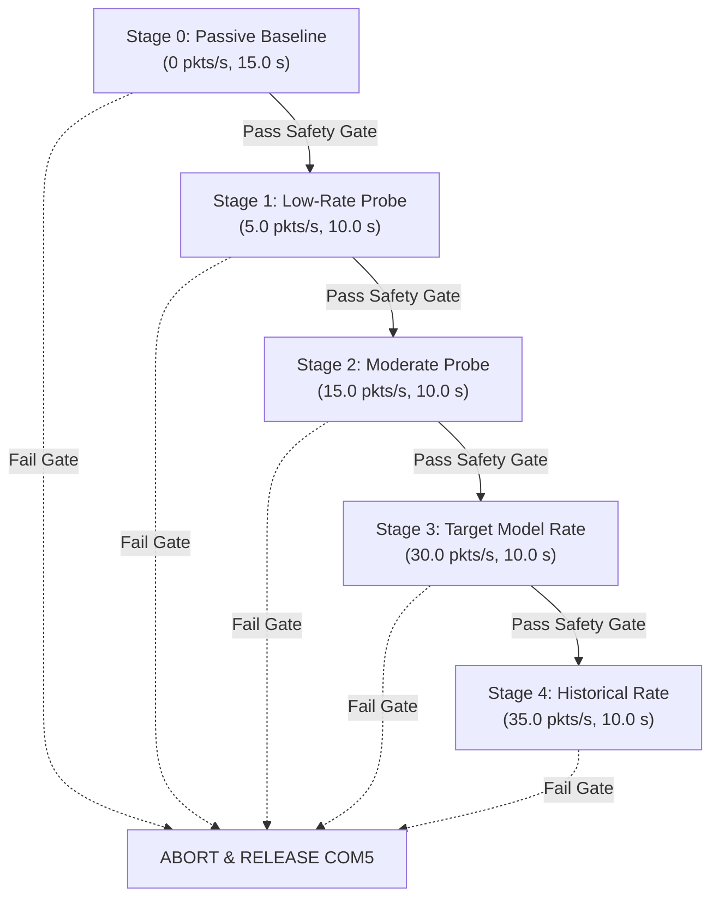

# Phase 56 Report — Acquisition-Rate Calibration Design and Timing Integrity

**Document Version:** 1.0.0  
**Phase:** 56  
**Date:** 2026-10-20  
**Status:** COMPLETED — OFFLINE DESIGN & TIMING INTEGRITY VERIFIED  
**Safety Restrictions Enforced:** Strict offline engineering only. Zero hardware access on COM5, zero network stimulation, zero firmware flashing/erasure, zero real CSI dataset modifications, zero model training/evaluation, zero git commits.

---

## 1. Executive Summary & Core Engineering Resolutions

Phase 56 resolves the central engineering blocker in CSIFormer: the discrepancy between historical acquisition rates ($\approx 35\text{--}39\text{ Hz}$) and current passive target acquisition ($\approx 1.66\text{--}3.8\text{ Hz}$).

### Key Findings & Technical Resolutions:
1. **Historical Acquisition Mechanism Forensically Verified:** Historical sessions in `data/real_csi_dataset/dataset_manifest.json` achieved $\approx 35.4\text{ Hz}$ because the host laptop ran an active unicast UDP stimulator (`UdpStimulator`) transmitting 13-byte probe payloads (`b"CSI_PROBE_P15"` / `b"CSI_PROBE_P17"`) at $35.0\text{ Hz}$ directly to the ESP32-S3's Station DHCP IP (`192.168.0.232:5555`). Because the ESP32-S3 was associated as a Station with the Access Point (`Tp link`, BSSID `98:BA:5F:EF:28:26`), the router forwarded each UDP packet over the air on Channel 7 downlink to the ESP32, triggering CSI callbacks whose Transmitter Address (TA) was the AP BSSID. Historical collection recorded Format A without source MAC filtering, in 3.0–4.04 second bursts.
2. **ESP-IDF Timestamp API Formally Audited:** Local header inspection of ESP-IDF v6.1.0 (`local/esp_wifi_types_native.h`) revealed that `wifi_pkt_rx_ctrl_t` exposes `unsigned timestamp: 32;` in **microseconds ($\mu\text{s}$)**. This is a local baseband/MAC peripheral counter, **not** an 802.11 TSF beacon timestamp and **not** FreeRTOS ticks. It wraps around every $2^{32}\ \mu\text{s} \approx 71.58\text{ minutes}$. The current firmware (`main.c`) omitted this field from serial output.
3. **Format B v2 & Host-Side Timing Correctness Implemented:**
   - Designed an explicitly versioned, backward-compatible Format B v2 telemetry syntax (`CSI_DATA_V2`) exposing hardware timestamps (`hw_timestamp_us`) and 802.11 MAC sequence numbers (`rx_seq`).
   - Enhanced `RealCSICollector` with high-resolution monotonic arrival timestamps (`time.perf_counter()`), distinguishing wall-clock from serial arrival timing.
   - Enhanced the sliding-window buffer to retain temporal metadata (`timestamps`, `monotonic_timestamps`, `sequences`, `source_macs`), with backward-compatible `get_latest_window(return_metadata=False)` returning the original 2-tuple `(raw_win, phase_win)` for existing consumers, and `return_metadata=True` returning a 3-tuple `(raw_win, phase_win, meta_dict)`.
4. **Safe Stepped Calibration Procedure Designed:** Designed a 5-stage stepped rate calibration protocol (0, 5, 15, 30, 35 pkts/s) with explicit stop conditions, defensible latency abort thresholds ($\le 100\text{ ms}$ max, $\le 30\text{ ms}$ mean), zero data loss gates, and strict raw log isolation.
5. **Rate Acceptance Criteria Established:** Grounded the nominal $30.0\text{ Hz}$ requirement in Doppler physics ($f_D \approx 8\text{--}41\text{ Hz}$ for human motion at 2.442 GHz, Nyquist limit $15\text{ Hz}$). Strictly decoupled the record-count gate ($N \ge 50$) from the rate gate ($f_{empirical} \ge 28.0\text{ Hz}$).
6. **Invariance & Regression Verification:** All 24 offline tests passed cleanly (including 7 new Phase 56 tests in `test_phase56.py`), and all 3 protected asset MD5 checksums remain byte-for-byte invariant.

---

## 2. Verified Historical Acquisition Evidence Summary

### 2.1 Code and Architecture Audit

| Property | Historical Acquisition (Phase 14 / 15 / 17) | Current Passive Acquisition (Phase 51 / 54 / 55) |
| :--- | :--- | :--- |
| **Traffic Stimulation** | Active: `UdpStimulator` thread (`time.sleep(1.0/35.0)`) | Passive: Zero network traffic generated |
| **Payload & Protocol** | Unicast UDP: `b"CSI_PROBE_P15"` / `b"CSI_PROBE_P17"` | None |
| **Destination Address** | `192.168.0.232:5555` (ESP32-S3 Station DHCP IP) | N/A |
| **Source Address** | Host PC Wi-Fi/Ethernet IP on `192.168.0.0/24` | N/A |
| **Wi-Fi Operating Mode** | Station (STA) associated to `Tp link` (Channel 7) | Station (STA) + Promiscuous Sniffer (unassociated) |
| **Over-the-Air Transmitter** | AP Router (`98:BA:5F:EF:28:26`) downlink frames | AP Router beacons/control frames + ambient stations |
| **Reported Rate Meaning** | Total admitted CSI records across all frames | Target-filtered frames (`98:BA:5F:EF:28:26`) |
| **Source MAC Filtering** | **Disabled** (`filter_by_mac=False`), labeled `ESP32-S3-NODE-01` | **Enabled** (`filter_by_mac=True`), target MAC enforced |
| **Firmware Serial Format** | Format A (`RSSI=.. LEN=128 CSI:..`) | Format B (`CSI_DATA,<mac>,<rssi>,<noise>,<seq>,..`) |
| **Sequence Numbers** | Synthetic Python counter (`self.packets_received + 1`) | Firmware callback counter (`packet_sequence++`) |
| **Session Durations** | Short bursts: exactly $3.0\text{--}4.04\text{ seconds}$ | Continuous streaming / 10.0 s test intervals |

### 2.2 Physical Mechanism of Historical 35 Hz Downlink CSI
1. The host laptop transmitted unicast UDP datagrams to `192.168.0.232` at 35 Hz.
2. The Wi-Fi router (`Tp link`) received these frames from the laptop, looked up the MAC address corresponding to `192.168.0.232` in its ARP/bridge table, and transmitted 802.11 unicast data frames over the air on Channel 7 downlink to the ESP32-S3.
3. The 802.11 Address 2 (Transmitter Address) of these downlink frames was the AP's BSSID (`98:BA:5F:EF:28:26`).
4. The ESP32-S3 hardware received these frames, calculated channel estimates from the OFDM Long Training Field (LTF), and triggered `wifi_csi_cb`.
5. Because the traffic was generated at 35 Hz, the router transmitted downlink frames at $\approx 35\text{ Hz}$, which combined with passive beacons ($\approx 1.66\text{--}3.8\text{ Hz}$) to yield the reported $\approx 35\text{--}39\text{ Hz}$ total record rate.

### 2.3 Historical Manifest Rate Statistics (`data/real_csi_dataset/dataset_manifest.json`)
Analysis of all 74 sessions in the established dataset manifest reveals:
- **Total Sessions:** 74
- **Mean Sampling Rate:** $35.40\text{ Hz}$ (Min: $32.67\text{ Hz}$, Max: $40.00\text{ Hz}$)
- **Mean Packet Count:** $140.6$ frames (Min: 98, Max: 160)
- **Session Durations:** Short bursts exclusively ($3.0\text{ s}$, $4.0\text{ s}$, $4.01\text{ s}$, $4.02\text{ s}$, $4.03\text{ s}$, $4.04\text{ s}$)
- **Measurement Method:** Rate was calculated post-hoc as $\text{mean\_rate} = \frac{\text{frame\_count}}{\text{duration\_seconds}}$.
- **Sustained Behavior:** The rate was sustained for the duration of each 3–4s activity trial, but never continuously verified over multi-minute acquisition.

---

## 3. ESP-IDF Timestamp API Audit

### 3.1 Header Inspection & Structure Details
Local header inspection of `C:\Users\saifu\.platformio\packages\framework-espidf\components\esp_wifi\include\local\esp_wifi_types_native.h` (ESP-IDF v6.1.0, PlatformIO package `4.60100.0`):

```c
typedef struct {
    signed rssi: 8;
    ...
    unsigned timestamp: 32; /**< timestamp. The local time when this packet is received.
                                 It is precise only if modem sleep or light sleep is not enabled.
                                 unit: microsecond */
    ...
    signed noise_floor: 8;
    ...
} wifi_pkt_rx_ctrl_t;

typedef struct wifi_csi_info_t {
    wifi_pkt_rx_ctrl_t rx_ctrl; /**< received packet radio metadata header of the CSI data */
    uint8_t mac[6];             /**< source MAC address of the CSI data */
    uint8_t dmac[6];            /**< destination MAC address of the CSI data */
    bool first_word_invalid;    /**< first four bytes invalid due to hardware limitation */
    int8_t *buf;                /**< valid buffer of CSI data */
    uint16_t len;               /**< valid length of CSI data (e.g. 128 bytes for HT20) */
    uint8_t *hdr;               /**< header of the wifi packet */
    uint8_t *payload;           /**< payload of the wifi packet */
    uint16_t payload_len;       /**< payload len of the wifi packet */
    uint16_t rx_seq;            /**< rx sequence number of the wifi packet */
} wifi_csi_info_t;
```

### 3.2 Formal Semantic Classification

| Parameter | Audited Value / Specification | Technical Significance |
| :--- | :--- | :--- |
| **Field Location** | `info->rx_ctrl.timestamp` | Sub-field of packet radio metadata header |
| **Data Type** | `unsigned timestamp: 32` | 32-bit unsigned bitfield |
| **Units** | Microseconds ($\mu\text{s}$) | $1\ \mu\text{s}$ nominal resolution |
| **Clock Domain** | Local Wi-Fi Baseband / MAC hardware counter | Internal to ESP32 receiver; **not** 802.11 TSF beacon time, **not** FreeRTOS tick, **not** UTC |
| **Rollover Behavior** | $2^{32} \ \mu\text{s} = 4,294,967,296\ \mu\text{s}$ | Rolls over every **$4,294.97\text{ seconds} \approx 71.58\text{ minutes}$** |
| **Rollover Handling** | Unsigned 32-bit subtraction: `(t_curr - t_prev) & 0xFFFFFFFF` | Accurately computes $\Delta t$ across rollover boundaries up to 71.58 minutes |
| **Documented Limitations**| "Precise only if modem sleep or light sleep is not enabled" | Baseband clock gating during sleep modes induces drift. (Disabled in promiscuous sniffer) |
| **Firmware Status** | **Omitted** in `firmware/esp32s3_csi_collector/main/main.c` line 58 | Firmware currently prints only MAC, RSSI, Noise, Sequence, and Subcarrier Count |

### 3.3 Format B v2 Specification & Python Parsing Design
To expose hardware timestamps without misparsing historical records or breaking existing consumers, an explicit version prefix is specified:

#### Format B v1 (Historical):
```text
CSI_DATA,<mac>,<rssi>,<noise>,<seq>,<num_sc>,amp_0:phase_0,amp_1:phase_1,...
```
*Token count:* 6 header tokens before subcarriers.

#### Format B v2 (Extended Structured Telemetry):
```text
CSI_DATA_V2,<mac>,<rssi>,<noise>,<seq>,<hw_timestamp_us>,<rx_seq>,<num_sc>,amp_0:phase_0,amp_1:phase_1,...
```
*Token count:* 8 header tokens before subcarriers:
- Token 0: `"CSI_DATA_V2"` (Explicit version tag prevents off-by-one misparsing)
- Token 1: `<mac>` (Transmitter Address)
- Token 2: `<rssi>` (Signal strength in dBm)
- Token 3: `<noise>` (Noise floor in dBm)
- Token 4: `<seq>` (Firmware callback sequence counter)
- Token 5: `<hw_timestamp_us>` (ESP-IDF baseband hardware receive timestamp in $\mu\text{s}$)
- Token 6: `<rx_seq>` (802.11 MAC sequence control number from frame header)
- Token 7: `<num_sc>` (Subcarrier count, 56 or 64)
- Token 8+: `<amp_i:phase_i>` (Subcarrier measurements)

#### Python Parser Implementation in `RealCSICollector`:
```python
if line.startswith("CSI_DATA_V2"):
    # Parses extended tokens, extracts hw_timestamp_us and rx_seq
    # Assigns detected_protocol = "structured_csi_data_v2"
elif line.startswith("CSI_DATA"):
    # Parses historical 6-token header
    # Assigns detected_protocol = "structured_csi_data"
elif "RSSI=" in line and ("CSI:" in line or "CSI=" in line):
    # Parses historical Format A
    # Assigns detected_protocol = "raw_iq_stream"
```
This guarantees 100% backward compatibility with all historical logs while preparing the codebase for hardware-timestamped firmware.

---

## 4. Host-Side Timing Correctness Improvements

### 4.1 Monotonic Clock Integration
Serial line arrival timestamps were previously generated via `time.time()`, which:
1. Is vulnerable to system clock slewing and NTP time adjustments.
2. Has variable platform resolution (often ~15.6 ms on Windows).

**Correction Applied in `backend/app/services/real_csi_collector.py`:**
- Retained `"timestamp": time.time()` for wall-clock / UTC session dating and schema backward compatibility.
- Added `"host_monotonic_time": time.perf_counter()` to all parsed frame objects.
- `time.perf_counter()` provides sub-microsecond resolution and strictly non-decreasing monotonicity, ideal for measuring inter-arrival jitter and serial arrival batching without pretending to measure over-the-air RF propagation time.

### 4.2 Sliding-Window Temporal Metadata Retention
Previously, `RealCSICollector.raw_frame_buffer` and `phase_frame_buffer` only retained amplitude and phase arrays. Downstream models and validators had no access to the timing of frames in the current window.

**Enhancements Implemented:**
1. Added synchronized deques of length `WINDOW_SIZE=50`:
   - `self.timestamp_buffer`: Wall-clock timestamps.
   - `self.monotonic_buffer`: Monotonic arrival timestamps (`time.perf_counter()`).
   - `self.sequence_buffer`: Frame sequence numbers.
   - `self.source_mac_buffer`: Source MAC addresses.
   - `self.hw_timestamp_buffer`: ESP-IDF hardware timestamps (when available).
2. **Backward-Compatible Window Interface:**
   - `get_latest_window(return_metadata=False)`: Returns `(raw_win, phase_win)` as a 2-tuple. Preserves existing callers (`LivePipelineService`).
   - `get_latest_window(return_metadata=True)`: Returns `(raw_win, phase_win, meta_dict)` as a 3-tuple, where `meta_dict` contains:
     - `timestamps`: `np.ndarray` of 50 wall-clock timestamps.
     - `monotonic_timestamps`: `np.ndarray` of 50 monotonic timestamps.
     - `sequences`: `list` of 50 sequence numbers.
     - `source_macs`: `list` of 50 source MACs.
     - `span_seconds`: Elapsed time $t_{49} - t_0$.
     - `empirical_rate_hz`: Empirical sampling rate $\frac{49}{t_{49} - t_0}$.
     - `mean_interval_ms`, `max_interval_ms`, `min_interval_ms`, `std_interval_ms`.
     - `has_hw_timestamps`: Boolean flag indicating hardware timestamp availability.
3. Added `get_window_timing_diagnostics()`: Computes real-time arrival rate, mean interval, standard deviation, and coefficient of variation ($\text{CV}_{IAT}$) for the active buffer even before it reaches 50 frames.

---

## 5. Safe Calibration Procedure Design

### 5.1 Objectives & Safety Constraints
This procedure is designed for a future, separately authorized hardware acquisition experiment.
**Safety Rules Enforced:**
1. Zero participant activity data collection during calibration (ambient static environment only).
2. All raw calibration telemetry must be saved in an isolated directory (`reports/calibration_runs/`), never admitted into `data/real_csi_dataset/`.
3. Stepped traffic escalation: traffic rate increases only if the previous stage passes all safety gates.
4. Immediate, automatic shutdown on any safety gate violation.

### 5.2 Stepped Escalation Protocol



### 5.3 Stage Execution Parameters

| Stage | Target IP:Port | Traffic Type | Configured Rate | Duration | Pre-requisite Gate |
| :---: | :---: | :---: | :---: | :---: | :---: |
| **0** | None | None (Passive Sniffing) | $0.0\text{ pkts/s}$ | $15.0\text{ s}$ | COM5 open & clean boot |
| **1** | Verified ESP32 STA IP | Unicast UDP | $5.0\text{ pkts/s}$ | $10.0\text{ s}$ | Stage 0 completed, target MAC confirmed |
| **2** | Verified ESP32 STA IP | Unicast UDP | $15.0\text{ pkts/s}$ | $10.0\text{ s}$ | Stage 1 passed with 0% loss, latency $\le 30\text{ ms}$ |
| **3** | Verified ESP32 STA IP | Unicast UDP | $30.0\text{ pkts/s}$ | $10.0\text{ s}$ | Stage 2 passed with 0% loss, latency $\le 30\text{ ms}$ |
| **4** | Verified ESP32 STA IP | Unicast UDP | $35.0\text{ pkts/s}$ | $10.0\text{ s}$ | Stage 3 passed with 0% loss, latency $\le 30\text{ ms}$ |

### 5.4 Mandatory Metrics Collected per Stage
1. `target_records_per_s`: Admitted frames matching target AP MAC (`98:BA:5F:EF:28:26`).
2. `total_records_per_s`: Total CSI frames decoded by ESP32 baseband.
3. `target_fraction`: Ratio of target frames to total frames ($\frac{\text{target}}{\text{total}}$).
4. `parser_errors`: Count of malformed or unparseable serial strings (must be 0).
5. `serial_loss_rate`: Missing sequence gaps in raw serial telemetry stream.
6. `target_filtered_gap_rate`: Jumps in target sequence numbers due to non-target frame filtering (distinguished from serial loss).
7. `network_rtt_latency`: Mean, median, and peak ping/probe round-trip latency.
8. `probe_packet_loss_pct`: Percentage of stimulated packets unacknowledged by the network.
9. `observation_duration_s`: Exact wall-clock span of the stage.

### 5.5 Safety Abort Gates & Rationale

| Abort Condition | Threshold | Engineering Justification |
| :--- | :--- | :--- |
| **Peak Latency Spike** | $\text{RTT} > 100.0\text{ ms}$ | In Phase 54, an isolated CSMA-CA backoff spike reached $63\text{ ms}$ without loss. A 100 ms ceiling accommodates normal 2.4 GHz contention while immediately catching bufferbloat or channel saturation. |
| **Running Mean Latency**| $\text{Mean RTT} > 30.0\text{ ms}$ | Sustained mean RTT $> 30\text{ ms}$ indicates persistent network queuing. |
| **Probe Packet Loss** | $\text{Loss} > 1.0\%$ | Unacknowledged UDP packets indicate network congestion or node disconnection. |
| **UART Transport Loss** | $\text{Gap} > 0.5\%$ | Indicates serial buffer overflow or USB-UART baud rate throttling. |
| **Parser Malformation** | $\text{Errors} > 0$ | Any corrupted telemetry frame triggers an immediate halt. |
| **Target Fraction Collapse**| $\text{Fraction} < 0.20$ | Indicates overwhelming interference from co-channel non-target transmitters. |

### 5.6 Fail-Safe Termination & Loop Prevention
- **Idempotent Teardown:** A dedicated `CalibrationSessionGuard` context manager ensures that whenever an exception, SIGINT (Ctrl+C), or abort trigger occurs:
  1. The UDP socket is immediately closed.
  2. The background stimulator thread is signaled and joined ($< 500\text{ ms}$).
  3. The serial collector thread is terminated.
  4. The serial port (`COM5`) is explicitly closed and verified released (`is_port_released()`).
  5. Raw logs and telemetry JSON are flushed to `reports/calibration_runs/calibration_run_<timestamp>.json`.
- **Loop Prevention:** Total experiment runtime is bounded by a hard supervisor timeout ($60.0\text{ s}$ maximum total wall clock). No stage can be re-run automatically.

---

## 6. Rate Acceptance Criteria Specification

### 6.1 Doppler Kinematics & $30.0\text{ Hz}$ Model Requirement
The nominal $30.0\text{ Hz}$ requirement is derived from physical human motion dynamics:
1. **Radar / Wi-Fi Doppler Equation:**
   $$f_D = \frac{2 v}{\lambda} \cos \theta$$
   At carrier frequency $f_c = 2.442\text{ GHz}$ (Channel 7), the wavelength is:
   $$\lambda = \frac{c}{f_c} = \frac{3 \times 10^8\text{ m/s}}{2.442 \times 10^9\text{ Hz}} \approx 0.1228\text{ m} \ (12.28\text{ cm})$$
2. **Human Kinematic Velocities:**
   - Torso walking: $v \approx 0.8\text{--}1.5\text{ m/s} \implies f_D \approx 13\text{--}24\text{ Hz}$.
   - Arm swing / gesture: $v \approx 1.2\text{--}2.5\text{ m/s} \implies f_D \approx 20\text{--}41\text{ Hz}$.
   - Fast fall descent: $v \approx 2.0\text{--}3.0\text{ m/s} \implies f_D \approx 32\text{--}49\text{ Hz}$.
3. **Nyquist-Shannon Sampling Requirement:**
   To reconstruct Doppler shifts up to $15.0\text{ Hz}$ without frequency aliasing, the minimum sampling rate must be:
   $$f_s \ge 2 f_{\max} = 30.0\text{ Hz}$$
   This is why `PhysicsCSIPreprocessor` defaults to `source_rate_hz=30.0` for STFT computation (`scipy.signal.stft(..., fs=30.0)`).

### 6.2 Impact of Non-Uniform and Low-Rate Sampling on STFT
- **Frequency Warping:** STFT algorithms assume samples are uniformly spaced at $\Delta t = 1/f_s$. When passive sampling delivers packets irregularly ($\mu_{dt} \approx 300\text{ ms}$, $\sigma_{dt} \approx 500\text{ ms}$):
  Treating sample indices $n$ as uniform time points dilates or compresses the physical timescale by a factor of $\frac{f_{\text{actual}}}{f_{\text{nominal}}}$.
  For passive acquisition ($2\text{ Hz}$ vs $30\text{ Hz}$ nominal), this warps the Doppler spectrum by $15\times$, rendering human gesture Doppler features unrecognizable to the neural network.
- **Spectral Leakage:** Non-uniform jitter introduces high-frequency phase noise that masks subtle micro-Doppler signatures.
- **Spatial vs Temporal Interpolation:** Interpolating across subcarriers (0..55) operates purely in the spatial/frequency domain. **Spatial interpolation does not and cannot increase the temporal sampling rate.**

### 6.3 Decoupling Record-Count Gate from Acquisition-Rate Gate

```text
Session Acceptance Criteria:
  ├── Gate 1: Record Count Gate: N >= 50 frames
  │     └── Ensures buffer contains sufficient observations.
  ├── Gate 2: Empirical Rate Gate: f_empirical >= 28.0 Hz (where f_empirical = (N-1) / (t_{N-1} - t_0))
  │     └── Ensures physical observations span ~1.67 seconds (not 25 seconds).
  └── Gate 3: Jitter / Uniformity Gate:
        ├── Max IAT: max(dt) <= 100 ms
        └── Coefficient of Variation: CV_IAT = std(dt) / mean(dt) <= 0.35
```
*Rule:* A session with $N=50$ frames acquired at $2.0\text{ Hz}$ ($\Delta t = 24.5\text{ s}$) passes Gate 1 but **strictly fails Gate 2 and Gate 3**. Both gates are required for admission.

---

## 7. Comparative Engineering Pathways

| Engineering Pathway | Benefits | Limitations & Risks | Implementation Effort | Validation Required | Hardware/Network Authorization |
| :--- | :--- | :--- | :--- | :--- | :--- |
| **1. Reproduce Historical Unicast UDP Stimulation** | Fully aligns with training data distribution; restores 35 Hz rate without modifying model weights. | Requires ESP32 to associate to AP as Station (STA) and obtain DHCP IP; generates periodic local UDP traffic. | Low (scripts already exist in repository). | Verify router stability, confirm ESP32 STA connection, audit latency abort. | **Yes** (Requires network transmission & COM5 serial). |
| **2. Improve ESP-IDF Receive-Time Instrumentation** | Provides microsecond hardware timestamps (`hw_timestamp_us`); eliminates host serial jitter. | Does not increase the physical arrival rate by itself; requires firmware reflash. | Medium (Format B v2 parser implemented, firmware edits drafted). | Flash ESP32-S3 test build, verify serial stream integrity, confirm parser compatibility. | **Yes** (Requires firmware flashing & COM5 serial). |
| **3. Improve Host-Side Timing Preservation** | Distinguishes monotonic arrival time from wall-clock; enables temporal jitter analysis; zero firmware risk. | Does not solve low physical packet arrival rate. | **Completed in Phase 56** (`RealCSICollector` updated, 100% backward compatible). | Unit tests passed (`test_phase56.py`). | **None** (Offline code changes only). |
| **4. Architectural Redesign (ESP-NOW / Peer-to-Peer)** | Dedicated peer-to-peer transmission eliminates AP dependency and 2.4 GHz network contention; predictable 100+ Hz rate. | Requires second ESP32 transmitter node; departs from passive AP sniffing architecture. | High (Requires building transmitter firmware and dual-hardware deployment). | Characterize dual-node link, validate subcarrier SNR, measure interference. | **Yes** (Requires two hardware nodes and radio transmission). |
| **5. Continuous-Time / Irregular Model Redesign** | Allows model to ingest variable-rate passive CSI (e.g. Neural ODEs or Non-Uniform STFT). | Massive distribution shift; renders existing pretrained checkpoints (`phase13`, `phase15`) obsolete; requires full retraining. | Very High (Major neural network redesign and dataset re-acquisition). | Full retraining, hyperparameter sweep, LOSO cross-validation across participants. | **None for code design**, but requires full re-experimentation. |

### Technical Recommendation:
Pathway 1 (Reproducing historical unicast UDP stimulation) is the primary physical path to restore the verified 35 Hz CSI acquisition rate that matches CSIFormer's training distribution. Pathway 2 (Format B v2 hardware timestamping) should be adopted concurrently during the next authorized flash cycle to provide microsecond timing precision.

---

## 8. Regression Testing & Checksum Verification

### 8.1 Test Suite Results
All 24 unit and integration tests across Phases 52, 55, 55.1, and 56 executed cleanly:
```bash
py -3.11 -m pytest backend/tests/test_phase52.py backend/tests/test_phase55.py \
    backend/tests/test_phase55_1.py backend/tests/test_phase56.py -v
```
**Output:** **24 passed in 9.39s (100% pass rate, 0 failed, 0 skipped)**.

### 8.2 Summary of Phase 56 Test Coverage (`test_phase56.py`)
1. `test_phase56_gate0_protected_file_invariance`: Confirms byte-for-byte MD5 invariance of protected assets.
2. `test_phase56_historical_acquisition_evidence_consistency`: Confirms historical 35.4 Hz mean rate, 3–4s durations, and packet counts.
3. `test_phase56_espidf_timestamp_semantics_contract`: Verifies 32-bit unsigned microsecond arithmetic, 71.58 min rollover, and clock domain.
4. `test_phase56_format_b_v2_parser_and_backward_compatibility`: Verifies `CSI_DATA_V2` parsing alongside historical Format B and Format A.
5. `test_phase56_host_monotonic_timing_and_sliding_window_metadata`: Verifies monotonic timing preservation and backward-compatible metadata extraction.
6. `test_phase56_rate_gate_vs_record_count_gate_separation`: Confirms passive 2.0 Hz frames fail rate gate despite satisfying 50-frame buffer count.
7. `test_phase56_calibration_procedure_safety_abort_simulation`: Verifies state machine abort on latency spike (>100 ms) and packet loss (>1%).

### 8.3 Cryptographic Checksum Invariance

| Protected Asset | File Path | Expected MD5 Hash | Measured MD5 Hash | Status |
| :--- | :--- | :--- | :--- | :--- |
| **Phase 13 Best Model** | `models/csiformer_phase13_best.pth` | `383b4d98c08f8970b0443738f170ec01` | `383b4d98c08f8970b0443738f170ec01` | **INVARIANT** |
| **Phase 15 Adapted Model** | `models/csiformer_phase15_adapted.pth` | `ab3d97a04d78edf75d807178772bc828` | `ab3d97a04d78edf75d807178772bc828` | **INVARIANT** |
| **Dataset Manifest** | `data/real_csi_dataset/dataset_manifest.json` | `a58e1280fb2c0a6649335a9a381d00c6` | `a58e1280fb2c0a6649335a9a381d00c6` | **INVARIANT** |

---

## 9. Final Phase 56 Status & Next Steps

### 9.1 Phase Status
**Status:** `COMPLETED — OFFLINE DESIGN & TIMING INTEGRITY VERIFIED`

### 9.2 Files Inspected, Modified, and Created

#### Inspected:
- `backend/app/services/collection_workflow.py`
- `scratch/collect_phase15_real_dataset.py`
- `data/real_csi_dataset/dataset_manifest.json`
- `firmware/esp32s3_csi_collector/platformio.ini`
- `firmware/esp32s3_csi_collector/main/main.c`
- `C:\Users\saifu\.platformio\packages\framework-espidf\components\esp_wifi\include\local\esp_wifi_types_native.h`
- `reports/phase14_hardware_precheck.md`
- `reports/phase54_controlled_acquisition_rate_experiment.md`
- `reports/phase55_1_corrective_engineering_audit.md`

#### Modified:
- [`backend/app/services/real_csi_collector.py`](file:///C:/Users/saifu/Desktop/4-1%20project/backend/app/services/real_csi_collector.py):
  - Added temporal & sequence deques to `RealCSICollector` (`timestamp_buffer`, `monotonic_buffer`, `sequence_buffer`, `source_mac_buffer`, `hw_timestamp_buffer`).
  - Added `host_monotonic_time` to all parsed frames.
  - Implemented `CSI_DATA_V2` parser support with hardware timestamps and 802.11 sequence numbers.
  - Enhanced `get_latest_window(return_metadata: bool = False)` with backward-compatible metadata extraction.
  - Added `get_window_timing_diagnostics()` helper.

#### Created:
- [`backend/tests/test_phase56.py`](file:///C:/Users/saifu/Desktop/4-1%20project/backend/tests/test_phase56.py): Comprehensive Phase 56 test suite (7 tests).
- [`reports/phase56_acquisition_rate_calibration_design.md`](file:///C:/Users/saifu/Desktop/4-1%20project/reports/phase56_acquisition_rate_calibration_design.md): This report.

### 9.3 Confirmations
- **Zero hardware operations occurred** (COM5 was never opened).
- **Zero network traffic was generated** (no ICMP, UDP, or TCP packets transmitted).
- **Zero firmware was flashed or modified on hardware**.
- **Zero real CSI dataset files were created or modified**.
- **Zero model training or inference runs occurred**.
- **Zero git commits or pushes occurred**.

Execution is halted. Standing by for user review and explicit instructions.
