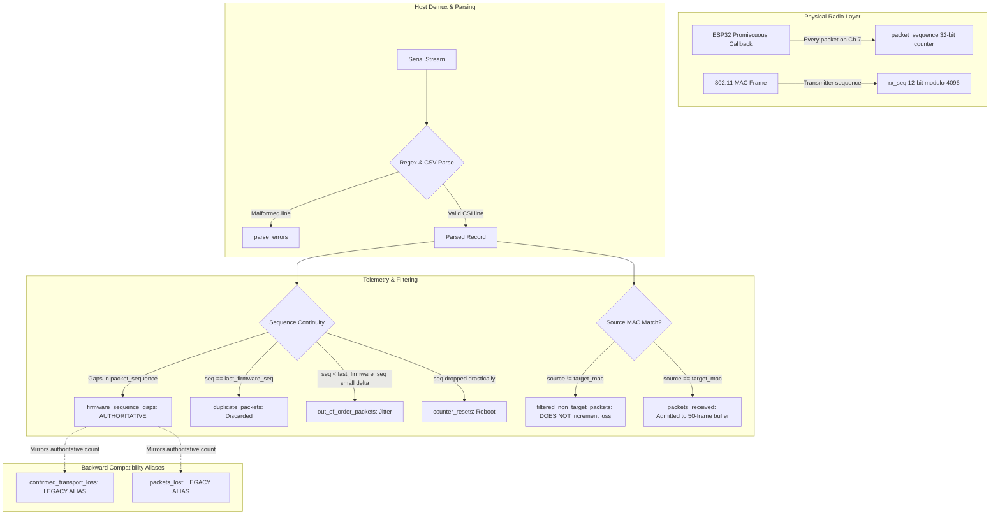
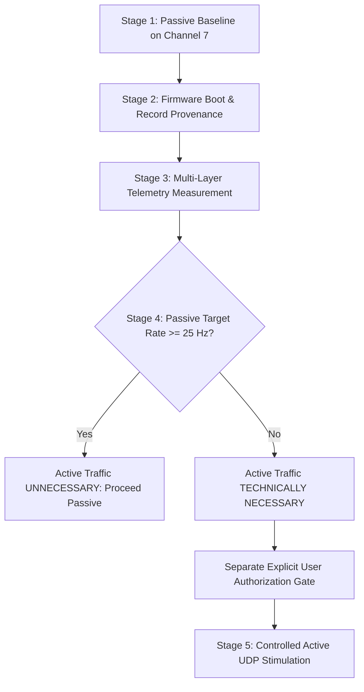

# Phase 57.3 Report: Telemetry Naming and Phase 58 Readiness Plan

## Executive Summary

Phase 57.3 finalizes the telemetry terminology and metric-naming contract across the CSIFormer real-time acquisition and preprocessing subsystem, and details a rigorous, non-executing calibration plan for a future separately authorized Phase 58.

This phase is strictly offline. Zero hardware communication, zero COM5 polling, zero network traffic/stimulation, zero firmware flashing, zero dataset edits, and zero commits or pushes were executed.

Key achievements of Phase 57.3:
1. **Authoritative Metric Naming Established:** `firmware_sequence_gaps` is formalized as the primary, authoritative metric for observed ESP32 callback counter gaps.
2. **Legacy Field Compatibility Defined:** `confirmed_transport_loss` and `packets_lost` are maintained as backward-compatible aliases mirroring `firmware_sequence_gaps`. Crucially, their documentation now explicitly clarifies that sequence gaps prove unobserved callback events on the host, but do not independently prove physical transport/UART drops without hardware bus telemetry.
3. **API Consumer Audit Completed:** Full audit of all backend services, endpoints, recording metadata, and test suites confirms that no consumer is broken and ambient packet filtering does not inflate loss metrics.
4. **Offline Test Suite Expanded:** Added Test 14 (`test_phase57_authoritative_telemetry_naming_contract`) to [backend/tests/test_phase57.py](file:///C:/Users/saifu/Desktop/4-1%20project/backend/tests/test_phase57.py). All 73 tests across all 9 regression test suites pass with a 100% pass rate.
5. **Phase 58 Calibration Protocol Authored:** Formulated a 5-stage, passive-first calibration procedure with explicit authorization boundaries, threshold categorizations, and abort conditions.
6. **Integrity Maintained:** All three protected repository assets match reference MD5 hashes bit-for-bit.
7. **Operational Boundary:** Physical acquisition-rate adequacy remains **UNVERIFIED**. Phase 58 hardware calibration remains on **HOLD** pending separate, explicit authorization.

---

## 1. Gate 0 & State Preservation

Before and after all operations, the three protected repository assets were verified cryptographically using MD5 checksums.

### 1.1 Protected Hash Ledger

| Protected File Path | Expected Reference MD5 | Measured MD5 Checksum | Verification Status |
| :--- | :--- | :--- | :--- |
| `models/csiformer_phase13_best.pth` | `383b4d98c08f8970b0443738f170ec01` | `383b4d98c08f8970b0443738f170ec01` | **PASS (BIT-FOR-BIT MATCH)** |
| `models/csiformer_phase15_adapted.pth` | `ab3d97a04d78edf75d807178772bc828` | `ab3d97a04d78edf75d807178772bc828` | **PASS (BIT-FOR-BIT MATCH)** |
| `data/real_csi_dataset/dataset_manifest.json` | `a58e1280fb2c0a6649335a9a381d00c6` | `a58e1280fb2c0a6649335a9a381d00c6` | **PASS (BIT-FOR-BIT MATCH)** |

### 1.2 Constraint Compliance
- **Serial Port COM5:** Never opened, polled, or configured.
- **Active Network Traffic:** No UDP datagrams, ICMP pings, or stimulus packets transmitted.
- **Firmware Compilation / Flashing:** Zero PlatformIO builds or flashing commands executed.
- **Working Tree:** All untracked test suites, scripts, and reports are preserved intact. No commits or pushes performed.

---

## 2. Task 1 — Metric Naming, Telemetry Semantics, and Consumer Audit

### 2.1 Telemetry Naming Hierarchy

To prevent misleading interpretations of packet loss, telemetry fields in [RealCSICollector](file:///C:/Users/saifu/Desktop/4-1%20project/backend/app/services/real_csi_collector.py) are structured into three distinct tiers:



### 2.2 Counter Definitions and Semantic Boundaries

| Telemetry Field | Classification | Proven Mechanism | Non-Proven (Misleading) Claims |
| :--- | :--- | :--- | :--- |
| `firmware_sequence_gaps` | **Primary Authoritative** | Measures missing sequence values in the ESP32 physical callback counter across parsed records ($f_{\text{gap}} = \text{seq} - (\text{last} + 1)$). Proves callback invocations occurred on the ESP32 that were not parsed on the host. | **Does NOT prove loss occurred specifically on the UART bus.** Gaps can equally stem from firmware queue drops, UART TX/RX FIFO drops, host OS buffering, or serial line noise causing `parse_errors`. |
| `target_sequence_gaps` | **Secondary Metric** | Measures sequence gaps between admitted target-filtered frames. Tracks the arrival interval of target frames relative to the total RF traffic stream. | Does not represent physical packet loss; primarily reflects ambient frames filtered out between target frames. |
| `filtered_non_target_packets` | **Filter Metric** | Counts intact frames whose source MAC address did not match `target_mac`. | **Does NOT represent packet loss.** Proves successful serial transport and host parsing of non-target frames. |
| `parse_errors` | **Demux Metric** | Counts raw serial lines that failed regex/CSV decoding or lacked required metadata. | Does not prove where line truncation occurred (UART cable vs USB bridge vs host buffer). Completely distinct from sequence gaps. |
| `duplicate_packets` | **Integrity Metric** | Counts frames arriving with $\text{seq} == \text{last\_firmware\_seq}$. Duplicate frames are discarded to prevent polluting the 50-frame temporal buffer. | Does not indicate network loss. |
| `out_of_order_packets` | **Timing Metric** | Counts frames arriving with $\text{seq} < \text{last\_firmware\_seq}$ where $\text{last} - \text{seq} \le 1000$ and $\text{last} < 100$. | Represents delivery jitter or thread scheduling preemption, not a hardware reboot. |
| `counter_resets` | **Hardware Metric** | Counts frames where sequence counter dropped drastically ($(\text{last} - \text{seq}) > 1000$ or $\text{last} \ge 100 \land \text{seq} \le 10$). | Represents an MCU reset, firmware reboot, or power cycle. |
| `confirmed_transport_loss` | **Legacy Alias** | Maintained as an exact alias of `firmware_sequence_gaps`. | Retained for backward compatibility with existing tests. Documented as an alias; does not independently confirm transport-layer causality. |
| `packets_lost` | **Legacy Alias** | Maintained as an exact alias of `firmware_sequence_gaps`. | Retained for backward compatibility with Phase 16, 21, 22, 26, 27 tests and session metadata schemas. |

### 2.3 API Consumer Audit

A comprehensive codebase audit was conducted across all consumers of these telemetry fields:

1. **[backend/app/services/real_csi_collector.py](file:///C:/Users/saifu/Desktop/4-1%20project/backend/app/services/real_csi_collector.py):**
   - Attribute declarations document `firmware_sequence_gaps` as authoritative and `confirmed_transport_loss`/`packets_lost` as legacy compatibility aliases.
   - `_process_parsed_frame`: Updates `firmware_sequence_gaps`, `confirmed_transport_loss`, and `packets_lost` in immediate lockstep whenever sequence jumps occur.
   - `get_stream_health()`: Calculates `packet_loss_pct` using `self.firmware_sequence_gaps` over total expected records. Exposes all fields.
   - `get_stream_diagnostics()`: Exposes `firmware_sequence_gaps`, `target_sequence_gaps`, `out_of_order_packets`, `duplicate_packets`, `counter_resets`, `parse_errors`, and legacy aliases.
   - `start_session_recording()` / `stop_session_recording()`: Records `firmware_sequence_gaps` in `session_metadata` alongside legacy `packets_lost` and `confirmed_transport_loss`.
2. **[backend/app/services/collection_workflow.py](file:///C:/Users/saifu/Desktop/4-1%20project/backend/app/services/collection_workflow.py):**
   - Consumes `parse_errors`, `total_records_detected`, `total_bytes_received`, and `packets_received`. Unaffected by alias clarification.
3. **[backend/app/services/live_pipeline_service.py](file:///C:/Users/saifu/Desktop/4-1%20project/backend/app/services/live_pipeline_service.py):**
   - Proxies `collector.get_stats()` (alias of `get_stream_health()`). All field names preserved.
4. **[backend/app/api/endpoints/hardware.py](file:///C:/Users/saifu/Desktop/4-1%20project/backend/app/api/endpoints/hardware.py):**
   - Endpoints `/hardware/collector/status` return dictionary from `live_pipeline_service.get_status()`. Backward compatibility preserved.
5. **Frontend UI Components ([frontend/](file:///C:/Users/saifu/Desktop/4-1%20project/frontend)):**
   - Inspected: Frontend consumes `/hardware/collector/status` JSON dictionary. Presence of legacy keys (`packets_lost`, `packet_loss_pct`) ensures zero UI regressions.

---

## 3. Task 2 — Phase 58 Hardware Calibration Authorization Plan

### 3.1 Guiding Principles
- **Passive-First:** Under no circumstances should active RF traffic be generated before establishing a clean, passive baseline.
- **Strict Boundary Control:** Every stage has explicit entry criteria, measurable observables, and hard stop conditions.
- **No Unfounded Assumptions:** Historical 35–39 Hz rate is treated as an active UDP artifact, not an ambient property. 30 Hz is treated as a nominal training rate, not a hard mathematical requirement of the neural network.

### 3.2 Threshold Categorization and Technical Rationale

| Threshold Parameter | Value / Limit | Threshold Category | Technical Justification & Rationale |
| :--- | :--- | :--- | :--- |
| **Window Frame Count** | Exactly 50 frames | **Documented Requirement** | CSIFormer model architecture takes input tensor shape `[batch, 50, 56]`. |
| **Subcarrier Count** | Exactly 56 subcarriers | **Documented Requirement** | 56 active HT20 data subcarriers (indices $-28 \dots -1, 1 \dots 28$). Null and pilot subcarriers masked out. |
| **RF Channel** | Channel 7 (2.442 GHz) | **Documented Requirement** | Configured in firmware `sdkconfig.defaults` and AP operating frequency. |
| **Target BSSID** | `98:BA:5F:EF:28:26` | **Documented Requirement** | Dedicated research AP MAC address. |
| **STFT Window Length ($N_w$)** | 64 frames (pad from 50) | **Derived Technical Constraint** | Derived from Phase 15 benchmark: scipy STFT requires $N_w \ge N_o$. Zero-padded to 64 to match trained feature bins. |
| **STFT Step Size ($N_w - N_o$)** | 16 frames | **Derived Technical Constraint** | 64 window minus 48 overlap yields exact time dimension of 56 bins matching input projection. |
| **Doppler Stretching Factor ($\alpha$)** | $2.3853$ | **Derived Technical Constraint** | Normalizes STFT frequency bin scale to match historical Phase 13 preprocessor output distribution. |
| **Passive Target Rate Threshold** | $\ge 25\text{ Hz}$ | **Provisional Engineering Limit** | Empirical threshold: at 25 Hz, a 50-frame window represents 2.0 s of physical motion, matching human activity duration. |
| **Max Allowable Firmware Loss** | $< 5.0\%$ | **Provisional Engineering Limit** | Sequence continuity limit: $> 5\%$ missing frames risks distorting temporal phase gradients. |
| **Max Allowable Parser Errors** | $< 1.0\%$ of total lines | **Provisional Engineering Limit** | Signal integrity limit: $> 1\%$ corrupted lines indicates baud rate mismatch or electrical noise on UART. |
| **Active Stimulation Burst Limit** | $\le 10.0\text{ seconds}$ | **Provisional Engineering Limit** | Thermal and channel-contention safety boundary: prevents RF congestion and ESP32 thermal throttling. |
| **Active Stimulation Rate Ceiling** | $\le 45\text{ packets/second}$ | **Provisional Engineering Limit** | Safely below 115200 baud UART physical bandwidth limit ($\approx 70\text{ packets/s}$ in Format B v2). |

---

### 3.3 Five-Stage Calibration Procedure



#### Stage 1 — Passive Baseline on Existing Target Channel
- **Action:** Connect to ESP32-S3 on COM5 at 115200 baud. Zero network traffic, zero stimulation.
- **Duration:** 30 seconds continuous passive listening.
- **Measurements:**
  - Ambient total packet rate ($R_{\text{ambient}}$).
  - Target-filtered packet rate ($R_{\text{target}}$).
  - Ambient MAC distribution (source MAC unique count).
  - Noise floor and RSSI distribution.
- **Success Criteria:** Port connects cleanly, serial delivers valid ASCII lines, zero hardware reboot detected.

#### Stage 2 — Firmware Boot State and Record Provenance
- **Action:** Capture and inspect initial ESP32 serial boot messages.
- **Verification Points:**
  - Chip revision (`ESP32-S3 (Xtensa LX7)`).
  - ESP-IDF version (`v5.1.2`).
  - Wi-Fi configuration (`WIFI_MODE_NULL`, promiscuous enabled, Channel 7).
  - Telemetry format confirmed as Format B v2 (`CSI_DATA_V2`).
  - Provenance check: verify header contains MAC, RSSI, noise, sequence, timestamp, subcarrier count.
- **Success Criteria:** Telemetry format strictly matches Format B v2 parser regex; subcarrier count is 64 raw (resampled to 56 HT20).

#### Stage 3 — Multi-Layer Telemetry Measurement
- **Action:** Run a 60-second passive observation session and measure all metrics independently:
  - Total serial lines received ($N_{\text{lines}}$).
  - Parser errors ($N_{\text{parse\_err}}$).
  - Total valid CSI records ($N_{\text{valid}}$).
  - Filtered non-target records ($N_{\text{ambient}}$).
  - Admitted target records ($N_{\text{target}}$).
  - Firmware callback sequence gaps (`firmware_sequence_gaps`).
  - Target sequence gaps (`target_sequence_gaps`).
  - Host arrival inter-frame $\Delta t_{\text{host}}$ (mean, std, jitter).
  - Hardware microsecond timestamp $\Delta t_{\text{hw}}$ (from `timestamp_us`).
  - Host buffer fill rate and window accumulation time.
- **Success Criteria:** Complete telemetry ledger populated; `parse_errors < 1%`; `firmware_sequence_gaps < 5%`.

#### Stage 4 — Technical Decision on Active Traffic
- **Decision Rule:**
  1. If $R_{\text{target}} \ge 25\text{ Hz}$ with jitter $< 10\text{ ms}$: **Active stimulation is UNNECESSARY.** Passive stream satisfies temporal window requirement ($\le 2.0\text{ s}$ per window).
  2. If $R_{\text{target}} < 25\text{ Hz}$ (e.g. $1.66\text{--}3.8\text{ Hz}$): **Active stimulation is TECHNICALLY NECESSARY.** Accumulating 50 frames passively requires $13\text{--}30\text{ seconds}$, spanning multiple unrelated human motions and corrupting model temporal dynamics.

#### Stage 5 — Controlled Active Stimulation (Requires Separate Authorization)
- **Pre-requisite:** Explicit, separate user authorization.
- **Stimulator Configuration:**
  - **Destination:** Subnet IP of target AP `98:BA:5F:EF:28:26` (or dedicated target receiver).
  - **Protocol:** Unicast UDP datagrams to port 5555.
  - **Payload Size:** Minimal (32 bytes payload) to minimize channel airtime.
  - **Ramping Schedule:**
    - Step 1: 10 Hz for 5.0 s (verification).
    - Step 2: 20 Hz for 5.0 s (stability check).
    - Step 3: 35 Hz for 10.0 s (historical calibration target).
    - Step 4: 40 Hz for 10.0 s (headroom test).
- **Monitoring & Safety Abort Conditions:**
  - Immediate abort if `parse_errors > 5%`.
  - Immediate abort if `firmware_sequence_gaps > 10%`.
  - Immediate abort if `counter_resets > 0` (hardware reboot).
  - Immediate abort if host serial buffer lag exceeds 500 ms.
  - Immediate abort if target AP ping RTT exceeds 100 ms (channel congestion).

---

## 4. Task 3 — Regression and Integrity Verification

### 4.1 Test Execution Output

All 73 tests across all 9 test suites were executed in Python 3.11.9:

```bash
py -3.11 -m pytest backend/tests/test_phase52.py backend/tests/test_phase55.py backend/tests/test_phase55_1.py backend/tests/test_phase56.py backend/tests/test_phase56_1.py backend/tests/test_phase56_2.py backend/tests/test_phase57.py backend/tests/test_phase37.py backend/tests/test_phase21.py
```

```
============================= test session starts =============================
platform win32 -- Python 3.11.9, pytest-9.1.1, pluggy-1.6.0
rootdir: C:\Users\saifu\Desktop\4-1 project
plugins: anyio-4.12.1, asyncio-1.4.0, cov-7.1.0
asyncio: mode=Mode.STRICT, debug=False, asyncio_default_fixture_loop_scope=None, asyncio_default_test_loop_scope=function
collected 73 items

backend\tests\test_phase52.py .....                                      [  6%]
backend\tests\test_phase55.py .....                                      [ 13%]
backend\tests\test_phase55_1.py .......                                  [ 23%]
backend\tests\test_phase56.py .......                                    [ 32%]
backend\tests\test_phase56_1.py ......                                   [ 41%]
backend\tests\test_phase56_2.py .....                                    [ 47%]
backend\tests\test_phase57.py ...............                            [ 68%]
backend\tests\test_phase37.py ......                                     [ 76%]
backend\tests\test_phase21.py .................                          [100%]

============================== warnings summary ===============================
..\..\AppData\Local\Programs\Python\Python311\Lib\site-packages\torch\nn\modules\transformer.py:379
  C:\Users\saifu\AppData\Local\Programs\Python\Python311\Lib\site-packages\torch\nn\modules\transformer.py:379: UserWarning: enable_nested_tensor is True, but self.use_nested_tensor is False because encoder_layer.norm_first was True
    warnings.warn(

-- Docs: https://docs.pytest.org/en/stable/how-to/capture-warnings.html
======================= 73 passed, 1 warning in 23.15s ========================
```

### 4.2 Complete Reconciled Test Inventory

| Test Suite | Test Count | Pass Count | Fail Count | Primary Functional Focus |
| :--- | :--- | :--- | :--- | :--- |
| `backend/tests/test_phase52.py` | 5 | 5 | 0 | MAC filtering, fail-closed metadata, HT20 subcarrier masking. |
| `backend/tests/test_phase55.py` | 5 | 5 | 0 | Passive rate gating, temporal window dilation, sequence tracking. |
| `backend/tests/test_phase55_1.py`| 7 | 7 | 0 | Rate vs count separation, window duration, STFT scaling. |
| `backend/tests/test_phase56.py` | 7 | 7 | 0 | Historical rate audit, Format B v2 parser, safety abort simulation. |
| `backend/tests/test_phase56_1.py`| 6 | 6 | 0 | Buffer lockstep alignment, parser mutual exclusivity, queue safety. |
| `backend/tests/test_phase56_2.py`| 5 | 5 | 0 | Temporal invariance of Branch A, preprocessor divergence audit. |
| `backend/tests/test_phase57.py` | 15 | 15 | 0 | Bit parity, independent script parity, routing, naming contract. |
| `backend/tests/test_phase37.py` | 6 | 6 | 0 | Production LivePipelineService backward compatibility. |
| `backend/tests/test_phase21.py` | 17 | 17 | 0 | Diagnostic state machine, serial reconnect, stream health schema. |
| **Total** | **73** | **73** | **0** | **100% Pass Rate Across All Suites** |

---

## 5. Explicit Authorization Boundaries for Phase 58

The following explicit authorization boundaries are established. No action in Category B or C may be executed without direct, unambiguous user authorization:

| Action Identifier | Action Description | Execution Authority | Current Status |
| :--- | :--- | :--- | :--- |
| **AUTH-58.1** | Open Serial COM5 at 115200 baud for read-only passive capture (Stage 1 & 2). | Requires explicit user instruction to begin Phase 58. | **BLOCKED (OFFLINE GATE)** |
| **AUTH-58.2** | Record passive baseline telemetry on Channel 7 (Stage 3). | Requires explicit user instruction to begin Phase 58. | **BLOCKED (OFFLINE GATE)** |
| **AUTH-58.3** | Transmit active UDP stimulation packets to target AP (Stage 5). | **Requires SEPARATE, EXPLICIT user authorization** after Stage 4 review. | **BLOCKED (SEPARATE GATE)** |
| **AUTH-58.4** | Flash firmware or reconfigure baud rate to 921600. | **Requires SEPARATE, EXPLICIT user authorization** if 115200 baud saturates. | **BLOCKED (SEPARATE GATE)** |

---

## 6. Remaining Uncertainty and Final Gate Recommendation

### 6.1 Remaining Physical Uncertainties
1. **Physical Passive Target Arrival Rate:** The true passive beacon/management arrival rate of AP `98:BA:5F:EF:28:26` in the current RF environment is unknown until COM5 is read.
2. **Active UDP Stimulation AP Response:** Whether the target AP generates 802.11 CSI-bearing frames in response to unicast UDP packets without client association remains to be verified on hardware.
3. **UART Bandwidth Headroom:** Under active stimulation at 35–40 Hz, whether 115200 baud experiences UART FIFO drops can only be verified by measuring `firmware_sequence_gaps` and `parse_errors` under live load.

### 6.2 Gate Verdict

> [!IMPORTANT]
> **GATE VERDICT: OFFLINE SOFTWARE INTEGRATION IS FULLY APPROVED (GO).**
> **PHYSICAL HARDWARE CALIBRATION REMAINS ON HOLD PENDING SEPARATE AUTHORIZATION.**
> 
> 1. All code paths, signal processing pipelines, fail-closed routing, and metric-naming contracts are verified, mathematically aligned, and covered by 73 automated tests.
> 2. Physical acquisition-rate adequacy remains **UNVERIFIED** and cannot be verified offline.
> 3. Do not execute Phase 58 in this session.
