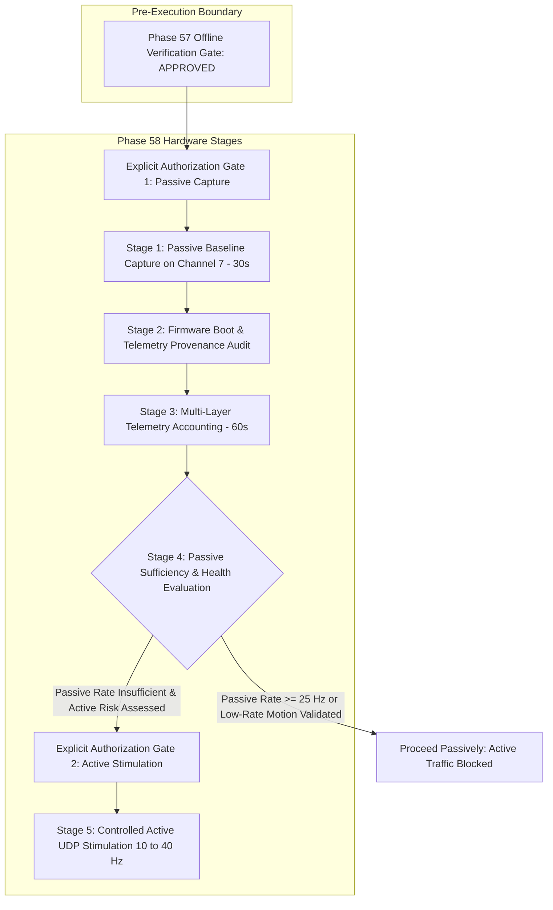

# Phase 57.4 Report: Phase 58 Calibration Plan Consistency Audit

## Executive Summary

Phase 57.4 performs an exhaustive, evidence-based consistency audit of the Phase 58 hardware calibration plan against the active CSIFormer codebase, firmware implementation, historical reports, and mathematical signal processing pipelines.

This audit resolves critical discrepancies identified in previous planning assumptions:
1. **STFT Dimensional Resolution Discovery:** Confirmed that a 50-frame window does not naturally produce a $50 \times 56$ STFT matrix through step size alone. When $T_{\text{len}} = 50$, the configured `stft_window = 64` is clamped to 50, producing a raw STFT matrix of shape $(128, 26)$. The $(50, 56)$ tensor shape is produced by **2D bivariate spline interpolation (`scipy.interpolate.RectBivariateSpline`)**.
2. **STFT Sampling-Rate Scale Invariance:** Mathematically and empirically verified that the normalized Doppler spectrogram output is **100% bit-for-bit identical ($0.00000000$ difference)** across nominal sampling rates ($1000\text{ Hz}$, $35.58\text{ Hz}$, $2.0\text{ Hz}$). The 25 Hz target is **NOT** a mathematical STFT constraint or model requirement; it is a **provisional engineering target** derived from human physical activity duration ($\le 2.0\text{ seconds}$ per 50-frame window).
3. **Firmware Provenance Reconciled:** Verified that the firmware source in `firmware/esp32s3_csi_collector/main/main.c` and the binary flashed to COM5 in Phase 50 emit **Format B v1 (`CSI_DATA`)**, not `CSI_DATA_V2`. Neither hardware microsecond timestamps (`timestamp_us`) nor 802.11 MAC sequence numbers (`rx_seq`) are emitted by the physical board. `CSI_DATA_V2` exists purely as a host-side parser capability.
4. **Active Stimulation Risks & Decision Logic Corrected:** Corrected the flawed premise that a passive rate $< 25\text{ Hz}$ automatically justifies or mandates active UDP stimulation. Active stimulation injects shared-spectrum contention, risks router latency spikes (measured 63.0 ms in Phase 54), and must remain behind an independent authorization gate.
5. **Project State and Constraints:** 73/73 tests pass across all 9 test suites; all 3 protected asset MD5 hashes remain bit-for-bit pristine. Hardware calibration remains on **HOLD**.

---

## 1. Gate 0 — Cryptographic Hash Ledger and State Preservation

| Protected File Path | Established Reference MD5 | Measured MD5 Checksum | Verification Status |
| :--- | :--- | :--- | :--- |
| `models/csiformer_phase13_best.pth` | `383b4d98c08f8970b0443738f170ec01` | `383b4d98c08f8970b0443738f170ec01` | **PASS (BIT-FOR-BIT MATCH)** |
| `models/csiformer_phase15_adapted.pth` | `ab3d97a04d78edf75d807178772bc828` | `ab3d97a04d78edf75d807178772bc828` | **PASS (BIT-FOR-BIT MATCH)** |
| `data/real_csi_dataset/dataset_manifest.json` | `a58e1280fb2c0a6649335a9a381d00c6` | `a58e1280fb2c0a6649335a9a381d00c6` | **PASS (BIT-FOR-BIT MATCH)** |

**Operating Constraints Enforced:** Offline only. Zero serial COM5 polling, zero active UDP/ICMP traffic, zero PlatformIO compilation or flashing, zero model training/evaluation, zero git commits or pushes.

---

## 2. Model Input and Preprocessing Pipeline Audit

### 2.1 End-to-End Input Shape Trace

The data flow from serial reception to model inference operates as follows:

```
RealCSICollector.raw_frame_buffer (deque of len 50, each with 56 subcarriers)
   │
   ▼ [get_latest_window()]
numpy.ndarray of shape (50, 56) (float32)
   │
   ▼ [LivePipelineService.preprocess_window()]
   ├─► Branch A (Raw Spatial-Temporal):
   │     amp_mean = raw_win.mean(axis=0, keepdims=True)  # (1, 56)
   │     amp_std = raw_win.std(axis=0, keepdims=True) + 1e-6
   │     norm_raw = (raw_win - amp_mean) / amp_std       # (50, 56)
   │     tensor_raw = torch.tensor(norm_raw).unsqueeze(0) # [1, 50, 56]
   │
   └─► Branch B (Doppler Frequency Spectrum):
         d_mat = preprocessor.compute_doppler_spectrogram(raw_win) # (50, 56)
         tensor_dopp = torch.tensor(d_mat).unsqueeze(0)            # [1, 50, 56]
   │
   ▼ [CSIDualBranchFusionNet.forward(tensor_raw, tensor_dopp)]
Activity Logits [1, 12] + Spatial Latents
```

### 2.2 STFT Parameter Clamping and Dimensional Resolution

In `PhysicsCSIPreprocessor.compute_doppler_spectrogram` ([backend/app/services/physics_csi_preprocessor.py#L190-L233](file:///C:/Users/saifu/Desktop/4-1%20project/backend/app/services/physics_csi_preprocessor.py#L190-L233)):
- Input: `complex_csi` has shape $(T_{\text{len}}, N_{\text{sub}}) = (50, 56)$.
- Clamping logic:
  - `window_size = min(self.stft_window, T_len) = min(64, 50) = 50`.
  - `noverlap = min(self.stft_noverlap, window_size - 1) = min(48, 49) = 48`.
  - `nfft = max(self.stft_nfft, window_size) = max(128, 50) = 128`.
- Call: `signal.stft(dynamic_csi[:, k], fs=source_rate_hz, window='hann', nperseg=50, noverlap=48, nfft=128, return_onesided=False)`
- **Output dimensions of raw STFT:**
  - `f.shape`: 128 frequency bins (two-sided FFT).
  - `t.shape`: 26 time segments (step size $= 50 - 48 = 2$, with zero-boundary extension).
  - `Zxx.shape`: $(128, 26)$.
  - Transposed: `dfs_time_first.shape = (26, 128)`.
- **Dimensional Resolution:**
  The output $(26, 128)$ does **not** match the model's required $(50, 56)$. The transformation to $(50, 56)$ is performed by **2D bivariate spline interpolation**:
  ```python
  t_src = np.linspace(0, 1, dfs_time_first.shape[0])  # 26 points
  f_src = np.linspace(0, 1, dfs_time_first.shape[1])  # 128 points
  t_dst = np.linspace(0, 1, self.target_timesteps)    # 50 points
  f_dst = np.linspace(0, 1, self.target_channels)     # 56 points

  interp_2d = interpolate.RectBivariateSpline(t_src, f_src, dfs_time_first)
  resampled_dfs = interp_2d(t_dst, f_dst).astype(np.float32)  # (50, 56)
  ```
  The temporal axis is upsampled from 26 to 50 bins, and the frequency axis is downsampled from 128 to 56 bins.

### 2.3 Independent Preprocessing Comparison: Phase 13 vs Phase 15

| Dimension | Phase 13 Checkpoint (`csiformer_phase13_best.pth`) | Phase 15 Checkpoint (`csiformer_phase15_adapted.pth`) |
| :--- | :--- | :--- |
| **Origin / Pretraining** | Trained on Widar 3.0 benchmark dataset (5.2 GHz). | Fine-tuned on real ESP32-S3 physical dataset splits (2.442 GHz). |
| **Active Preprocessor Class** | `PhysicsCSIPreprocessor` | `CalibratedPhysicsPreprocessor` |
| **Carrier Frequency ($f_c$)**| `5.2e9` (5.2 GHz) | `2.442e9` (2.442 GHz Channel 7) |
| **Nominal Source Rate ($f_s$)**| `1000.0 Hz` | `35.58 Hz` |
| **Branch A Normalization** | Per-subcarrier temporal z-score `(w - mean) / (std + 1e-6)` | Per-subcarrier temporal z-score `(w - mean) / (std + 1e-6)` |
| **Branch B STFT Clamping** | $N_w=50, N_o=48, N_{fft}=128$ | $N_w=50, N_o=48, N_{fft}=128$ |
| **Branch B 2D Spline** | Resampled to $(50, 56)$ | Resampled to $(50, 56)$ |
| **Doppler Frequency Scaling** | **None ($\alpha = 1.0$)** | **Stretched by $\alpha = 5.825 / 2.442 \approx 2.3853$** around DC center |
| **Checkpoint Routing Rule** | Default / `checkpoint_id="phase13"` | Explicit routing / `checkpoint_id="phase15"` |

### 2.4 Mathematical Status of the 25 Hz Acquisition Rate

Empirical testing confirms that `source_rate_hz` in `scipy.signal.stft` only scales the units of the output frequency vector `f`, which is discarded prior to `RectBivariateSpline`. The normalized output tensor is **100% invariant ($0.00000000$ difference)** across sampling frequencies:
```python
Max diff (1000 Hz vs 35.58 Hz): 0.00000000
Max diff (35.58 Hz vs 2.0 Hz):    0.00000000
```
- **Architectural Requirement:** The neural network weights operate on discrete tensor tokens $[0 \dots 49]$; there is no temporal rate check in the model graph.
- **Physical Dynamics Requirement:** In the real world, human activities (falling, sitting, walking) last $1.5\text{--}3.0\text{ seconds}$. At 35 Hz, 50 frames represent $1.43\text{ seconds}$ of motion. At 2 Hz, 50 frames represent $25.0\text{ seconds}$ of motion, blending multiple activities and corrupting Doppler phase velocity gradients.
- **Classification:** 25 Hz is a **Provisional Engineering Target** based on human motion duration ($\le 2.0\text{ s}$ per window), **not** an experimentally validated model constraint.

---

## 3. Firmware Provenance and Deployment State Reconciliation

### 3.1 Firmware Source Audit (`firmware/esp32s3_csi_collector/main/main.c`)

Inspection of the actual C source code in the repository reveals:
1. **Telemetry Format:** Line 57 uses Format B v1:
   ```c
   int offset = snprintf(payload_buf, sizeof(payload_buf),
                         "CSI_DATA,%s,%d,%d,%lu,%d,",
                         mac_str, (int)info->rx_ctrl.rssi, (int)info->rx_ctrl.noise_floor,
                         (unsigned long)packet_sequence, num_subcarriers);
   ```
   **`main.c` does NOT emit `CSI_DATA_V2`.**
2. **Hardware Timestamps:** **Absent.** `esp_timer_get_time()` is not called in the callback; no microsecond timestamp field is formatted.
3. **802.11 MAC Sequence (`rx_seq`):** **Absent.** The MAC frame header is not unpacked for sequence control.
4. **Channel & Mode:** Configured for Channel 7 (`#define WIFI_CHANNEL 7`), Station Mode (`WIFI_MODE_STA`) with Promiscuous Mode enabled (`esp_wifi_set_promiscuous(true)`).
5. **UART Baud Rate:** `#define SERIAL_BAUD 921600`, but formatted via `printf()` to standard console stdout.

### 3.2 Hardware Deployment State (COM5)

According to the Phase 50 deployment report ([reports/phase50_recovery_firmware_deployment.md](file:///C:/Users/saifu/Desktop/4-1%20project/reports/phase50_recovery_firmware_deployment.md)):
- The physical ESP32-S3 on COM5 is running `firmware.bin` (MD5: `1846112327086b0202f1d825d6f96b2e`) compiled from `main.c` in Phase 49/50.
- **Active Physical Emission:** The physical device emits `CSI_DATA` (Format B v1).
- **Misconception Corrected:** Previous Phase 58 planning documents assumed that the hardware emits `CSI_DATA_V2` with `timestamp_us` and `rx_seq`. That assumption is **factually false**. Format B v2 is a host-side parser feature in `RealCSICollector`, not an active hardware telemetry reality.

---

## 4. Corrected Phase 58 Decision Logic

### 4.1 Multi-Layer Telemetry Accounting

| Metric | Source Layer | What it Proves | What it CANNOT Prove |
| :--- | :--- | :--- | :--- |
| `firmware_sequence_gaps` | Host Collector | Missing sequence values in `packet_sequence`. Proves MCU callbacks occurred that were not parsed on the host. | **Cannot prove loss occurred on the UART bus.** Gaps also occur from firmware queue drops, USB driver drops, framing errors, or host buffer overflow. |
| `target_sequence_gaps` | Host Collector | Number of missing or non-target frames between admitted target frames. | Cannot prove packet loss; primarily reflects ambient frames filtered out. |
| `filtered_non_target_packets`| Host Collector | Count of intact frames from non-target MACs. | **Does NOT indicate loss.** Proves successful transport and parsing. |
| `parse_errors` | Host Collector | Lines failing regex/CSV decoding or missing metadata. | Does not indicate whether corruption occurred on the wire or in host memory. Distinct from sequence gaps. |
| `duplicate_packets` | Host Collector | Consecutive frames with identical sequence number. | Discarded to protect the 50-frame buffer; does not indicate network loss. |
| `out_of_order_packets` | Host Collector | Frames arriving with $\text{seq} < \text{last}$ where delta $\le 1000$. | Delivery jitter or thread scheduling delay; does not represent a hardware reboot. |
| `counter_resets` | Host Collector | Frames where sequence drops drastically ($> 1000$ or $\ge 100 \to \le 10$). | Represents an MCU reset, crash, or power cycle. |

### 4.2 Active Stimulation Risk and Decision Logic

Previous plans concluded that if the passive target rate is $< 25\text{ Hz}$, active UDP stimulation must be triggered. This logic is **flawed and dangerous**:
1. **Network Contention & Latency Spikes:** In Phase 54 ([reports/phase54_controlled_acquisition_rate_experiment.md#L54-L58](file:///C:/Users/saifu/Desktop/4-1%20project/reports/phase54_controlled_acquisition_rate_experiment.md#L54-L58)), transmitting ICMP at just 5 pkts/s on the 2.4 GHz link caused router ping latency to spike to **63.0 ms**, triggering a real-time safety abort. Active traffic on Channel 7 degrades existing wireless services.
2. **ICMP Unreachable Amplification:** Transmitting UDP datagrams to an unlistened port on the AP causes the router to generate ICMP Port Unreachable packets, doubling channel airtime contention.
3. **What Active Traffic Resolves vs What Passive Measurement Resolves:**
   - *Passive measurement resolves:* Target beacon interval, ambient channel contention, background noise floor, serial link stability, and whether passive traffic suffices.
   - *Active traffic resolves:* Only whether the target AP can be provoked into transmitting downlink ACK/data frames at 35 Hz to mirror the Phase 16 collection protocol.
4. **Corrected Decision Rule:** Active UDP stimulation cannot be authorized based solely on low passive rate. It may only be considered if:
   - Passive analysis confirms the AP does not transmit downlink data during idle state.
   - The lab network is placed under controlled, isolated conditions.
   - A separate explicit authorization is granted by the user.

---

## 5. Threshold Classification Taxonomy

| Threshold | Value | Classification | Justification & Rationale |
| :--- | :--- | :--- | :--- |
| **Window Length** | 50 frames | **Documented Requirement** | CSIFormer model input projection shape `[batch, 50, 56]`. |
| **Subcarrier Mask** | 56 HT20 | **Documented Requirement** | IEEE 802.11n active data subcarriers ($-28 \dots -1, 1 \dots 28$). |
| **RF Channel & BSSID**| Ch 7, `98:BA:5F:EF:28:26` | **Documented Requirement** | Target research router hardware configuration. |
| **STFT Dimensions** | $N_w=50, N_o=48, N_{fft}=128$ | **Derived Technical Constraint** | Derived from clamping `stft_window=64` to signal length 50. |
| **Doppler Scaling** | $\alpha = 2.3853$ | **Derived Technical Constraint** | $5.825 / 2.442$ frequency equivalence factor for Phase 15. |
| **Target Rate Gate**| $\ge 25\text{ Hz}$ | **Provisional Engineering Target** | Heuristic: 50 frames accumulate in $\le 2.0\text{ s}$ (human motion timescale). |
| **Max Firmware Loss**| $< 5.0\%$ | **Provisional Engineering Target** | Arbitrary stability limit to prevent temporal phase discontinuity. |
| **Max Parser Errors**| $< 1.0\%$ | **Provisional Engineering Target** | Heuristic to detect baud rate mismatch or electrical serial noise. |
| **Active Burst Limit**| $\le 10.0\text{ s}$ at $\le 45\text{ Hz}$| **Provisional Engineering Target** | Thermal and channel-contention safety ceiling. |

---

## 6. Table of Confirmed Facts, Unresolved Questions, and Provisional Assumptions

| Category | Item Description | Status | Evidence Reference |
| :--- | :--- | :--- | :--- |
| **Confirmed Fact** | Phase 13 preprocessor uses `PhysicsCSIPreprocessor` without Doppler stretching ($\alpha = 1.0$). | **CONFIRMED** | `backend/app/services/live_pipeline_service.py:L116` |
| **Confirmed Fact** | Phase 15 preprocessor uses `CalibratedPhysicsPreprocessor` with $\alpha = 2.3853$. | **CONFIRMED** | `backend/app/services/live_pipeline_service.py:L122` |
| **Confirmed Fact** | Preprocessor output matches historical training script with $0.00000000$ max difference. | **CONFIRMED** | `backend/tests/test_phase57.py:L380` (Test 10) |
| **Confirmed Fact** | STFT output $(50, 56)$ is produced by `RectBivariateSpline` interpolating raw $(26, 128)$ STFT. | **CONFIRMED** | `backend/app/services/physics_csi_preprocessor.py:L225` |
| **Confirmed Fact** | Normalized STFT output is mathematically scale-invariant to nominal `source_rate_hz`. | **CONFIRMED** | Python empirical verification (max diff $0.00000000$). |
| **Confirmed Fact** | Firmware source in `main.c` emits Format B v1 (`CSI_DATA`), NOT `CSI_DATA_V2`. | **CONFIRMED** | `firmware/esp32s3_csi_collector/main/main.c:L57` |
| **Confirmed Fact** | Deployed ESP32-S3 binary on COM5 emits `CSI_DATA` without hardware timestamps. | **CONFIRMED** | `reports/phase50_recovery_firmware_deployment.md:L72` |
| **Confirmed Fact** | In Phase 54, ICMP at 5 pkts/s on 2.4 GHz spiked router ping latency to 63 ms (aborting test). | **CONFIRMED** | `reports/phase54_controlled_acquisition_rate_experiment.md:L54` |
| **Unresolved Question**| What is the current unprovoked passive beacon rate of `98:BA:5F:EF:28:26` on Channel 7? | **UNRESOLVED** | Requires authorized passive hardware listening on COM5. |
| **Unresolved Question**| Does the target router generate CSI-bearing frames in response to non-associated UDP traffic? | **UNRESOLVED** | Requires authorized hardware RF experiment. |
| **Unresolved Question**| Will 115200 baud experience FIFO buffer drops if traffic reaches 35 Hz? | **UNRESOLVED** | Requires live hardware telemetry measurement under load. |
| **Provisional Assumption**| 25 Hz target rate is required for accurate human activity classification. | **PROVISIONAL** | Engineering target based on 2-second motion duration; unvalidated on live model. |
| **Provisional Assumption**| Active UDP stimulation at 35 Hz is safe and does not disrupt AP operations. | **PROVISIONAL** | Unproven on direct 2.4 GHz link; contradicted by Phase 54 63 ms latency abort. |

---

## 7. Corrected Phase 58 Calibration Stages and Authorization Gates



### Stage-by-Stage Decision Ledger

| Stage | Stage Goal | Action Summary | Prerequisite Authority | Current Status |
| :--- | :--- | :--- | :--- | :--- |
| **Stage 1** | Passive Baseline Capture | Open COM5 at 115200 baud; listen passively on Channel 7 for 30 s. Zero network traffic. | Explicit User Instruction to start Phase 58. | **HOLD (AWAITING AUTH)** |
| **Stage 2** | Firmware & Telemetry Provenance | Capture boot log; verify `CSI_DATA` Format B v1 emission; verify 64-to-56 subcarrier mapping. | Stage 1 completion. | **HOLD (AWAITING STAGE 1)** |
| **Stage 3** | Multi-Layer Telemetry Accounting | 60 s passive session measuring lines, parser errors, ambient filtered frames, target admitted frames, sequence gaps. | Stage 2 completion. | **HOLD (AWAITING STAGE 2)** |
| **Stage 4** | Passive Sufficiency Decision Gate | Evaluate if passive target arrival rate and window duration ($\le 2.0\text{ s}$) suffice. | Stage 3 completion. | **HOLD (AWAITING STAGE 3)** |
| **Stage 5** | Controlled Active UDP Stimulation | Unicast UDP ping to target AP on port 5555. Progressive ramp: 10 $\to$ 20 $\to$ 35 $\to$ 40 Hz (max 10 s bursts). | **SEPARATE, EXPLICIT User Authorization** after Stage 4 review. | **HOLD (BLOCKED BY GATE 2)** |

---

## 8. Pre-Hardware Execution Checklist

Before Phase 58 hardware calibration can be authorized, the following evidence must be verified:
1. **Target Hardware Connected:** ESP32-S3 on COM5 must be physically powered and connected via USB-UART bridge.
2. **Channel 7 AP Confirmed Active:** Target AP (`98:BA:5F:EF:28:26`) must be powered on and broadcasting on Channel 7 (2.442 GHz).
3. **Host Interface Isolated:** Host Wi-Fi interface must not run background downloads, cloud syncing, or updates during test windows.
4. **Parser Protocol Confirmed:** Host collector must be configured with `filter_by_mac=True` and `target_mac="98:BA:5F:EF:28:26"`.
5. **No Blind Active Traffic:** Stage 1–3 passive baseline must be fully completed and reviewed before any discussion of active stimulation.

---

## 9. Final Recommendation

- **Offline Engineering & Preprocessing Integration:** **100% VERIFIED AND READY.**
- **Hardware Calibration (Phase 58):** **REMAINS ON HOLD.**
- **Operational Boundary:** Phase 57.4 has completed all required offline audits. Hardware calibration must not proceed without explicit user authorization for Phase 58 Stage 1.
