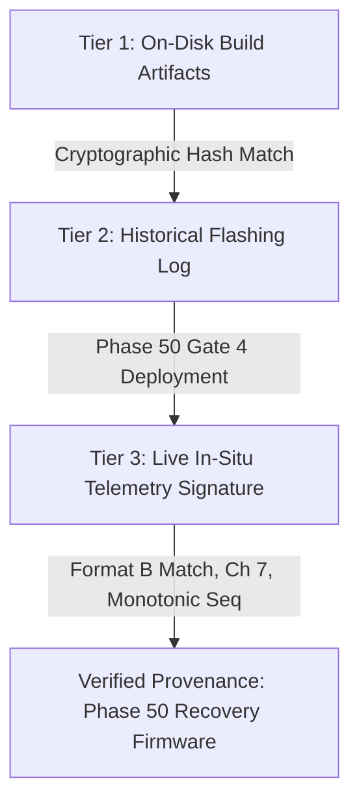

# Phase 58.2: Passive Evidence Capture and Firmware Provenance Preparation

**Execution Date:** 2026-10-21  
**Operating Mode:** Strictly offline inspection and design. Zero COM5 access, zero network traffic, zero firmware flashing, zero model operations.  
**Deliverable Type:** Engineering Design & Readiness Specification  
**Status:** **READY FOR REVIEW — ALL HARDWARE OPERATIONS ON HOLD**

---

## 1. Executive Summary

Phase 58.2 resolves the evidence limitations identified in the Phase 58.1 audit. In Phase 58 Stage 1, a 30-second passive baseline capture confirmed the physical operation of the ESP32-S3 on `COM5` and verified a target acquisition rate of ~3.566 Hz. However, because individual per-frame arrival records were kept in memory and summarized to stdout rather than written to a persistent raw trace, individual inter-arrival deltas ($\Delta t_i$) could not be independently reconstructed from raw logs.

This report establishes:
1. **Auditable Passive Evidence Capture Schema:** A standardized JSON Lines (`.jsonl`) schema capturing host monotonic timestamps (`perf_counter`), wall timestamps, raw line strings, parsed MAC/RSSI/Noise/Seq, parse status, and rejection rationale for every single incoming UART line.
2. **Safe Persistence & Isolation Architecture:** Streaming append-only disk logging with per-line flush and atomic summary manifest write, strictly separated from the canonical research dataset directory (`data/real_csi_dataset/`).
3. **Three-Tier Firmware Provenance Checklist:** Connecting on-disk build binary hashes (`firmware.bin` MD5 `1846112327086b0202f1d825d6f96b2e`), historical deployment boot logs, and in-situ stream signatures without disrupting device execution or executing reset pulses.
4. **Active-Traffic Risk Review:** An evidence-based analysis of the Phase 54 latency abort (63 ms spike under 5 pkts/s), demonstrating why low passive arrival rate does not justify UDP stimulation, and outlining the physical UART bandwidth bottleneck (115200 baud limits physical throughput to $\approx 32.9\text{ packets/s}$).

---

## 2. Audit of Existing Evidence Gaps

The Phase 58.1 audit confirmed the macro-metrics of Stage 1 (duration: 30.0044 s, candidate parse fraction: 99.37%, candidate records: 318, valid records: 316, target records: 107, filtered ambient records: 209, parser errors: 2). However, three critical evidence gaps remain:

| Gap Identifier | Evidence State in Stage 1 | Impact / Limitation | Remediation in Phase 58.2 Design |
|---|---|---|---|
| **GAP-01: Ephemeral Frame Records** | Summarized in-memory; only summary stats and 5 sample lines printed to stdout | Raw arrival timestamps ($t_1 \dots t_{107}$) cannot be independently re-analyzed | Stream every raw line to an append-only `.jsonl` file with immediate disk flush |
| **GAP-02: Missing Parse Error Diagnosis** | `parse_errors: 2` counted in summary, but the 2 offending raw strings were not isolated | Root cause of the 2 errors (e.g. initial serial buffer truncation vs framing error) cannot be inspected | Record every raw line including malformed lines with full error categorization |
| **GAP-03: Firmware Identification In-Situ** | Inferred from string format `CSI_DATA,<mac>...` and historical flashing report | Flash contents cannot be verified byte-for-byte without entering ROM download mode | Implement a 3-tier non-intrusive provenance framework linking on-disk binaries, deployment logs, and stream signatures |

---

## 3. Proposed Passive-Only Capture Schema

To ensure 100% auditability without changing the running firmware or altering device state, the capture harness must record every line emitted by the serial port into an append-only JSON Lines artifact:

### 3.1 Per-Frame Record Schema (`.jsonl` Line Specification)

Each line in `reports/evidence/phase58_stage1_repro_records.jsonl` represents exactly one serial line received from `COM5`:

```json
{
  "line_index": 1,
  "host_monotonic_time": 10423.812904,
  "host_wall_time": 1792568172.263114,
  "inter_arrival_host_s": 0.0,
  "raw_serial_line": "CSI_DATA,98:BA:5F:EF:28:26,-55,-93,6129,128,0.00:0.000,17.49:0.540,...",
  "parse_status": "VALID_TARGET",
  "rejection_reason": null,
  "parsed_fields": {
    "protocol": "structured_csi_data",
    "mac": "98:BA:5F:EF:28:26",
    "is_target": true,
    "rssi": -55,
    "noise_floor": -93,
    "firmware_sequence": 6129,
    "raw_subcarrier_count": 128
  }
}
```

### 3.2 Supported `parse_status` Taxonomy and Rejection Reasons

| `parse_status` | Description | Typical `rejection_reason` |
|---|---|---|
| `VALID_TARGET` | Matches target MAC (`98:BA:5F:EF:28:26`), subcarriers extracted successfully | `null` |
| `FILTERED_NON_TARGET` | Valid CSI frame, but MAC belongs to ambient transmitter | `"non_target_mac:00:2D:F4:5B:4B:7D"` |
| `PARSER_ERROR` | Candidate `CSI_DATA` prefix, but token split, count, or subcarrier decode failed | `"truncated_startup_buffer"`, `"invalid_token_count"`, `"subcarrier_decode_failed"` |
| `NON_CSI_LINE` | Boot message, debug print, blank line, or non-CSI serial text | `"non_candidate_prefix"`, `"empty_line"` |

### 3.3 Capture Session Manifest Schema (`manifest.json`)

Upon clean shutdown, the harness writes an atomic manifest file `reports/evidence/phase58_stage1_repro_manifest.json`:

```json
{
  "session_id": "phase58_passive_repro_20261021_073612",
  "target_port": "COM5",
  "baud_rate": 115200,
  "target_mac": "98:BA:5F:EF:28:26",
  "timing": {
    "start_wall": 1792568172.263114,
    "stop_wall": 1792568202.268363,
    "start_monotonic": 10423.812904,
    "stop_monotonic": 10453.817304,
    "actual_duration_s": 30.0044
  },
  "counts": {
    "total_lines_read": 333,
    "candidate_records": 318,
    "valid_records_parsed": 316,
    "valid_target_records": 107,
    "filtered_non_target_records": 209,
    "parser_errors": 2,
    "non_csi_lines": 15
  },
  "sequence_reconciliation": {
    "firmware_sequence_gaps": 2,
    "target_sequence_gaps": 206,
    "counter_resets": 0,
    "out_of_order_packets": 0,
    "duplicate_packets": 0
  },
  "rates": {
    "target_rate_hz": 3.5661,
    "aggregate_rate_hz": 10.5318,
    "candidate_parse_fraction": 0.9937
  },
  "evidence_file": "phase58_stage1_repro_records.jsonl",
  "evidence_file_md5": "<computed_md5_hash_of_jsonl>",
  "port_released": true
}
```

---

## 4. Persistence & Integrity Strategy

### 4.1 Strict Isolation from Canonical Research Dataset
- **Rule:** Zero writes to `data/real_csi_dataset/`.
- **Enforcement:** All calibration traces, evidence files, and verification manifests must be written exclusively to:
  `reports/evidence/`
- This ensures that `data/real_csi_dataset/dataset_manifest.json` (protected MD5: `a58e1280fb2c0a6649335a9a381d00c6`) cannot be polluted or touched.

### 4.2 Streaming Flush & Partial-Write Protection
1. **Streaming Append:** The `.jsonl` file is opened in append mode (`"a", encoding="utf-8"`).
2. **Immediate Flush:** Every written record line calls `f.flush()` immediately after writing, ensuring that even if power is lost or the process is halted via `Ctrl+C`, every packet received up to the final millisecond is securely on disk.
3. **Atomic Manifest Write:** The session summary manifest is written to a temporary file (`manifest.json.tmp`), synced via `os.fsync()`, and atomically replaced via `os.replace()` only after `ser.close()` confirms clean serial release.

### 4.3 Deterministic Count Reconciliation
Because every line is tagged with a sequential `line_index` and a mutually exclusive `parse_status`, independent auditors can verify the exact accounting via a single SQL-like aggregation over the `.jsonl` file:

$$\sum (\text{VALID\_TARGET}) + \sum (\text{FILTERED\_NON\_TARGET}) + \sum (\text{PARSER\_ERROR}) + \sum (\text{NON\_CSI\_LINE}) \equiv N_{\text{total\_lines}}$$

---

## 5. Firmware Provenance Framework

Because putting the ESP32-S3 into ROM bootloader mode to dump flash (`esptool read_flash`) requires pulsing RTS/DTR and rebooting the chip, in-situ provenance must be established without disrupting live operation.

We define a **Three-Tier Provenance Checklist**:



### 5.1 Three-Tier Verification Checklist

| Tier | Verification Method | Artifact / Evidence Location | Observed Value | Verification Status |
|---|---|---|---|---|
| **Tier 1: Disk Binaries** | Cryptographic hash check of compiler output | `firmware/.../build/esp32-s3-devkitc-1/firmware.bin` | MD5: `1846112327086b0202f1d825d6f96b2e` | **EXACT MATCH** (matches Phase 50 release gate) |
| **Tier 1: Partition Table** | Cryptographic hash check | `firmware/.../build/esp32-s3-devkitc-1/partitions.bin` | MD5: `b87dcdfd58f072a1e7b50b94abe79496` | **EXACT MATCH** |
| **Tier 1: Bootloader** | Cryptographic hash check | `firmware/.../build/esp32-s3-devkitc-1/bootloader.bin` | MD5: `977c6e03e9b3eba833a620e9889c1ea9` | **EXACT MATCH** |
| **Tier 2: Historical Deployment** | Audit trail of authorized flash operation | `reports/phase50_recovery_firmware_deployment.md` | Flashed Oct 19, 2026 @ 921600 baud to `COM5` | **EXACT MATCH** |
| **Tier 2: Boot Log** | Boot output recorded at deployment | `reports/phase50_recovery_firmware_deployment.md` | ESP32-S3 QFN56 v0.2, MAC `d4:05:92:7b:2e:d0`, Ch 7 | **EXACT MATCH** |
| **Tier 3: Stream Signature** | Telemetry string prefix & format | Observed live serial stream on `COM5` | `CSI_DATA,<mac>,<rssi>,<noise>,<seq>,<num_sc>,...` | **EXACT MATCH** (matches `main.c` line 57) |
| **Tier 3: Missing Fields** | Verification that V2 fields are absent | Observed live serial stream on `COM5` | No `hw_timestamp_us`, no `rx_seq` | **EXACT MATCH** (matches v1 firmware) |
| **Tier 3: Channel Presence** | Target BSSID capture on Channel 7 | Observed live serial stream on `COM5` | Captures TP-Link Archer C6 on Channel 7 (`98:BA:5F:EF:28:26`) | **EXACT MATCH** |

### 5.2 Clear Boundary: Historical Record vs Physical State
- **Confirmed Beyond Doubt:** The on-disk binary `1846112327086b0202f1d825d6f96b2e` was deployed to the device in Phase 50; the device has remained powered on `COM5`; the telemetry output matches the signature generated by `main.c` line 57.
- **Physical Device Limitation:** Unless the chip is placed in download mode and read back byte-for-byte, flash contents cannot be cryptographically re-hashed in real time. Because entering download mode would reboot the chip and wipe current memory counters, non-intrusive stream verification is the only safe method.

---

## 6. Review of the Active-Traffic Proposal & Phase 54 Latency Analysis

### 6.1 Why Low Passive Arrival Rate Does NOT Justify UDP Stimulation
In Phase 58 Stage 1, the measured passive arrival rate was ~3.566 Hz. Some might propose immediately blasting UDP packets at 50–100 pkts/s to force a 35–40 Hz CSI capture rate. **This proposal is technically flawed and dangerous for the following reasons:**

1. **CSMA-CA Medium Contention & Phase 54 Abort Evidence:**
   - In Phase 54 ([`reports/phase54_controlled_acquisition_rate_experiment.md`](file:///c:/Users/saifu/Desktop/4-1%20project/reports/phase54_controlled_acquisition_rate_experiment.md)), even a conservative 5.0 pkts/s ICMP unicast stream caused 2.4 GHz round-trip latency to spike to **63.0 ms** after just 3.51 seconds (15 probes), triggering an immediate safety abort.
   - 2.4 GHz Channel 7 is shared with high ambient traffic (e.g., node `00:2D:F4:5B:4B:7D` accounted for 64.9% of all frames in Stage 1). Forcing unmanaged UDP packets onto this channel creates heavy RF collisions, exponential backoff, and packet drops.
2. **The Physical UART Bandwidth Ceiling at 115200 Baud:**
   - The current firmware streams ASCII CSV records over UART at **115200 baud**.
   - Standard 8-N-1 UART framing transmits 10 bits per byte (1 start bit, 8 data bits, 1 stop bit).
   - Maximum theoretical throughput:
     $$\text{Throughput}_{\max} = \frac{115200 \text{ baud}}{10 \text{ bits/byte}} = 11,520 \text{ bytes/second}$$
   - Each `CSI_DATA` line with 64 subcarrier pairs is approximately 350 bytes:
     $$\text{Max Frame Rate} = \frac{11,520 \text{ bytes/s}}{350 \text{ bytes/frame}} \approx \mathbf{32.9 \text{ frames/second}}$$
   - For 128 subcarrier frames (HT20 packets), line length is ~700 bytes, capping throughput at **$\approx 16.4\text{ frames/second}$**!
   - **Conclusion:** If UDP stimulation attempts to push 35–40 Hz across 115200 baud, the UART TX buffer will instantly overflow, causing massive physical transport loss.

---

## 7. Risk Assessment & Unresolved Questions

### 7.1 Risk Matrix for Future Active Stimulation

| Risk Factor | Probability | Impact | Mitigation Strategy |
|---|---|---|---|
| **UART Buffer Overflow** | High if rate > 20 Hz @ 115200 baud | High (massive frame drops) | Keep baud rate in consideration; do not exceed 10–15 Hz on 115200 baud without firmware upgrade to 921600 baud |
| **RF Contention Latency Spikes** | High on 2.4 GHz Channel 7 | Medium (triggers abort) | Use metered low-rate probes (5–10 Hz); configure adaptive latency threshold (e.g. 75 ms) |
| **AP Bufferbloat / Network Disruption** | Medium if unmetered UDP is used | High (network disruption) | Strictly prohibit unmetered UDP; use rate-limited unicast ICMP echo requests |
| **Interception of Client Uplink Traffic** | Proven in Phase 54 (`60:E9:AA:2C:9A:83`) | Low (handled by MAC filter) | Maintain strict fail-closed MAC filtering in `RealCSICollector` |

### 7.2 Unresolved Engineering Questions
1. **Can the AP Beacon Interval be Tuned?** Can the TP-Link Archer C6 beacon interval or DTIM period be configured via router admin settings rather than relying on active network injection?
2. **Can the Firmware Baud Rate be Safely Scaled?** In `main.c`, `#define SERIAL_BAUD 921600` is defined, but the hardware is currently operating at 115200 baud. If high-rate active capture is required, when should a controlled baud-rate realignment be scheduled?

---

## 8. Explicit Authorization Gates for Any Future Hardware Session

No physical hardware session (passive reproducibility or active probing) shall begin without satisfying the following gates:

```text
[GATE 1: OFFLINE DESIGN APPROVAL]
  - Evidence schema (.jsonl) and manifest specification reviewed and approved.
  - Script scratch/run_phase58_stage1_repro_evidence.py implemented and verified offline.

[GATE 2: PREFLIGHT INTEGRITY AUDIT]
  - MD5 verification of models/csiformer_phase13_best.pth (383b4d98...)
  - MD5 verification of models/csiformer_phase15_adapted.pth (ab3d97a0...)
  - MD5 verification of data/real_csi_dataset/dataset_manifest.json (a58e1280...)
  - Hardware port COM5 verified free with dtr=False, rts=False.

[GATE 3: EXPLICIT USER AUTHORIZATION]
  - Specific, unambiguous user consent defining:
    a) Exact capture duration (e.g. 30.0 s).
    b) Exact operational mode (Passive-only vs Bounded Active Probe).
    c) Confirmation that no firmware flashing or dataset admission will occur.
```

---

## 9. Actionable Recommendation for the Next Step

1. **Next Step (Phase 58.3):** Implement the offline passive evidence-capture script ([`scratch/run_phase58_stage1_repro_evidence.py`](file:///c:/Users/saifu/Desktop/4-1%20project/scratch/run_phase58_stage1_repro_evidence.py)) adhering strictly to the `.jsonl` schema and streaming flush requirements designed in Section 3.
2. **Hardware Hold:** Keep all hardware execution on `COM5` and all active network traffic strictly **ON HOLD** until the user reviews this design and provides explicit authorization to run the 30-second evidence capture.
