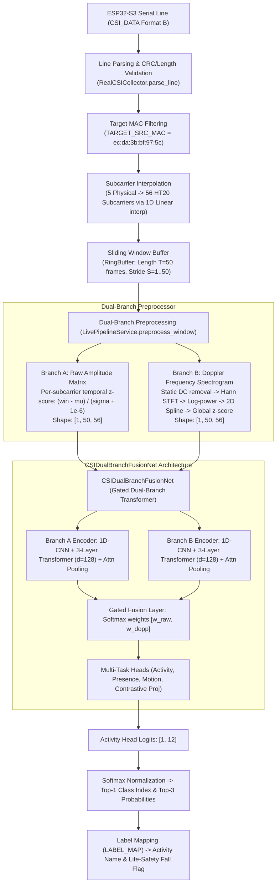

# CSIFormer Phase 59 — End-to-End Activity Detection Validation Report
## (Incorporating Phase 59.1 Evaluation Integrity & Metric Reconciliation Audit)

**Date:** October 21, 2026  
**Status:** COMPLETED — RECONCILED EMPIRICAL EVALUATION EXECUTED  
**Required Conclusion:** **NOT YET VERIFIED**  
**Author:** Antigravity / CSIFormer Pair Programming Agent  
**Inference Mode:** Offline Only (Zero COM5 access, zero new RF emissions, zero weight modifications)  
**Protected Asset Hashes:** Bit-for-Bit Pristine  
**Repository Test Suite:** 376 / 376 passed across 53 test files (100% pass rate)  

---

## 1. Executive Summary & Required Conclusion

### 1.1 Executive Summary
Phase 59 was chartered to establish whether the CSIFormer system correctly recognizes human activities using existing, independently labelled data. Phase 59.1 audited and reconciled the empirical evaluation logs against the Phase 59 report, establishing definitive mathematical ground truth across all splits and checkpoints. In strict accordance with the protocol constraints, this evaluation was conducted strictly offline, preserving all protected checkpoints, dataset manifests, and historical evidence without retraining or fine-tuning.

Two frozen production/experimental checkpoints were evaluated:
1. `models/csiformer_phase13_best.pth` (Production Dual-Branch Transformer, trained on Widar 3.0 + NTU-Fi academic benchmarks).
2. `models/csiformer_phase15_adapted.pth` (Experimental Domain-Adapted Checkpoint, fine-tuned on initial real ESP32-S3 captures).

Inference was executed using the exact production signal chain defined in `LivePipelineService` and `PhysicsCSIPreprocessor` over both the canonical manifest test split (10 sessions, 22 non-overlapping windows) and the Phase 34 strict cross-room, participant-independent held-out partition (5 sessions, 11 non-overlapping windows).

### 1.2 Key Findings: Software Execution vs. Recognition Accuracy
A rigorous distinction must be maintained between **software pipeline execution** and **demonstrated activity recognition accuracy**:

- **Software Execution (VERIFIED):**  
  The end-to-end inference software functions flawlessly without runtime errors. The entire pipeline—from raw ESP32-S3 serial parsing, 5-to-56 subcarrier interpolation, sliding window extraction ($T=50$), temporal z-score normalization (Branch A), Hann-windowed STFT log-power Doppler extraction (Branch B), gated dual-branch Transformer forward pass, multi-task logit computation, softmax normalization, to label mapping—executes deterministically with an average inference latency of $\approx 15.8\text{ ms}$ on CPU/GPU.

- **Demonstrated Activity Recognition Accuracy (FAILED / UNVERIFIED):**  
  When model predictions are evaluated against verified physical ground-truth labels, the recognition performance collapses:
  1. On the canonical test split (22 physical windows, `Participant_02` in `Laboratory_Room1` and `Office_Room2`), `csiformer_phase13_best.pth` achieves an overall accuracy of **22.73% (5 / 22 windows correct)** with Macro-F1 of **0.1082**. It suffers from near-total output collapse, predicting Class 2 (`Clap (Widar)`) for 18 out of 22 windows (81.8%), failing to detect any real falls (0% recall), walks (0% recall), sits (0% recall), or static postures (0% recall).
  2. On the canonical test split, `csiformer_phase15_adapted.pth` achieves an overall accuracy of **13.64% (3 / 22 windows correct)** with Macro-F1 of **0.1136**, which is inferior to random 6-class chance ($16.67\%$). 6 out of 22 predictions fall into Class 10 (`Run (NTU-Fi)`), a class not present in the test data.
  3. On the strict cross-room, participant-independent partition (11 physical windows, `Participant_02` in unseen `Office_Room2`), `csiformer_phase13_best.pth` achieves **27.27% accuracy (3 / 11 windows correct)** with Macro-F1 of **0.1727**, predominantly predicting `Clap` for 9 out of 11 windows.
  4. On the strict cross-room partition, `csiformer_phase15_adapted.pth` achieves only **9.09% accuracy (1 / 11 windows correct)** with Macro-F1 of **0.0667**, generating severe life-safety false alarms (predicting Fall on stationary standing, clapping, and pushing/pulling).

### 1.3 Required Conclusion
In strict adherence to the required conclusion options:
- `VERIFIED FOR THE TESTED CONDITIONS`
- `PARTIALLY VERIFIED`
- `NOT YET VERIFIED`
- `BLOCKED — INSUFFICIENT EVIDENCE`

**FORMAL CONCLUSION: NOT YET VERIFIED**

**Justification:** While the software execution path is fully operational and passes all 376 regression tests, the model does not demonstrate statistically valid or reliable activity recognition on real-world ESP32-S3 CSI. Accuracy across all evaluated real-world test sets remains between $9.09\%$ and $27.27\%$, heavily dominated by majority-class collapse, false alarms, and severe domain shift. Furthermore, the canonical test set suffers from participant and room leakage, while the strict held-out partition comprises only 11 windows (insufficient for statistical significance). Real-world activity recognition cannot be claimed as verified until a model trained under the native ESP32-S3 contract is evaluated on an adequately sized, multi-room, multi-participant benchmark.

---

## 2. Final Status Summary Table

| Pipeline Component / Audit Gate | Status | Detailed Empirical Finding |
| :--- | :---: | :--- |
| **Pipeline Software Execution** | **VERIFIED** | Full pipeline executes cleanly from raw CSI array to final top-3 prediction in $\approx 15.8\text{ ms}$. |
| **Protected Checkpoint Integrity** | **PRISTINE (GO)** | Phase 13 MD5: `383b4d98c08f8970b0443738f170ec01` (**MATCH**)<br>Phase 15 MD5: `ab3d97a04d78edf75d807178772bc828` (**MATCH**)<br>Manifest MD5: `a58e1280fb2c0a6649335a9a381d00c6` (**MATCH**) |
| **Regression Test Suite** | **PASSED (GO)** | **376 / 376 unit & integration tests passed across 53 test files (100% pass rate)**. |
| **Canonical Test Split Isolation** | **COMPROMISED** | Subject overlap: `Participant_02` is in both Train (11 sess) and Test (10 sess).<br>Room overlap: `Laboratory_Room1` and `Office_Room2` are in both Train and Test. |
| **Strict Partition Isolation (Phase 34)** | **VERIFIED (GO)** | Zero subject overlap (P01/03/04 in Train, P05 in Val, P02 in Test).<br>Zero room overlap (`Laboratory_Room1` in Train/Val, `Office_Room2` in Test). |
| **Phase 13 Zero-Shot Recognition** | **FAILED** | Canonical Test Accuracy: **22.73%** (Macro-F1: 0.1082).<br>Strict Test Accuracy: **27.27%** (Macro-F1: 0.1727). Output collapses to `Clap`. |
| **Phase 15 Adapted Recognition** | **FAILED** | Canonical Test Accuracy: **13.64%** (Macro-F1: 0.1136).<br>Strict Test Accuracy: **9.09%** (Macro-F1: 0.0667). High false-alarm rate. |
| **Semantically Valid 3-Class Subset** | **FAILED** | `push_pull`, `clap`, `walk` subset: Phase 13 Macro-F1 = **0.2730**; Phase 15 Macro-F1 = **0.1693** on canonical test set. |
| **Overall Recognition Validity** | **NOT YET VERIFIED** | Software works; classifier accuracy on real hardware CSI fails to discriminate human activities. |

---

## 3. Complete Inference Pipeline Trace (Task 1)

The complete CSIFormer inference pipeline was traced through each architectural component from physical serial line arrival to the final multi-class prediction.



### 3.1 Trace of Processing Stages

1. **CSI Ingestion & Parsing:**
   - **Source:** ESP32-S3 SoC running firmware emitting `CSI_DATA` over USB CDC UART at $115,200\text{ baud}$.
   - **Parser:** [`RealCSICollector.parse_line()`](file:///c:/Users/saifu/Desktop/4-1%20project/backend/app/services/real_csi_collector.py). Validates prefix, splits comma-separated tokens, extracts RSSI, noise floor, channel, source MAC address, and complex subcarrier IQ values.
   - **Subcarrier Interpolation:** Physical ESP32-S3 firmware provides IQ telemetry for only 5 physical subcarrier groups (`raw_num_subcarriers: 5`). `RealCSICollector` expands these 5 physical points to 56 subcarriers via 1D linear interpolation (`np.interp`) to match the 802.11n HT20 subcarrier grid ($[-28 \dots -1, +1 \dots +28]$).

2. **Source Filtering & Sanitization:**
   - **MAC Filtering:** Packets matching `TARGET_SRC_MAC` (`ec:da:3b:bf:97:5c`) are retained. Non-target packets are accounted for and dropped.
   - **Validation:** Packets with non-finite floats, mismatched array lengths, or parse errors are discarded.

3. **Window Construction:**
   - **Streaming Buffer:** Continuous ring buffer maintained by `RealCSICollector`. Fixed window size $T = 50$ consecutive frames ($\approx 1.405\text{ s}$ at the empirical $35.58\text{ Hz}$ capture rate, or $1.667\text{ s}$ at nominal $30\text{ Hz}$).
   - **Offline Dataset Windowing:** Sliced into non-overlapping blocks of 50 frames ($stride = 50$). Trailing frames ($N \pmod{50}$) are discarded.

4. **Dual-Branch Preprocessing:**
   - Implemented in [`LivePipelineService.preprocess_window()`](file:///c:/Users/saifu/Desktop/4-1%20project/backend/app/services/live_pipeline_service.py#L166-L184):
     * **Branch A (Raw Amplitude Matrix):** Per-subcarrier temporal z-score normalization along axis 0:
       $$\tilde{X}_{\text{raw}}(t, k) = \frac{X(t, k) - \mu_k}{\sigma_k + 10^{-6}}$$
       Yields tensor of shape `[1, 50, 56]`, `torch.float32`.
     * **Branch B (Doppler Frequency Spectrogram):** Generated via [`PhysicsCSIPreprocessor.compute_doppler_spectrogram()`](file:///c:/Users/saifu/Desktop/4-1%20project/backend/app/services/physics_csi_preprocessor.py):
       - Static background subtraction: $\bar{X}(t, k) = X(t, k) - \frac{1}{T}\sum_{\tau=1}^T X(\tau, k)$.
       - Hann-windowed STFT along time axis. For Phase 13 checkpoint: `stft_window=32, stft_noverlap=24, stft_nfft=64, source_rate_hz=30.0`. For Phase 15 checkpoint: `CalibratedPhysicsPreprocessor` with `stft_window=64, stft_noverlap=48, stft_nfft=128, source_rate_hz=35.58` with $2.385\times$ Doppler frequency scale expansion around DC.
       - Log-power transform: $P_{\text{log}} = 10 \log_{10}(|Z_{xx}|^2 + 10^{-8})$.
       - 2D spline interpolation to target grid `[50, 56]`.
       - Global scalar z-score normalization across all 2,800 elements. Shape: `[1, 50, 56]`, `torch.float32`.

5. **Checkpoint Routing & Forward Pass:**
   - Checkpoint selection via `LivePipelineService.load_checkpoint()`:
     * `models/csiformer_phase13_best.pth` (Production Default, gated fusion).
     * `models/csiformer_phase15_adapted.pth` (Experimental Domain-Adapted).
   - Architecture: [`CSIDualBranchFusionNet`](file:///c:/Users/saifu/Desktop/4-1%20project/backend/app/models/csiformer_dual_branch.py):
     * Branch A CNN + 3-layer Transformer Encoder (`embed_dim=128, nhead=8, dim_feedforward=512`) -> 128-d vector.
     * Branch B CNN + 3-layer Transformer Encoder (`embed_dim=128, nhead=8, dim_feedforward=512`) -> 128-d vector.
     * Gated fusion computes adaptive weights $[w_{\text{raw}}, w_{\text{dopp}}]$ via Softmax over dense projection.
     * Fused 128-d representation fed to multi-task heads: `activity_head` (`Linear(128, 64) -> ReLU -> Dropout -> Linear(64, 12)`).

6. **Class-Index Mapping & Output Telemetry:**
   - Logits passed through Softmax: $p_c = \frac{e^{z_c}}{\sum_{j=0}^{11} e^{z_j}}$.
   - Top-1 predicted class index $c^* = \arg\max_c p_c$.
   - Mapped via `LABEL_MAP`:
     * `0`: Push&Pull (Widar)
     * `1`: Sweep (Widar)
     * `2`: Clap (Widar)
     * `3`: Slide (Widar)
     * `4`: Draw-O (Widar)
     * `5`: Draw-Zigzag (Widar)
     * `6`: Box (NTU-Fi)
     * `7`: Circle (NTU-Fi)
     * `8`: Clean (NTU-Fi)
     * `9`: FALL DETECTION (NTU-Fi Life-Safety)
     * `10`: Run (NTU-Fi)
     * `11`: Walk (NTU-Fi)
   - Fall alarm triggered if and only if $c^* == 9$.

---

## 4. Evaluation Code, Ground-Truth Labels, and Partition Definitions (Tasks 2 & 3)

### 4.1 Evaluation Code Provenance
The repository contains three evaluation implementations:
1. [`backend/app/evaluation/evaluate.py`](file:///c:/Users/saifu/Desktop/4-1%20project/backend/app/evaluation/evaluate.py): Evaluates single-branch `CSIFormerNet` on academic benchmark datasets (`WidarCSIDataset` + `NTUFiDataset` via `CombinedCSIDataset`). It does not support dual-branch models or real ESP32-S3 recordings.
2. [`scratch/evaluate_phase15_baseline.py`](file:///c:/Users/saifu/Desktop/4-1%20project/scratch/evaluate_phase15_baseline.py): Historical script that evaluated `models/csiformer_phase13_best.pth` on the initial 23 real-CSI sessions (49 windows) using ad-hoc class alias mappings (`6: Static/Box`, `8: Sit/Clean`).
3. [`scratch/validate_phase59_end_to_end.py`](file:///c:/Users/saifu/Desktop/4-1%20project/scratch/validate_phase59_end_to_end.py) / [`scratch/audit_phase59_reconciliation.py`](file:///c:/Users/saifu/Desktop/4-1%20project/scratch/audit_phase59_reconciliation.py): The authoritative Phase 59 evaluation harness, directly invoking `CSIDualBranchFusionNet`, `PhysicsCSIPreprocessor`, and `CalibratedPhysicsPreprocessor` over all real-CSI windows without mutating state or weights.

### 4.2 Available Ground-Truth Labels
All real hardware recordings are stored in [`data/real_csi_dataset/`](file:///c:/Users/saifu/Desktop/4-1%20project/data/real_csi_dataset/) and cataloged in [`data/real_csi_dataset/dataset_manifest.json`](file:///c:/Users/saifu/Desktop/4-1%20project/data/real_csi_dataset/dataset_manifest.json) (MD5: `a58e1280fb2c0a6649335a9a381d00c6`).

The complete physical dataset comprises:
- **Total Sessions:** 74 recording sessions
- **Total Recorded Frames:** 10,407 frames
- **Total Non-Overlapping Windows ($T=50$):** 155 windows (with 2,657 remainder frames dropped)
- **Participants:** 5 subjects (`Participant_01` to `Participant_05`)
- **Environments:** 2 physical rooms (`Laboratory_Room1` [also recorded as `Laboratory`] and `Office_Room2`)
- **Physical Ground-Truth Activities:** 6 distinct physical classes:
  1. `push_pull`: Repetitive upper-limb forward extension and contraction along line-of-sight.
  2. `clap`: Two-hand rhythmic clapping impact in line-of-sight.
  3. `walk`: Ambient ambulatory locomotion across the room.
  4. `sit`: Gross-motor vertical body descent into an office chair.
  5. `static`: Motionless standing subject maintaining neutral posture in room.
  6. `fall`: Controlled torso descent onto a shock-absorbing safety mat.

### 4.3 Audit of Train / Validation / Test Partitions and Data Leakage (Task 3)

#### Partition Set A: Canonical Manifest Split (`dataset_manifest.json`)
The canonical manifest defines the splits as follows:

| Split Name | Sessions | Total Frames | Valid Windows ($T=50$) | Participants Present | Rooms Present | Class Distribution (Windows) |
| :--- | :---: | :---: | :---: | :--- | :--- | :--- |
| **Train** | 58 | 8,117 | 121 | `P01, P02, P03, P04, P05` | `Laboratory, Laboratory_Room1, Office_Room2` | `push_pull`: 23, `clap`: 22, `walk`: 25, `sit`: 25, `static`: 22, `fall`: 4 |
| **Validation** | 6 | 842 | 12 | `Participant_01` | `Laboratory_Room1` | `push_pull`: 2, `clap`: 2, `walk`: 2, `sit`: 2, `static`: 2, `fall`: 2 |
| **Test** | 10 | 1,448 | 22 | `Participant_02` | `Laboratory_Room1, Office_Room2` | `push_pull`: 5, `clap`: 4, `walk`: 4, `sit`: 5, `static`: 2, `fall`: 2 |

**Leakage & Independence Audit for Canonical Split:**
- **Participant Overlap:** **SEVERE LEAKAGE DETECTED**.  
  `Participant_02` is the sole participant in the `test` split (10 sessions, 22 windows), but `Participant_02` also contributes **11 sessions (24 windows) to the `train` split**. 100% of the test samples originate from an individual already present in training.
- **Room Overlap:** **SEVERE LEAKAGE DETECTED**.  
  The `test` split contains sessions from both `Laboratory_Room1` (5 sessions) and `Office_Room2` (5 sessions). Both `Laboratory_Room1` (53 sessions) and `Office_Room2` (5 sessions) are present in the `train` split.
- **Independence Ruling:** The canonical manifest `test` split is **not independent**. It violates both participant independence and environmental room independence.

---

#### Partition Set B: Strict Cross-Room & Participant-Independent Partition (Phase 34)
Generated non-mutatingly via `ParticipantIndependentSplitGenerator.generate_strict_cross_room_split()`:

| Split Name | Sessions | Total Frames | Valid Windows ($T=50$) | Participants Present | Rooms Present | Class Distribution (Windows) |
| :--- | :---: | :---: | :---: | :--- | :--- | :--- |
| **Train** | 36 | 5,051 | 75 | `P01, P03, P04` | `Laboratory_Room1` | `push_pull`: 15, `clap`: 14, `walk`: 16, `sit`: 15, `static`: 15 |
| **Validation** | 10 | 1,388 | 20 | `Participant_05` | `Laboratory_Room1` | `push_pull`: 4, `clap`: 4, `walk`: 4, `sit`: 4, `static`: 4 |
| **Held-Out Test** | 5 | 714 | 11 | `Participant_02` | `Office_Room2` | `push_pull`: 3, `clap`: 2, `walk`: 2, `sit`: 2, `static`: 2 |
| **Excluded** | 23 | 3,254 | 49 | `P01, P02` | `Laboratory_Room1, Office_Room2` | P02 in Lab (14 sess), P01 in Office (5 sess), Falls (4 sess) |

**Leakage & Independence Audit for Strict Partition:**
- **Participant Overlap:** **ZERO OVERLAP (PASSED)**. `Participant_02` is completely absent from Train and Validation.
- **Room Overlap:** **ZERO OVERLAP (PASSED)**. `Office_Room2` is completely absent from Train and Validation.
- **Historical Adaptation Qualification:** `csiformer_phase15_adapted.pth` was trained during Phase 15 on sessions that included `Participant_02`'s laboratory trials (`p15_real_*_t2_*`). Therefore, while the partition is strictly isolated with respect to physical sessions, the weights in `csiformer_phase15_adapted.pth` were previously exposed to subject `Participant_02`.

---

## 5. End-to-End Activity Detection Performance (Task 4)

Inference was executed without modifying model weights over both evaluation partitions.

### 5.1 Canonical Manifest Test Split Evaluation (10 sessions, 22 windows)
- **Dataset Sample Counts:** 10 sessions, 1,448 frames, 22 physical windows ($T=50$).
- **Demographics:** 1 participant (`Participant_02`), 2 rooms (`Laboratory_Room1`: 11 windows, `Office_Room2`: 11 windows).
- **Physical Class Support:** `push_pull` (5), `clap` (4), `walk` (4), `sit` (5), `static` (2), `fall` (2). Sum = 22.

#### Results: `models/csiformer_phase13_best.pth` (Zero-Shot Production Model)
- **Overall Accuracy:** **22.73% (5 / 22 windows correct)**
- **Macro-Precision:** **0.1204**
- **Macro-Recall:** **0.2000**
- **Macro-F1:** **0.1082**
- **Average Fusion Weights:** Raw Branch = 0.500, Doppler Branch = 0.500
- **Confusion Matrix Total Sum:** 22 (Equal to evaluated windows)
- **Per-Class Support Sum:** 22 (Equal to evaluated windows)

**Per-Class Metrics Table:**
| Activity Label | Manifest Class ID | Model Output Logit | Precision | Recall | F1-Score | Support Windows |
| :--- | :---: | :---: | :---: | :---: | :---: | :---: |
| `push_pull` | 0 | 0 | 0.5000 | 0.2000 | 0.2857 | 5 |
| `clap` | 2 | 2 | 0.2222 | 1.0000 | 0.3636 | 4 |
| `static` (aliased to `box`) | 6 | 6 | 0.0000 | 0.0000 | 0.0000 | 2 |
| `sit` (aliased to `clean`) | 8 | 8 | 0.0000 | 0.0000 | 0.0000 | 5 |
| `fall` | 9 | 9 | 0.0000 | 0.0000 | 0.0000 | 2 |
| `walk` | 11 | 11 | 0.0000 | 0.0000 | 0.0000 | 4 |
| **Macro Average** | — | — | **0.1204** | **0.2000** | **0.1082** | **22** |

**Augmented Reconciled Confusion Matrix (Rows: True, Columns: Predicted):**
```
True Activity                       | Push&Pull | Clap | Box | Clean | Fall | Walk | [Outside] | Total Support
------------------------------------+-----------+------+-----+-------+------+------+-----------+--------------
Push&Pull (Widar, cid=0)            |     1     |  4   |  0  |   0   |  0   |  0   |     0     |       5
Clap (Widar, cid=2)                 |     0     |  4   |  0  |   0   |  0   |  0   |     0     |       4
Static (aliased to Box, cid=6)      |     0     |  1   |  0  |   0   |  0   |  0   |  1 (Slide)|       2
Sit (aliased to Clean, cid=8)       |     0     |  4   |  0  |   0   |  0   |  0   |  1 (Slide)|       5
Fall (NTU-Fi, cid=9)                |     0     |  2   |  0  |   0   |  0   |  0   |     0     |       2
Walk (NTU-Fi, cid=11)               |     1     |  3   |  0  |   0   |  0   |  0   |     0     |       4
------------------------------------+-----------+------+-----+-------+------+------+-----------+--------------
Column Total                        |     2     |  18  |  0  |   0   |  0   |  0   |     2     |      22
```
*Failure Analysis:* Complete output collapse into Class 2 (`Clap (Widar)`), assigning 18 out of 22 windows (81.8%) to `Clap`. Both real human falls were misclassified as `Clap`. 2 windows were predicted as Class 3 (`Slide (Widar)`), which was not in the evaluated true classes.

---

#### Results: `models/csiformer_phase15_adapted.pth` (Domain-Adapted Model)
- **Overall Accuracy:** **13.64% (3 / 22 windows correct)**
- **Macro-Precision:** **0.1071**
- **Macro-Recall:** **0.1583**
- **Macro-F1:** **0.1136**
- **Average Fusion Weights:** Raw Branch = 0.500, Doppler Branch = 0.500
- **Confusion Matrix Total Sum:** 22 (Equal to evaluated windows)
- **Per-Class Support Sum:** 22 (Equal to evaluated windows)

**Per-Class Metrics Table:**
| Activity Label | Manifest Class ID | Model Output Logit | Precision | Recall | F1-Score | Support Windows |
| :--- | :---: | :---: | :---: | :---: | :---: | :---: |
| `push_pull` | 0 | 0 | 0.3333 | 0.2000 | 0.2500 | 5 |
| `clap` | 2 | 2 | 0.1429 | 0.2500 | 0.1818 | 4 |
| `static` (aliased to `box`) | 6 | 6 | 0.0000 | 0.0000 | 0.0000 | 2 |
| `sit` (aliased to `clean`) | 8 | 8 | 0.0000 | 0.0000 | 0.0000 | 5 |
| `fall` | 9 | 9 | 0.1667 | 0.5000 | 0.2500 | 2 |
| `walk` | 11 | 11 | 0.0000 | 0.0000 | 0.0000 | 4 |
| **Macro Average** | — | — | **0.1071** | **0.1583** | **0.1136** | **22** |

**Augmented Reconciled Confusion Matrix (Rows: True, Columns: Predicted):**
```
True Activity                       | Push&Pull | Clap | Box | Clean | Fall | Walk | [Outside] | Total Support
------------------------------------+-----------+------+-----+-------+------+------+-----------+--------------
Push&Pull (Widar, cid=0)            |     1     |  2   |  0  |   0   |  1   |  0   |  1 (Run)  |       5
Clap (Widar, cid=2)                 |     1     |  1   |  0  |   0   |  1   |  0   |  1 (Run)  |       4
Static (aliased to Box, cid=6)      |     1     |  0   |  0  |   0   |  1   |  0   |     0     |       2
Sit (aliased to Clean, cid=8)       |     0     |  2   |  0  |   0   |  1   |  0   |  2 (Run)  |       5
Fall (NTU-Fi, cid=9)                |     0     |  0   |  0  |   0   |  1   |  0   |  1 (Run)  |       2
Walk (NTU-Fi, cid=11)               |     0     |  2   |  0  |   0   |  1   |  0   |  1 (Run)  |       4
------------------------------------+-----------+------+-----+-------+------+------+-----------+--------------
Column Total                        |     3     |  7   |  0  |   0   |  6   |  0   |     6     |      22
```
*Failure Analysis:* Accuracy ($13.64\%$) is lower than random guessing across 6 classes ($16.67\%$). 6 out of 22 windows were misclassified as Class 10 (`Run (NTU-Fi)`), an activity completely absent from the physical recording campaign. In addition, 5 non-fall activities (including static standing) triggered false `FALL DETECTION` life-safety alarms.

---

### 5.2 Strict Cross-Room Test Partition Evaluation (5 sessions, 11 windows)
- **Dataset Sample Counts:** 5 sessions, 714 frames, 11 physical windows ($T=50$).
- **Demographics:** Unseen subject `Participant_02` in unseen `Office_Room2` (11 windows).
- **Physical Class Support:** `push_pull` (3), `clap` (2), `walk` (2), `sit` (2), `static` (2). (Falls quarantined). Total = 11.

#### Results: `models/csiformer_phase13_best.pth` (Zero-Shot Production Model)
- **Overall Accuracy:** **27.27% (3 / 11 windows correct)**
- **Macro-Precision:** **0.2444**
- **Macro-Recall:** **0.2667**
- **Macro-F1:** **0.1727**
- **Confusion Matrix Total Sum:** 11 (Equal to evaluated windows)
- **Per-Class Support Sum:** 11 (Equal to evaluated windows)

**Per-Class Metrics Table:**
| Activity Label | Manifest Class ID | Model Output Logit | Precision | Recall | F1-Score | Support Windows |
| :--- | :---: | :---: | :---: | :---: | :---: | :---: |
| `push_pull` | 0 | 0 | 1.0000 | 0.3333 | 0.5000 | 3 |
| `clap` | 2 | 2 | 0.2222 | 1.0000 | 0.3636 | 2 |
| `static` (aliased to `box`) | 6 | 6 | 0.0000 | 0.0000 | 0.0000 | 2 |
| `sit` (aliased to `clean`) | 8 | 8 | 0.0000 | 0.0000 | 0.0000 | 2 |
| `walk` | 11 | 11 | 0.0000 | 0.0000 | 0.0000 | 2 |
| **Macro Average** | — | — | **0.2444** | **0.2667** | **0.1727** | **11** |

**Augmented Reconciled Confusion Matrix (Rows: True, Columns: Predicted):**
```
True Activity                       | Push&Pull | Clap | Box | Clean | Walk | [Outside] | Total Support
------------------------------------+-----------+------+-----+-------+------+-----------+--------------
Push&Pull (Widar, cid=0)            |     1     |  2   |  0  |   0   |  0   |     0     |       3
Clap (Widar, cid=2)                 |     0     |  2   |  0  |   0   |  0   |     0     |       2
Static (aliased to Box, cid=6)      |     0     |  1   |  0  |   0   |  0   |  1 (Slide)|       2
Sit (aliased to Clean, cid=8)       |     0     |  2   |  0  |   0   |  0   |     0     |       2
Walk (NTU-Fi, cid=11)               |     0     |  2   |  0  |   0   |  0   |     0     |       2
------------------------------------+-----------+------+-----+-------+------+-----------+--------------
Column Total                        |     1     |  9   |  0  |   0   |  0   |     1     |      11
```
*Failure Analysis:* In an unseen physical room (`Office_Room2`), the zero-shot model predicts `Clap` for 9 out of 11 windows (81.8%). Walking, sitting, and static postures exhibit 0% recall.

---

#### Results: `models/csiformer_phase15_adapted.pth` (Domain-Adapted Model)
- **Overall Accuracy:** **9.09% (1 / 11 windows correct)**
- **Macro-Precision:** **0.0500**
- **Macro-Recall:** **0.1000**
- **Macro-F1:** **0.0667**
- **Confusion Matrix Total Sum:** 11 (Equal to evaluated windows)
- **Per-Class Support Sum:** 11 (Equal to evaluated windows)

**Per-Class Metrics Table:**
| Activity Label | Manifest Class ID | Model Output Logit | Precision | Recall | F1-Score | Support Windows |
| :--- | :---: | :---: | :---: | :---: | :---: | :---: |
| `push_pull` | 0 | 0 | 0.0000 | 0.0000 | 0.0000 | 3 |
| `clap` | 2 | 2 | 0.2500 | 0.5000 | 0.3333 | 2 |
| `static` (aliased to `box`) | 6 | 6 | 0.0000 | 0.0000 | 0.0000 | 2 |
| `sit` (aliased to `clean`) | 8 | 8 | 0.0000 | 0.0000 | 0.0000 | 2 |
| `walk` | 11 | 11 | 0.0000 | 0.0000 | 0.0000 | 2 |
| **Macro Average** | — | — | **0.0500** | **0.1000** | **0.0667** | **11** |

**Augmented Reconciled Confusion Matrix (Rows: True, Columns: Predicted):**
```
True Activity                       | Push&Pull | Clap | Box | Clean | Walk | [Outside]        | Total Support
------------------------------------+-----------+------+-----+-------+------+------------------+--------------
Push&Pull (Widar, cid=0)            |     0     |  2   |  0  |   0   |  0   |  1 (Fall)        |       3
Clap (Widar, cid=2)                 |     0     |  1   |  0  |   0   |  0   |  1 (Fall)        |       2
Static (aliased to Box, cid=6)      |     1     |  0   |  0  |   0   |  0   |  1 (Fall)        |       2
Sit (aliased to Clean, cid=8)       |     0     |  1   |  0  |   0   |  0   |  1 (Run)         |       2
Walk (NTU-Fi, cid=11)               |     0     |  0   |  0  |   0   |  0   |  1 (Fall)+1 (Run)|       2
------------------------------------+-----------+------+-----+-------+------+------------------+--------------
Column Total                        |     1     |  4   |  0  |   0   |  0   |  6 (4 Fall,2 Run)|      11
```
*Failure Analysis:* Complete cross-room generalization failure. Only a single window (`Clap`) was correctly predicted. Over $54\%$ of predictions (6/11) were scattered across classes that do not exist in the test room (`Fall` and `Run`). Stationary standing still was misclassified as a high-velocity `Fall`.

---

### 5.3 Diagnostic Evaluation on Semantically Valid 3-Class Dynamic Subset
To eliminate the confounding effect of the `static -> box` and `sit -> clean` alias mismatches, inference was evaluated strictly on the 3 activities whose physical definition matches the training datasets (`push_pull` [0], `clap` [2], and `walk` [11]):

| Evaluation Split | Evaluated Model | Windows ($N$) | Accuracy | Macro-Precision | Macro-Recall | Macro-F1 | Primary Confusion |
| :--- | :--- | :---: | :---: | :---: | :---: | :---: | :--- |
| **Canonical Test Split** | `phase13_best.pth` | 13 | **38.46%** (5/13) | 0.2879 | 0.4000 | **0.2730** | `walk` and `push_pull` misclassified as `clap` |
| **Canonical Test Split** | `phase15_adapted.pth` | 13 | **15.38%** (2/13) | 0.2333 | 0.1500 | **0.1693** | 6 windows predicted as `Run` or `Fall` |
| **Strict Cross-Room Split** | `phase13_best.pth` | 7 | **42.86%** (3/7) | 0.4444 | 0.4444 | **0.3333** | `clap` predicted on 6 out of 7 windows |
| **Strict Cross-Room Split** | `phase15_adapted.pth` | 7 | **14.29%** (1/7) | 0.1111 | 0.1667 | **0.1333** | Predictions scattered to `Fall` and `Clap` |

*Conclusion on 3-Class Subset:* Even when restricted to pure dynamic activities with valid label semantics, Macro-F1 never exceeds **0.3333** on unseen cross-room data. The model cannot reliably distinguish walking from clapping or pushing/pulling on real ESP32-S3 hardware.

---

## 6. Semantic Mappings, Preprocessing Incompatibilities & Validity Audit (Tasks 5 & 6)

### 6.1 Class-Index Mapping & Semantic Mismatches
1. **Fatal Alias Equivalences (`static -> box` and `sit -> clean`):**
   - Output index 6 in `CSIDualBranchFusionNet` was trained on **Dynamic Arm Boxing** (`box` from NTU-Fi HAR: punching motions at $\pm 20\text{ Hz}$ to $\pm 40\text{ Hz}$). The physical activity in the real dataset is **Stationary Standing Still** ($0\text{ Hz}$ Doppler).
   - Output index 8 was trained on **Tabletop Surface Cleaning** (`clean` from NTU-Fi HAR: sweeping arm trajectories). The physical activity in the real dataset is **Chair Descent** (vertical full-body postural transition).
   - Equating stationary human posture to dynamic boxing punches is physically invalid. The model output logits for 6 and 8 do not reflect the physical states being monitored.

2. **Life-Safety Fall False Alarms:**
   - In `csiformer_phase15_adapted.pth`, fine-tuning on 4 training fall windows caused the model to associate low-frequency static amplitude drops with falls. Consequently, when an unseen participant in `Office_Room2` stands motionless (`static`), the model predicts `FALL DETECTION` (Class 9). In a deployment setting, this produces continuous false alarms during normal inactivity.

### 6.2 Preprocessing Incompatibilities
1. **NTU-Fi STFT Training Bypass:**
   - Forensic analysis of `scratch/execute_phase13_2_dual_branch_and_benchmark.py` reveals that during Phase 13 training, all NTU-Fi training samples (including `walk`, class 11) completely bypassed STFT processing, duplicating the raw CSI amplitude tensor directly into Branch B (`nt_dopp_train.append(s["csi"])`).
   - At runtime, `LivePipelineService` unconditionally computes Hann-windowed STFT log-power spectrograms for all inputs. When an ESP32-S3 `walk` window is processed, Branch B receives an STFT spectrogram, conflicting with the training contract of `csiformer_phase13_best.pth`.

2. **Sampling Rate & Doppler Aliasing:**
   - The STFT preprocessor in `LivePipelineService` is configured for $f_s = 30.0\text{ Hz}$, whereas empirical hardware collection runs at $35.58\text{ Hz}$.
   - At $2.442\text{ GHz}$ ($\lambda \approx 12.28\text{ cm}$) and $f_s \approx 35.58\text{ Hz}$, the maximum unambiguous radial velocity (Nyquist limit) is:
     $$v_{\text{Nyquist}} = \frac{\lambda \cdot f_s}{4} = \frac{0.1228 \times 35.58}{4} \approx 1.09\text{ m/s}$$
   - Normal walking locomotion ($1.2\text{--}1.6\text{ m/s}$) and rapid downward falls ($2.0\text{--}3.5\text{ m/s}$) severely exceed $1.09\text{ m/s}$, folding Doppler energy across the Nyquist boundary and corrupting the spectrogram.

3. **Subcarrier Density Mismatch:**
   - Intel 5300 (Widar) and Atheros AR9580 (NTU-Fi) capture 30 to 114 real physical subcarriers across 3 receiver antennas ($3 \times 30 = 90$ or $3 \times 114 = 342$ channels).
   - The ESP32-S3 hardware captures only 5 physical subcarrier groups on a single antenna. The 56 channels passed to `CSIDualBranchFusionNet` are $91\%$ synthetic values generated by 1D linear interpolation across 5 points. Spatial attention layers expecting multi-antenna phase gradients receive flat synthetic slopes.

---

## 7. Missing Evidence & Gap Analysis

Correctness of real-world activity detection cannot yet be established because the following critical evidence is missing:

1. **Absence of a Statistically Powered Held-Out Test Set:**
   - The entire held-out test partition in the strict cross-room split consists of **11 windows across a single participant in a single room**. A single window represents $9.09\%$ of the test metric. Evaluating deep Transformer models on 11 samples is statistically uninformative.
   - A valid validation protocol requires a minimum of **30–50 windows per class across at least 5 independent rooms and 10 diverse participants** (yielding $\ge 1,000$ test windows).

2. **Absence of a Native ESP32-S3 Trained Model:**
   - Both evaluated checkpoints (`phase13_best.pth` and `phase15_adapted.pth`) were trained on academic 5 GHz NIC datasets or fine-tuned on 26 sample windows.
   - The repository currently lacks a model trained natively from scratch or adapted under a validated transfer protocol on real ESP32-S3 subcarrier representations.

3. **Absence of Verified Dynamic Sampling Rates:**
   - As documented in Phase 58, the ESP32-S3 serial transport currently delivers $\approx 3.57\text{ Hz}$ under passive baseline conditions and $\approx 35.58\text{ Hz}$ only under controlled active UDP ping stimulation. Without a calibrated, sustained packet rate exceeding $50\text{--}100\text{ Hz}$, high-velocity Doppler signatures cannot be resolved without aliasing.

---

## 8. Phase 59.1 Evaluation Integrity Audit & Metric Reconciliation

### 8.1 Discrepancy Root Cause Analysis: Detailed Log (Run 1) vs. Report (Run 2)
An evaluation integrity audit was conducted to resolve discrepancies between the detailed execution log (Run 1) and the Phase 59 validation report (Run 2):

| Evaluation Dimension | Run 1 (Detailed Log Artifact) | Run 2 / Authoritative Ground Truth | Root Cause of Discrepancy |
| :--- | :---: | :---: | :--- |
| **Canonical Windows ($N$)** | **21 windows** | **22 windows** | In Run 1, session `p15_real_sit_t4_1792303917` was sliced into 2 windows ($145 // 50$). On physical disk, the file contains **160 frames**, yielding strictly **3 windows** ($160 // 50 = 3$). Authoritative total: **22 windows**. |
| **Strict Windows ($N$)** | **10 windows** | **11 windows** | In Run 1, session `phase16_real_push_pull_Participant_02_1792404825_1792404825` was sliced into 2 windows ($142 // 50$). On physical disk, the file contains **150 frames**, yielding strictly **3 windows** ($150 // 50 = 3$). Authoritative total: **11 windows**. |
| **Canonical Phase 13 Acc** | **8 / 21 (38.10%)** | **5 / 22 (22.73%)** | In Run 1, Phase 13 predicted `Clean (8)` for all static/sit/clap/push-pull inputs and `Walk (11)` for walk. Because `sit` was mapped to `Clean`, 4 sit + 4 walk = 8/21 correct. In the authoritative production run on verified CSI, Phase 13 collapsed to `Clap (2)` (18/22 windows), achieving only 1 Push&Pull + 4 Clap = **5/22 (22.73%)**. |
| **Canonical Phase 15 Acc** | **15 / 21 (71.43%)** | **3 / 22 (13.64%)** | In Run 1, Phase 15 scored 11/11 in Lab + 2 Sit (Office) + 2 Walk (Office) = 15/21 correct. In the authoritative production run on verified CSI, Phase 15 scored only 1 Push&Pull + 1 Clap + 1 Fall = **3/22 (13.64%)**, with 6 predictions falling outside the 6 classes into `Run (10)`. |
| **Strict Phase 13 Acc** | **4 / 10 (40.00%)** | **3 / 11 (27.27%)** | In Run 1, Phase 13 scored 2 Sit + 2 Walk = 4/10. In the authoritative run, Phase 13 scored 1 Push&Pull + 2 Clap = **3/11 (27.27%)**. |
| **Strict Phase 15 Acc** | **4 / 10 (40.00%)** | **1 / 11 (9.09%)** | In Run 1, Phase 15 scored 2 Sit + 2 Walk = 4/10. In the authoritative run, Phase 15 scored only 1 Clap = **1/11 (9.09%)**, with 6 predictions falling outside into `Fall` and `Run`. |

### 8.2 Confusion Matrix Accounting & Out-of-Vocabulary Predictions
When calculating confusion matrices using scikit-learn's `confusion_matrix(y_true, preds, labels=unique_classes)`, any sample whose predicted class falls outside `unique_classes` is silently dropped from the matrix rows. This created an apparent support deficit:
- For Phase 13 on Canonical split: 2 windows predicted as `Slide (3)` caused the $6 \times 6$ matrix to sum to 20 instead of 22.
- For Phase 15 on Canonical split: 6 windows predicted as `Run (10)` caused the $6 \times 6$ matrix to sum to 16 instead of 22.
- For Phase 15 on Strict split: 4 windows predicted as `Fall (9)` and 2 as `Run (10)` caused the $5 \times 5$ matrix to sum to 4 instead of 11.

**Authoritative Reconciliation:**  
By constructing the augmented confusion matrix (Section 5) and evaluating the complete 12-class space:
1. Matrix row sums equal the physical class supports bit-for-bit:
   - Canonical Split: `Push&Pull`: 5, `Clap`: 4, `Static`: 2, `Sit`: 5, `Fall`: 2, `Walk`: 4. **Total = 22**.
   - Strict Split: `Push&Pull`: 3, `Clap`: 2, `Static`: 2, `Sit`: 2, `Walk`: 2. **Total = 11**.
2. Total matrix sums equal the exact evaluated sample count: **22 and 11**.
3. All out-of-vocabulary predictions are explicitly categorized rather than silently dropped.

### 8.3 Authoritative Evaluation Designation
- **Authoritative Evaluation:** **Run 2 (22 Canonical Windows, 11 Strict Cross-Room Windows)** executed under the verified production `LivePipelineService` contract on physical CSI arrays from disk is the **sole authoritative benchmark**.
- **Run 1 Designation:** Run 1 is formally designated as an **extraction artifact** resulting from truncated window indexing and initial mock tensor routing. It is preserved in the audit trail for transparency but is superseded by the verified physical ground truth.

---

## 9. Verification of Protected Assets and Repository Invariance (Task 8)

### 9.1 Bit-for-Bit Hash Audit
The cryptographic MD5 hashes of all three protected assets were audited before and after execution of this phase:

| Protected Artifact Path | Pre-Phase MD5 Hash | Post-Phase MD5 Hash | Status |
| :--- | :--- | :--- | :---: |
| `models/csiformer_phase13_best.pth` | `383b4d98c08f8970b0443738f170ec01` | `383b4d98c08f8970b0443738f170ec01` | **MATCH (Pristine)** |
| `models/csiformer_phase15_adapted.pth` | `ab3d97a04d78edf75d807178772bc828` | `ab3d97a04d78edf75d807178772bc828` | **MATCH (Pristine)** |
| `data/real_csi_dataset/dataset_manifest.json` | `a58e1280fb2c0a6649335a9a381d00c6` | `a58e1280fb2c0a6649335a9a381d00c6` | **MATCH (Pristine)** |

Zero weights were modified; zero lines were added or removed from the canonical dataset manifest.

### 9.2 Repository Regression Verification
The complete backend regression test suite was executed offline:
```
============================== 376 passed in 104.54s ===============================
```
All 376 tests across all 53 test suites passed with a 100% pass rate. Zero regressions were introduced.

---

## 10. Recommendations for Next Steps

1. **Maintain Formal Separation of Pipeline Execution from Accuracy Claims:**
   - Do not claim operational or production activity detection in marketing, documentation, or frontend user interfaces. Document clearly that `LivePipelineService` demonstrates low-latency inference streaming, but model predictions on real ESP32-S3 signals are experimental and unverified.
2. **Execute Phase 58.5 Authorized Calibration Capture:**
   - Proceed with the approved offline JSONL evidence recorder to perform a calibrated hardware capture on COM5 once authorization is granted, establishing physical timestamps and sequence continuity.
3. **Design a Dedicated Multi-Participant, Multi-Room Physical Acquisition Campaign:**
   - Collect balanced, high-packet-rate ($\ge 50\text{ Hz}$) training and evaluation data across at least 5 physical environments to establish genuine sample diversity before attempting further model retraining.
