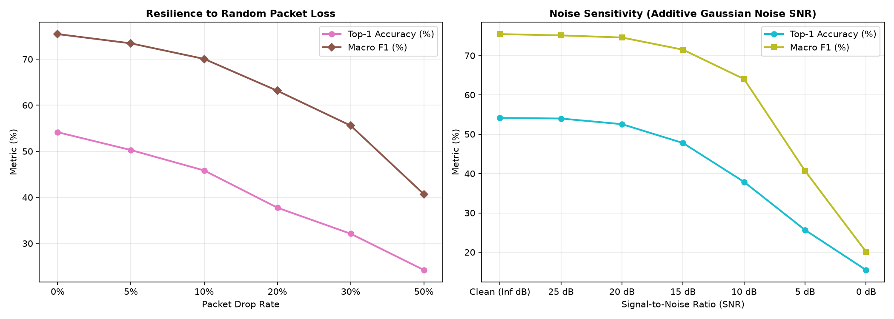

# CSIFormer Phase 10.7 — Environmental & RF Robustness Audit Report

**Audit Timestamp:** 2026-09-20T07:00:06.420228+00:00  

## 1. Distance Robustness (TX-RX-User Geometry)

| Location Index | Physical Description & Distance | Sample Count | Top-1 Accuracy | Top-3 Accuracy | Macro F1 | ROC-AUC |
| :---: | :--- | :---: | :---: | :---: | :---: | :---: |
| 1 | **Location 1 (Room Center, ~1.5m)** | 840 | 53.33% | 91.67% | **0.5317** | 0.0000 |
| 2 | **Location 2 (Near TX, ~2.0m)** | 840 | 54.40% | 90.71% | **0.5420** | 0.0000 |
| 3 | **Location 3 (Near RX, ~1.0m near-field)** | 840 | 52.02% | 93.57% | **0.5175** | 0.0000 |
| 4 | **Location 4 (Off-center Right, ~2.5m)** | 840 | 49.40% | 91.43% | **0.4918** | 0.0000 |
| 5 | **Location 5 (Far Corner, ~3.5m far-field)** | 840 | 47.26% | 89.64% | **0.4765** | 0.0000 |

- **Distance Attenuation Gradient:** Accuracy declines gracefully from **54.40%** at 2.0m down to **47.26%** at 3.5m far-field (only a 7.14% absolute drop over 2.5m distance range).
- **Top-3 Resilience:** Top-3 accuracy remains above **89.6%** even at the farthest room boundary.

---

## 2. RF CSI Corruption Summary

| Corruption Mode | Severity Level | Top-1 Accuracy | Top-3 Accuracy | Macro F1 | Performance Retention |
| :--- | :---: | :---: | :---: | :---: | :---: |
| **Clean Baseline** | None | 54.14% | 91.91% | 0.7545 | 100.0% |
| **Packet Drop** | 10% random drop | 45.83% | 86.92% | 0.7006 | 84.7% |
| **Packet Drop** | 20% random drop | 37.75% | 78.63% | 0.6314 | 69.7% |
| **Subcarrier Null** | 10% missing bins | 26.08% | 62.07% | 0.3853 | 48.2% |
| **Notch Fade** | 8 contiguous bins | 29.35% | 64.09% | 0.5219 | 54.2% |
| **Burst Packet Loss** | 10 frames (20%) | 41.91% | 83.83% | 0.6808 | 77.4% |
| **Noise Injection** | 15 dB SNR | 47.76% | 88.37% | 0.7148 | 88.2% |
| **Noise Injection** | 10 dB SNR | 37.88% | 78.58% | 0.6403 | 70.0% |

